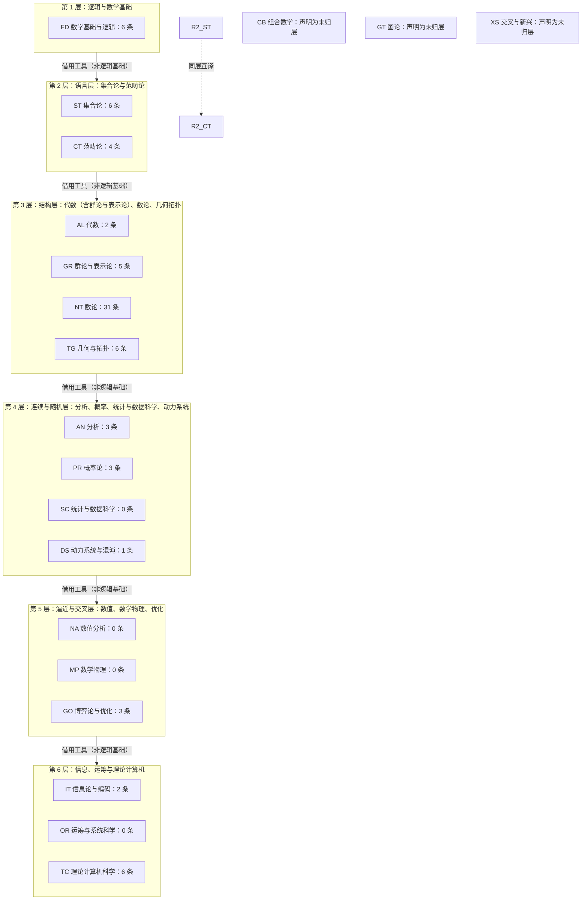
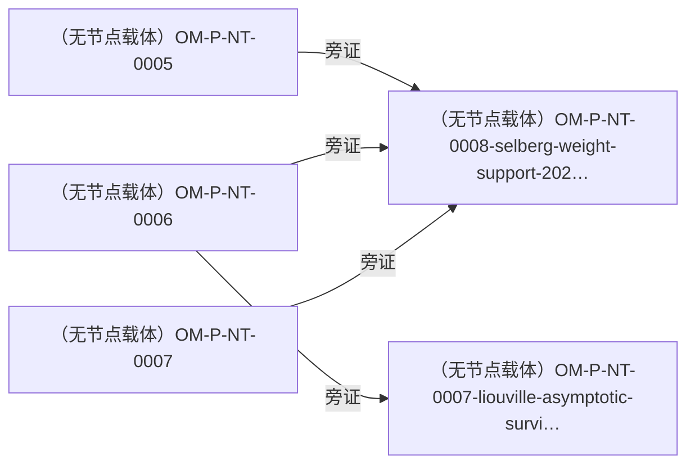

# 四层总览：理论体系 × 逻辑 × 方程 × 未解难题

> 本文件是**装配物**：正文散文手写，所有计数点名 `10-文献与索引/知识图谱/_版面/graph_face.txt`（下称「版面」，它是本轮唯一载体），节点与边逐字取自 `10-文献与索引/graph.json` 的图谱快照 `10-文献与索引/知识图谱/graph.json`，五张流程图按字节嵌自 `10-文献与索引/知识图谱/流程图/`。重跑 `python -m openmath graph` 会同时更新版面与图；文档若与版面不符，**以版面为准并改文档**。

## 〇、先说清楚：这一轮没有证明任何东西

「攻破没有攻破的难题」这一条，本轮**未达成**，而且不能靠写文档达成。盘面给的是一套可复核的现状：

- 台账里的难题状态只有 `OPEN`／`PARTIAL`／`PROPOSED` 这一类**声明**，没有任何一条被标成已证；版面判定见其末行 verdict（本轮 3 类 DEFECT/LEDGER-GAP 非空 → EDGE_ENDPOINT_OFF_GRAPH, ID_MULTI_FILE, MD_ONLY_LEDGER）。
- 图谱能说的是「哪条关系不可遍历」，不能说的是「猜想成立」。§五把不可遍历的关系逐条点名，这就是「没攻破」的确切形状。
- 上一轮已判死的路线不在本文里复活：`03-难题与猜想/` 里带 `CANCELLATION` 的账本仍在图上（§四）。

## 一、四层是什么，以及图上真正住了多少东西

| 层 | 装什么 | 图上节点（版面 `00-四层总览`） |
| --- | --- | --- |
| 体系层 | 20 个数学域的目录与依赖分层 | 版面未列（该层没有任何节点） |
| 逻辑层 | 定义／符号／前提（`OM-D-*`） | 19 |
| 方程层 | 公式／定理／算法／反例（`OM-F-*` `OM-T-*` `OM-A-*` `OM-X-*`） | 38 |
| 难题层 | 猜想、问题、纲领与攻坚账本（`OM-P-*`、md 台账） | 33 |

层的节点数由版面印出；跨层的真实边共 180 条，折叠成 6 条层间边画在总览图上。（两轮之间的涨幅见上一批条目，本句不重复历史数；修**键**那一步讲的是机制——上一版按 `id or path` 建节点键，24 份 md 账本里有 13 份共用同一个号段 ID，于是部分面孔在图上无处落脚，指向它们文件路径的边被渲染器 `continue` 掉；键修好之后版面 `nodes / unique keys` 印 90 / 90。48→160 这一步涨的是**内容**：第 1／2／2b／3 批把「哪条定理用到哪条定义」逐条写进记录，跨层的边于是真的存在了，而不是我把它画出来。三处读数都点名版面。）
台账规模（版面）：机器可读记录 66 条、仅 md 的账本节点 24 份、验证文档 4 份、类型化边 417 条、YAML 解析失败 0 份。
边的两端能不能落到节点上，版面 `---- endpoint resolution ----` 现印：两端都在图内 398 / 417，一端无载体 15 条，两端无载体 4 条，两端并成同一个键 0 条。（口径核对：本脚本把这三格相加与版面 `typed edges` 比过一次，398＋15＋4＝417。）

```mermaid
flowchart TB
  subgraph SYS[体系层：14 个域有登记条目（共 20 域）]
    D_AL["AL 代数：2 条"]
    D_AN["AN 分析：3 条"]
    D_CB["CB 组合数学：2 条"]
    D_CT["CT 范畴论：4 条"]
    D_DS["DS 动力系统与混沌：1 条"]
    D_FD["FD 数学基础与逻辑：6 条"]
    D_GO["GO 博弈论与优化：3 条"]
    D_GR["GR 群论与表示论：5 条"]
    D_IT["IT 信息论与编码：2 条"]
    D_NT["NT 数论：31 条"]
    D_PR["PR 概率论：3 条"]
    D_ST["ST 集合论：6 条"]
    D_TC["TC 理论计算机科学：6 条"]
    D_TG["TG 几何与拓扑：6 条"]
  end
  subgraph L1[逻辑层：19 个节点]
    n1["OM-D-AL-0001 同态、核、像与商 definition/L1/PROPOSED"]
    n2["OM-D-CT-0001 范畴、函子与自然变换 definition/L1/PROPOSED"]
    n3["OM-D-CT-0002 笛卡尔闭范畴与指数对象 definition/L1/PROPOSED"]
    n4["OM-D-FD-0001 朴素概括原则 definition/L1/PROPOSED"]
    n5["OM-D-FD-0002 形式语言、证明关系与一致性陈述 definition/L1/PROPOSED"]
    n6["OM-D-GO-0001 博弈、策略、效用与混合策略单纯形 definition/L1/PROPOSED"]
    n7["OM-D-GR-0001 群作用、轨道与稳定子 definition/L1/PROPOSED"]
    n8["OM-D-GR-0002 有限群的阶与 p-子群计数 definition/L1/PROPOSED"]
    n9["OM-D-GR-0003 复表示与字符 definition/L1/PROPOSED"]
    n10["OM-D-IT-0001 离散无记忆信道、互信息与容量 definition/L1/PROPOSED"]
    n11["OM-D-NT-0001 精确整除脉冲、素数指示与整数阶跃 definition/L2/VERIFIED(L2)"]
    n12["OM-D-PR-0001 概率空间与随机变量 definition/L1/PROPOSED"]
    n13["OM-D-ST-0001 选择公理 definition/L1/PROPOSED"]
    n14["OM-D-ST-0002 可数性与两个 aleph 基数 definition/L1/PROPOSED"]
    n15["OM-D-ST-0003 二元关系、良序与选择函数 definition/L1/PROPOSED"]
    n16["OM-D-TC-0001 NP 完全性（多项式时间归约下的完全类） definition/L1/PROPOSED"]
    n17["OM-D-TC-0002 复杂性类 P、NP 与 SAT definition/L1/PROPOSED"]
    n18["OM-D-TG-0001 拓扑空间、连续映射与同胚 definition/L1/PROPOSED"]
    n19["OM-D-TG-0002 紧凸集与上半连续的集值映射 definition/L1/PROPOSED"]
  end
  subgraph L2[方程层：38 个节点]
    n20["OM-A-NT-0001 Meissel–Lehmer 精确素数计数算法 algorithm/L2/VERIF…"]
    n21["OM-F-AN-0001 欧拉恒等式 formula/L3/VERIFIED(L3)"]
    n22["OM-F-AN-0002 Riemann ζ 函数函数方程 formula/L3/VERIFIED(L3)"]
    n23["OM-F-AN-0003 欧拉公式（一般形式）· 复指数把加法折成旋转 formula/L3/VERIFIED…"]
    n24["OM-F-NT-0001 Legendre φ 分块递归与轮积恒等式 formula/L2/VERIFIED(…"]
    n25["OM-F-NT-0002 第 n 素数的 n-only 有限表示（母公式） formula/L2/VERIFI…"]
    n26["OM-F-NT-0003 区间素数计数的 Legendre 窗口恒等式（方块窗口） formula/L3/VE…"]
    n27["OM-F-NT-0004 n²+1 序列的 Legendre–Möbius 筛恒等式与余项爆… formula…"]
    n28["OM-T-AL-0001 第一同构定理 theorem/L1/PROPOSED"]
    n29["OM-T-CB-0001 Ramsey 定理（有限形式） theorem/L1/PROPOSED"]
    n30["OM-T-CB-0002 Sperner 引理 theorem/L1/PROPOSED"]
    n31["OM-T-CT-0001 米田引理 theorem/L1/PROPOSED"]
    n32["OM-T-CT-0002 Lawvere 对角不动点定理 theorem/L1/PROPOSED"]
    n33["OM-T-DS-0001 Poincare 回归定理 theorem/L1/PROPOSED"]
    n34["OM-T-FD-0001 哥德尔第一不完备定理 theorem/L1/PROPOSED"]
    n35["OM-T-FD-0002 哥德尔第二不完备定理 theorem/L1/PROPOSED"]
    n36["OM-T-GO-0001 von Neumann 极小极大定理 theorem/L1/PROPOSED"]
    n37["OM-T-GO-0002 Nash 均衡存在性定理 theorem/L1/PROPOSED"]
    n38["OM-T-GR-0001 西罗定理 theorem/L1/PROPOSED"]
    n39["OM-T-GR-0002 不可约字符的正交关系 theorem/L1/PROPOSED"]
    n40["OM-T-IT-0001 Shannon 有噪信道编码定理 theorem/L1/PROPOSED"]
    n41["OM-T-NT-0001 素数离散微积分闭环（指示 ↔ 计数 ↔ 第 n 素数） theorem/L2/VER…"]
    n42["OM-T-NT-0002 素数计数分块递归分解（Legendre φ 递归恒等式） theorem/L2/VE…"]
    n43["OM-T-NT-0003 阶乘互素定理（下一素数母定理） theorem/L2/VERIFIED(L2)"]
    n44["OM-T-NT-0004 首逃逸合数平方定理 theorem/L2/VERIFIED(L2)"]
    n45["OM-T-NT-0005 模 6 合数覆盖母方程 theorem/L2/VERIFIED(L2)"]
    n46["OM-T-NT-0006 一般 wheel 覆盖定理 theorem/L2/VERIFIED(L2)"]
    n47["OM-T-NT-0007 阶乘互素安全窗口定理 theorem/L2/VERIFIED(L2)"]
    n48["OM-T-NT-0008 素数间隔的 Jacobsthal 上界 theorem/L2/VERIFIED(L2)"]
    n49["OM-T-PR-0001 Kolmogorov 强大数律 theorem/L1/PROPOSED"]
    n50["OM-T-PR-0002 中心极限定理 theorem/L1/PROPOSED"]
    n51["OM-T-ST-0001 良序定理 theorem/L1/PROPOSED"]
    n52["OM-T-TC-0001 停机问题不可判定 theorem/L1/PROPOSED"]
    n53["OM-T-TC-0002 Cook-Levin 定理（SAT 是 NP 完全） theorem/L1/PROP…"]
    n54["OM-T-TG-0001 Brouwer 不动点定理 theorem/L1/PROPOSED"]
    n55["OM-T-TG-0002 Banach-Tarski 分球定理 theorem/L1/PROPOSED"]
    n56["OM-T-TG-0003 角谷不动点定理 theorem/L1/PROPOSED"]
    n57["OM-X-FD-0001 罗素悖论（朴素概括原则的反例） counterexample/L1/PROPOSED"]
  end
  subgraph L3[难题层：33 个节点]
    n58["OM-P-NT-0001 OM-P-NT-0001 · 黎曼假设（Riemann Hypot… doc/OPEN"]
    n59["OM-P-NT-0003 OM-P-NT-0003 · 强哥德巴赫猜想（Strong Bin… doc/PAR…"]
    n60["OM-P-NT-0003 PWCV 框架下强哥德巴赫猜想的结构分析 doc/?"]
    n61["OM-P-NT-0003 强哥德巴赫：Ramanujan 局部模型主项的审计与缺口定位 doc/?"]
    n62["OM-P-NT-0003-KEY-BOUND-20260920 关键点攻坚：不引用真实分拆数的单侧误差上界 d…"]
    n63["OM-P-NT-0003 OM-P-NT-0003 前缀覆盖前沿、一般缺口引理与有限最优值证书 doc/?"]
    n64["OM-P-NT-0003 OM-P-NT-0003 反证法路线：反例的容斥等价形式与近反例穷… doc/?"]
    n65["OM-P-NT-0003 OM-P-NT-0003 · 合数模角色定位与 conductor… doc/?"]
    n66["OM-P-NT-0003-DIRECTIONS-20260920 多方向实验：精确卷积、相邻迁移、逐层筛损失 …"]
    n67["OM-P-NT-0003 OM-P-NT-0003 引擎缺陷审计与修复：9 项真实缺陷、4 … doc/?"]
    n68["OM-P-NT-0003-NEW-METHODS-20260920 新方法审计：求导、高阶容斥、频谱、矩与组合…"]
    n69["OM-P-NT-0003 强哥德巴赫猜想 — 未证问题清单（整理稿） doc/?"]
    n70["OM-P-NT-0003 OM-P-NT-0003 生成式（和集覆盖）路线裁定：能否'用素数… doc/?"]
    n71["OM-P-NT-0003 强哥德巴赫猜想 — 突破靶心清单（可判定里程碑） doc/?"]
    n72["OM-P-NT-0003 OM-P-NT-0003 素数侧生成式审计：素数把偶数填满（对偶视… doc/?"]
    n73["OM-P-NT-0003 OM-P-NT-0003 素数侧生成路线的闭合：reach 可证、… doc/?"]
    n74["OM-P-NT-0003 OM-P-NT-0003 · 结构分解定理：投影恒等式与角色锁定 doc/?"]
    n75["OM-P-NT-0003-CANCELLATION-20260920 继续攻坚：精确误差账本与双边迁移 doc…"]
    n76["OM-P-NT-0003-JOINTSIEVE-PAPER-20260922 强哥德巴赫续研：二阶信息的精确反…"]
    n77["OM-P-NT-0003-JOINTSIEVE-20260922 联合筛证书：二阶/三阶 Bonferroni…"]
    n78["OM-P-NT-0003-JOINTSIEVE-VERIFY-20260922 联合筛证书：独立核验报告（20…"]
    n79["OM-P-NT-0003-CONT-20260920 强哥德巴赫联盟续研：从相关和到双素数的误差预算 doc/…"]
    n80["OM-P-NT-0003-REVIEW-20260922 强哥德巴赫：证明状态复核（2026-09-22） d…"]
    n81["OM-BR-0001 OM-BR-0001 · 三重奏定理：线性斜对称动力学 ↔ Fre… doc/?"]
    n82["OM-C-ST-0001 连续统假设 CH conjecture/L1/PROPOSED"]
    n83["OM-C-ST-0002 否定连续统假设 ¬CH conjecture/L1/PROPOSED"]
    n84["OM-C-TG-0001 朴素可测性公设（体积在刚体运动下不变且定义于所有有界集） conjecture/L1…"]
    n85["OM-P-FD-0001 希尔伯特纲领（有穷一致性证明） problem/L1/PROPOSED"]
    n86["OM-P-NT-0002 第 n 个素数的低复杂度精确公式 problem/L2/OPEN"]
    n87["OM-P-NT-0004 Landau 第四问题 · 是否存在无穷多个素数形如 n²+1 problem/L1…"]
    n88["OM-P-NT-0009 Landau 第三问题 · Legendre 猜想（相邻平方数之间… problem…"]
    n89["OM-P-TC-0001 判定问题（Entscheidungsproblem） problem/L1/PROP…"]
    n90["OM-P-TC-0002 P 与 NP 是否相等 problem/L1/PROPOSED"]
  end
  L2 -.->|"折叠 65 条真实边"| L1
  L2 -.->|"折叠 29 条真实边"| L3
  L1 -.->|"折叠 42 条真实边"| L2
  L1 -.->|"折叠 9 条真实边"| L3
  L3 -.->|"折叠 25 条真实边"| L2
  L3 -.->|"折叠 10 条真实边"| L1
```

## 二、体系层：域的分层与它真正的空白

分层来自 `01-数学体系/域依赖.yaml`（机器可读版；原先只有一张手画 ASCII 图，那版图会静默漏掉整行域，现在由 `DOMAIN_UNPLACED` 裁决）。版面：声明分层 6 层、归域 17 / 20 个，显式声明未归层的域 CB, GT, XS。

**关键读数**：版面 `domains with >=1 node` ＝ 14 / 20。也就是说 20 个域里 14 个域在台账上有内容（`AL`×2、`AN`×3、`CB`×2、`CT`×4、`DS`×1、`FD`×6、`GO`×3、`GR`×5、`IT`×2、`NT`×17、`PR`×3、`ST`×6、`TC`×6、`TG`×6），其余 6 个域目前只是目录名：`SC`（统计与数据科学）／`GT`（图论）／`NA`（数值分析）／`MP`（数学物理）／`OR`（运筹与系统科学）／`XS`（交叉与新兴）。上一版这一格是 2 / 20（只有 `NT` 与 `AN`）。口径分两把尺子：本行的 `×N` 只数**记录节点**（`graph.json` 里 `node_type=record`），而下面的分层图每格「× 条」数的是该域**全部节点**（记录＋仅 md 的账本）——例如 `NT` 记录 17 条、图上 31 个节点，差的 14 个是攻坚账本；全库仅 md 的账本节点本轮 24 个。引用「某域多少条」必须点名是哪一把尺子。分层图描述的是**借用工具的频率**，不是逻辑基础，这一点写在 yaml 头部。

## 三、逻辑层与方程层：台账里真正写下来的东西

下表逐字来自 `10-文献与索引/知识图谱/graph.json`（状态／等级是记录自己的字段，不是本文的评价）。「入边」按图上的边现算。

| ID | 类型 | 域 | 状态 | 等级 | 标题 | 入边 | LaTeX（若有） |
| --- | --- | --- | --- | --- | --- | --- | --- |
| `OM-F-AN-0001` | formula | AN | VERIFIED(L3) | L3 | 欧拉恒等式 | 2 | $e^{i\pi} + 1 = 0$ |
| `OM-F-AN-0002` | formula | AN | VERIFIED(L3) | L3 | Riemann ζ 函数函数方程 | 3 | $\zeta(s) = 2^{s} \pi^{s-1} \sin\left(\frac{\pi s}{2}\right) $ |
| `OM-A-NT-0001` | algorithm | NT | VERIFIED(L2) | L2 | Meissel–Lehmer 精确素数计数算法 | 9 | $Meissel: pi(x) = phi(x,a) + a - 1 - sum_{i=a+1}^{b} (pi(floo$ |
| `OM-D-NT-0001` | definition | NT | VERIFIED(L2) | L2 | 精确整除脉冲、素数指示与整数阶跃 | 16 | $delta_d(N) = floor(N/d) - floor((N-1)/d) = 1_{d／N}; I_P(N) =$ |
| `OM-F-NT-0001` | formula | NT | VERIFIED(L2) | L2 | Legendre φ 分块递归与轮积恒等式 | 17 | $phi(x,a) = phi(x,a-1) - phi(floor(x/p_a), a-1), phi(x,0) = x$ |
| `OM-F-NT-0002` | formula | NT | VERIFIED(L2) | L2 | 第 n 素数的 n-only 有限表示（母公式） | 2 | $L_n=floor(n(log n+log log n-1))+1, U_n=ceil(n(log n+log log $ |
| `OM-F-NT-0003` | formula | NT | VERIFIED(L3) | L3 | 区间素数计数的 Legendre 窗口恒等式（方块窗口） | 4 | $c(n) := #{p prime : n^2 < p <= (n+1)^2} = pi((n+1)^2) - pi(n$ |
| `OM-F-NT-0004` | formula | NT | VERIFIED(L3) | L3 | n²+1 序列的 Legendre–Möbius 筛恒等式与余项爆炸度量 | 4 | $omega(p) = #{n mod p : p ／ n^2+1} = 1 (p=2), 2 (p = 1 mod 4)$ |
| `OM-P-NT-0002` | problem | NT | OPEN | L2 | 第 n 个素数的低复杂度精确公式 | 12 | $Q1: 是否存在 F:N->N，使 F(n)=p_n 且不把 p_1..p_{n-1} 作为输入？（已解决：存在，Wil$ |
| `OM-P-NT-0009` | problem | NT | PROPOSED | L1 | Landau 第三问题 · Legendre 猜想（相邻平方数之间必有素数） | 13 | $对一切正整数 n，存在素数 p 满足 n^2 < p < (n+1)^2； 等价地 c(n) := pi((n+1)^2$ |
| `OM-P-NT-0004` | problem | NT | PROPOSED | L1 | Landau 第四问题 · 是否存在无穷多个素数形如 n²+1 | 4 | $是否存在无穷多个正整数 n 使得 n^2 + 1 为素数？ 记 A(N) = #{n <= N : n^2+1 为素数}$ |
| `OM-T-NT-0001` | theorem | NT | VERIFIED(L2) | L2 | 素数离散微积分闭环（指示 ↔ 计数 ↔ 第 n 素数） | 7 | $Delta pi(N) = pi(N) - pi(N-1) = I_P(N); p_n = min{x>=2: pi(x$ |
| `OM-T-NT-0002` | theorem | NT | VERIFIED(L2) | L2 | 素数计数分块递归分解（Legendre φ 递归恒等式） | 0 | $phi(x,a)=phi(x,a-1)-phi(floor(x/p_a),a-1), phi(x,0)=x; pi(x)$ |
| `OM-T-NT-0003` | theorem | NT | VERIFIED(L2) | L2 | 阶乘互素定理（下一素数母定理） | 5 | $q = NextPrime(m) = min{ x>m : gcd(x, m!) = 1 }$ |
| `OM-T-NT-0004` | theorem | NT | VERIFIED(L2) | L2 | 首逃逸合数平方定理 | 8 | $min{ C>1 : C composite and gcd(C,m!)=1 } = [NextPrime(m)]^2$ |
| `OM-T-NT-0005` | theorem | NT | VERIFIED(L2) | L2 | 模 6 合数覆盖母方程 | 3 | $N=6k+epsilon>3, epsilon in {-1,+1}; N composite iff exists a$ |
| `OM-T-NT-0006` | theorem | NT | VERIFIED(L2) | L2 | 一般 wheel 覆盖定理 | 7 | $gcd(N,M)=1, N=Ma+r, M=b+s? no; N=(Ma+r)(Mb+s), k = Mab + a s$ |
| `OM-T-NT-0007` | theorem | NT | VERIFIED(L2) | L2 | 阶乘互素安全窗口定理 | 5 | $if m < x < [NextPrime(m)]^2 then gcd(x, m!) = 1  <=>  x is p$ |
| `OM-T-NT-0008` | theorem | NT | VERIFIED(L2) | L2 | 素数间隔的 Jacobsthal 上界 | 1 | $g_n = p_{n+1}-p_n  <=  j(p_n#), j(M) = min { L : 任意 L 个连续整数中$ |

读法：方程层（公式／定理／算法／反例）在图上有 38 个节点，逻辑层 19 个——**这一格本轮翻了一倍方向**：上一版印的是「方程层 15 个节点、逻辑层只有 1 个」，那句话当时是对的，也是 §五 `UNDEFINED_SYMBOL` 高的原因（用了符号却没有定义记录可指）。现在记号被逐张写进 `OM-D-*` 定义卡，逻辑层从 1 涨到 19。但要诚实：同一把尺子上的 `UNDEFINED_SYMBOL` 不降反升，从上一版的 37 涨到版面的 51 枚——因为新定理卡又带来了新记号，涨的是分母而不是同一批缺口。**「逻辑层是空的」这句已作废，改写成「逻辑层薄且滞后于定理卡」**。

域×记录数（`graph.json` 的 record 节点按域现数，与版面 `domains with >=1 node` ＝ 14 / 20 同口径；逐条标题见 `10-文献与索引/知识图谱/交叉引用索引/按域.md`）：

| 域 | 记录条数 |
| --- | --- |
| `AL` | 2 |
| `AN` | 3 |
| `CB` | 2 |
| `CT` | 4 |
| `DS` | 1 |
| `FD` | 6 |
| `GO` | 3 |
| `GR` | 5 |
| `IT` | 2 |
| `NT` | 17 |
| `PR` | 3 |
| `ST` | 6 |
| `TC` | 6 |
| `TG` | 6 |

按目录（`graph.json` 的 path 前缀）：`02-公式库/代数`×2、`02-公式库/信息论与编码`×2、`02-公式库/几何与拓扑`×6、`02-公式库/分析`×3、`02-公式库/动力系统与混沌`×1、`02-公式库/博弈论与优化`×3、`02-公式库/数学基础与逻辑`×6、`02-公式库/数论`×16、`02-公式库/概率论`×3、`02-公式库/理论计算机科学`×6、`02-公式库/组合数学`×2、`02-公式库/群论与表示论`×5、`02-公式库/范畴论`×4、`02-公式库/集合论`×6、`03-难题与猜想/05-经典未解猜想`×1。证据等级分布：L1 48／L2 13／L3 5／L4 0——L4 为 0 是本库红线一的形状，不是疏漏。

```mermaid
flowchart LR
  n1["OM-A-NT-0001 Meissel–Lehmer 精确素数计数算法 algorithm/L2/VERIF…"]
  n2["OM-F-NT-0001 Legendre φ 分块递归与轮积恒等式 formula/L2/VERIFIED(…"]
  n1 -->|引用| n2
  n3["OM-P-NT-0002 第 n 个素数的低复杂度精确公式 problem/L2/OPEN"]
  n1 -->|引用| n3
  n1 -->|related| n2
  n1 -->|related| n3
  n1 -->|用到| n2
  n4["OM-C-ST-0001 连续统假设 CH conjecture/L1/PROPOSED"]
  n5["OM-C-ST-0002 否定连续统假设 ¬CH conjecture/L1/PROPOSED"]
  n4 -->|引用| n5
  n6["OM-D-ST-0001 选择公理 definition/L1/PROPOSED"]
  n4 -->|引用| n6
  n4 -.->|冲突| n5
  n4 -->|related| n6
  n4 -->|用到| n6
  n4 -->|用到| n6
  n5 -->|引用| n4
  n5 -->|引用| n6
  n5 -.->|冲突| n4
  n5 -->|related| n4
  n5 -->|用到| n6
  n7["OM-C-TG-0001 朴素可测性公设（体积在刚体运动下不变且定义于所有有界集） conjecture/L1…"]
  n8["OM-D-PR-0001 概率空间与随机变量 definition/L1/PROPOSED"]
  n7 -->|引用| n8
  n9["OM-T-TG-0002 Banach-Tarski 分球定理 theorem/L1/PROPOSED"]
  n7 -->|引用| n9
  n7 -.->|冲突| n9
  n7 -->|related| n9
  n7 -->|用到| n8
  n10["OM-D-AL-0001 同态、核、像与商 definition/L1/PROPOSED"]
  n11["OM-D-CT-0001 范畴、函子与自然变换 definition/L1/PROPOSED"]
  n10 -->|引用| n11
  n10 -->|related| n11
  n12["OM-D-CT-0002 笛卡尔闭范畴与指数对象 definition/L1/PROPOSED"]
  n12 -->|引用| n11
  n13["OM-T-CT-0002 Lawvere 对角不动点定理 theorem/L1/PROPOSED"]
  n12 -->|引用| n13
  n12 -->|related| n11
  n12 -->|related| n13
  n12 -->|用到| n11
  n14["OM-D-FD-0001 朴素概括原则 definition/L1/PROPOSED"]
  n15["OM-X-FD-0001 罗素悖论（朴素概括原则的反例） counterexample/L1/PROPOSED"]
  n14 -->|引用| n15
  n14 -.->|冲突| n15
  n16["OM-D-FD-0002 形式语言、证明关系与一致性陈述 definition/L1/PROPOSED"]
  n16 -->|引用| n14
  n17["OM-P-FD-0001 希尔伯特纲领（有穷一致性证明） problem/L1/PROPOSED"]
  n16 -->|引用| n17
  n18["OM-T-FD-0001 哥德尔第一不完备定理 theorem/L1/PROPOSED"]
  n16 -->|引用| n18
  n19["OM-T-FD-0002 哥德尔第二不完备定理 theorem/L1/PROPOSED"]
  n16 -->|引用| n19
  n16 -->|related| n14
  n20["OM-D-GO-0001 博弈、策略、效用与混合策略单纯形 definition/L1/PROPOSED"]
  n20 -->|引用| n8
  n21["OM-D-TG-0002 紧凸集与上半连续的集值映射 definition/L1/PROPOSED"]
  n20 -->|引用| n21
  n22["OM-T-GO-0001 von Neumann 极小极大定理 theorem/L1/PROPOSED"]
  n20 -->|引用| n22
  n23["OM-T-GO-0002 Nash 均衡存在性定理 theorem/L1/PROPOSED"]
  n20 -->|引用| n23
  n24["OM-T-TG-0003 角谷不动点定理 theorem/L1/PROPOSED"]
  n20 -->|引用| n24
  n20 -->|related| n22
  n20 -->|related| n23
  n20 -->|related| n24
  n20 -->|用到| n8
  n20 -->|用到| n21
  n25["OM-D-GR-0001 群作用、轨道与稳定子 definition/L1/PROPOSED"]
  n25 -->|引用| n10
  n25 -->|用到| n10
  n26["OM-D-GR-0002 有限群的阶与 p-子群计数 definition/L1/PROPOSED"]
  n26 -->|引用| n25
  n27["OM-T-GR-0001 西罗定理 theorem/L1/PROPOSED"]
  n26 -->|引用| n27
  n26 -->|related| n25
  n26 -->|related| n27
  n26 -->|用到| n25
  n28["OM-D-GR-0003 复表示与字符 definition/L1/PROPOSED"]
  n28 -->|引用| n10
  n28 -->|引用| n26
  n29["OM-T-GR-0002 不可约字符的正交关系 theorem/L1/PROPOSED"]
  n28 -->|引用| n29
  n28 -->|related| n10
  n28 -->|related| n26
  n28 -->|related| n29
  n28 -->|用到| n10
  n30["OM-D-IT-0001 离散无记忆信道、互信息与容量 definition/L1/PROPOSED"]
  n30 -->|引用| n8
  n31["OM-T-IT-0001 Shannon 有噪信道编码定理 theorem/L1/PROPOSED"]
  n30 -->|引用| n31
  n30 -->|related| n8
  n30 -->|related| n31
  n30 -->|用到| n8
  n32["OM-D-NT-0001 精确整除脉冲、素数指示与整数阶跃 definition/L2/VERIFIED(L2)"]
  n32 -->|引用| n2
  n33["OM-T-NT-0001 素数离散微积分闭环（指示 ↔ 计数 ↔ 第 n 素数） theorem/L2/VER…"]
  n32 -->|引用| n33
  n32 -->|related| n2
  n32 -->|related| n33
  n34["OM-D-ST-0003 二元关系、良序与选择函数 definition/L1/PROPOSED"]
  n8 -->|引用| n34
  n35["OM-T-DS-0001 Poincare 回归定理 theorem/L1/PROPOSED"]
  n8 -->|引用| n35
  n36["OM-T-PR-0001 Kolmogorov 强大数律 theorem/L1/PROPOSED"]
  n8 -->|引用| n36
  n8 -->|related| n35
  n8 -->|related| n36
  n8 -->|用到| n34
  n6 -->|引用| n4
  n37["OM-T-ST-0001 良序定理 theorem/L1/PROPOSED"]
  n6 -->|引用| n37
  n6 ==>|蕴含| n37
  n6 -->|related| n37
  n38["OM-D-ST-0002 可数性与两个 aleph 基数 definition/L1/PROPOSED"]
  n38 -->|引用| n4
  n38 -->|引用| n5
  n38 -->|引用| n6
  n38 -->|引用| n37
  n38 -->|related| n4
  n38 -->|related| n5
  n38 -->|related| n37
  n38 -->|用到| n6
  n34 -->|引用| n6
  n34 -->|引用| n37
  n34 -->|related| n6
  n34 -->|related| n37
  n34 -->|用到| n6
  n39["OM-D-TC-0001 NP 完全性（多项式时间归约下的完全类） definition/L1/PROPOSED"]
  n40["OM-P-TC-0002 P 与 NP 是否相等 problem/L1/PROPOSED"]
  n39 -->|引用| n40
  n41["OM-T-TC-0002 Cook-Levin 定理（SAT 是 NP 完全） theorem/L1/PROP…"]
  n39 -->|引用| n41
  n39 -->|related| n41
  n39 -->|用到| n41
  n42["OM-D-TC-0002 复杂性类 P、NP 与 SAT definition/L1/PROPOSED"]
  n42 -->|引用| n39
  n42 -->|引用| n40
  n42 -->|引用| n41
  n42 -->|related| n39
  n42 -->|related| n40
  n42 -->|related| n41
  n43["OM-D-TG-0001 拓扑空间、连续映射与同胚 definition/L1/PROPOSED"]
  n43 -->|引用| n11
  n43 -->|引用| n12
  n43 -->|引用| n34
  n44["OM-T-TG-0001 Brouwer 不动点定理 theorem/L1/PROPOSED"]
  n43 -->|引用| n44
  n43 -->|related| n11
  n43 -->|related| n44
  n43 -->|用到| n34
  n21 -->|引用| n43
  n21 -->|引用| n24
  n21 -->|related| n43
  n21 -->|related| n24
  n21 -->|用到| n43
  n45["OM-F-AN-0001 欧拉恒等式 formula/L3/VERIFIED(L3)"]
  n46["OM-F-AN-0002 Riemann ζ 函数函数方程 formula/L3/VERIFIED(L3)"]
  n45 -->|引用| n46
  n47["OM-F-AN-0003 欧拉公式（一般形式）· 复指数把加法折成旋转 formula/L3/VERIFIED…"]
  n45 -->|引用| n47
  n45 -->|推广| n47
  n45 -->|related| n46
  n46 -->|引用| n45
  n46 -->|related| n45
  n47 -->|引用| n45
  n47 -->|引用| n46
  n47 -->|related| n46
  n47 -->|特例| n45
  n2 -->|引用| n1
  n2 -->|引用| n3
  n2 -->|related| n1
  n2 -->|related| n3
  n48["OM-F-NT-0002 第 n 素数的 n-only 有限表示（母公式） formula/L2/VERIFI…"]
  n48 -->|引用| n32
  n48 -->|引用| n3
  n48 -->|引用| n33
  n48 -->|related| n32
  n48 -->|related| n3
  n48 -->|related| n33
  n48 -->|用到| n32
  n49["OM-F-NT-0003 区间素数计数的 Legendre 窗口恒等式（方块窗口） formula/L3/VE…"]
  n49 -->|引用| n2
  n50["OM-P-NT-0009 Landau 第三问题 · Legendre 猜想（相邻平方数之间… problem…"]
  n49 -->|引用| n50
  n49 -->|related| n2
  n49 -->|related| n50
  n51["OM-F-NT-0004 n²+1 序列的 Legendre–Möbius 筛恒等式与余项爆… formula…"]
  n51 -->|引用| n2
  n52["OM-P-NT-0004 Landau 第四问题 · 是否存在无穷多个素数形如 n²+1 problem/L1…"]
  n51 -->|引用| n52
  n53["OM-T-NT-0006 一般 wheel 覆盖定理 theorem/L2/VERIFIED(L2)"]
  n51 -->|引用| n53
  n51 -->|related| n2
  n51 -->|related| n52
  n51 -->|related| n53
  n54["OM-P-TC-0001 判定问题（Entscheidungsproblem） problem/L1/PROP…"]
  n17 -->|引用| n54
  n17 -->|引用| n18
  n17 -->|引用| n19
  n17 -.->|冲突| n18
  n17 -.->|冲突| n19
  n17 -->|related| n54
  n17 -->|用到| n19
  n3 -->|引用| n1
  n3 -->|引用| n2
  n52 -->|引用| n51
  n52 -->|引用| n50
  n52 ==>|蕴含| n51
  n52 -->|related| n51
  n52 -->|related| n50
  n52 -->|用到| n51
  n50 -->|引用| n49
  n50 -->|引用| n52
  n50 ==>|蕴含| n49
  n50 -->|related| n49
  n50 -->|related| n52
  n50 -->|用到| n49
  n54 -->|引用| n17
  n55["OM-T-TC-0001 停机问题不可判定 theorem/L1/PROPOSED"]
  n54 -->|引用| n55
  n54 -.->|冲突| n55
  n54 -->|related| n17
  n54 -->|用到| n55
  n40 -->|引用| n39
  n40 -->|引用| n41
  n40 -->|related| n39
  n40 -->|related| n41
  n40 -->|用到| n39
  n56["OM-T-AL-0001 第一同构定理 theorem/L1/PROPOSED"]
  n56 -->|引用| n10
  n57["OM-T-CT-0001 米田引理 theorem/L1/PROPOSED"]
  n56 -->|引用| n57
  n56 -->|related| n57
  n56 -->|用到| n10
  n58["OM-T-CB-0001 Ramsey 定理（有限形式） theorem/L1/PROPOSED"]
  n58 -->|引用| n38
  n59["OM-T-CB-0002 Sperner 引理 theorem/L1/PROPOSED"]
  n58 -->|引用| n59
  n58 -->|related| n38
  n58 -->|related| n59
  n58 -->|用到| n38
  n59 -->|引用| n43
  n59 -->|引用| n58
  n59 -->|引用| n44
  n59 -->|related| n43
  n59 -->|related| n58
  n59 -->|用到| n43
  n57 -->|引用| n11
  n57 -->|related| n11
  n57 -->|用到| n11
  n13 -->|引用| n11
  n13 -->|引用| n57
  n13 -->|引用| n18
  n13 -->|引用| n55
  n13 -->|related| n57
  n13 -->|related| n18
  n13 -->|related| n55
  n13 -->|用到| n11
  n35 -->|引用| n8
  n35 -->|引用| n36
  n35 -->|related| n8
  n35 -->|related| n36
  n35 -->|用到| n8
  n18 -->|引用| n17
  n18 -->|引用| n19
  n18 -.->|冲突| n17
  n18 ==>|蕴含| n17
  n18 -->|related| n19
  n19 -->|引用| n17
  n19 -->|引用| n18
  n19 -.->|冲突| n17
  n19 ==>|蕴含| n17
  n19 -->|related| n18
  n19 -->|用到| n18
  n22 -->|引用| n23
  n22 -->|引用| n44
  n22 -->|related| n23
  n22 -->|related| n44
  n22 -->|用到| n44
  n23 -->|引用| n43
  n23 -->|引用| n22
  n23 -->|引用| n24
  n23 -->|related| n22
  n23 -->|用到| n43
  n23 -->|用到| n24
  n27 -->|引用| n25
  n27 -->|引用| n33
  n27 -->|related| n33
  n27 -->|用到| n25
  n29 -->|引用| n10
  n29 -->|引用| n27
  n29 -->|related| n27
  n29 -->|用到| n10
  n31 -->|引用| n30
  n31 -->|引用| n36
  n31 -->|引用| n55
  n31 -->|related| n30
  n31 -->|related| n36
  n31 -->|related| n55
  n31 -->|用到| n30
  n31 -->|用到| n36
  n33 -->|引用| n1
  n33 -->|引用| n32
  n33 -->|引用| n2
  n33 -->|引用| n48
  n33 -->|引用| n3
  n33 -->|related| n1
  n33 -->|related| n32
  n33 -->|related| n2
  n33 -->|related| n48
  n33 -->|用到| n32
  n33 -->|用到| n2
  n60["OM-T-NT-0002 素数计数分块递归分解（Legendre φ 递归恒等式） theorem/L2/VE…"]
  n60 -->|引用| n1
  n60 -->|引用| n32
  n60 -->|引用| n2
  n60 -->|引用| n3
  n60 -->|推广| n2
  n60 -->|related| n1
  n60 -->|related| n32
  n60 -->|related| n2
  n61["OM-T-NT-0003 阶乘互素定理（下一素数母定理） theorem/L2/VERIFIED(L2)"]
  n61 -->|引用| n32
  n61 -->|引用| n33
  n62["OM-T-NT-0004 首逃逸合数平方定理 theorem/L2/VERIFIED(L2)"]
  n61 -->|引用| n62
  n63["OM-T-NT-0007 阶乘互素安全窗口定理 theorem/L2/VERIFIED(L2)"]
  n61 -->|引用| n63
  n61 -->|推广| n63
  n61 -->|related| n32
  n61 -->|related| n33
  n61 -->|related| n62
  n62 -->|引用| n32
  n62 -->|引用| n61
  n62 -->|引用| n63
  n62 -->|推广| n63
  n62 -->|related| n32
  n62 -->|related| n61
  n62 -->|related| n63
  n64["OM-T-NT-0005 模 6 合数覆盖母方程 theorem/L2/VERIFIED(L2)"]
  n64 -->|引用| n32
  n64 -->|引用| n53
  n64 -->|推广| n53
  n64 -->|related| n32
  n64 -->|related| n53
  n53 -->|引用| n1
  n53 -->|引用| n32
  n53 -->|引用| n3
  n53 -->|引用| n64
  n53 -->|related| n1
  n53 -->|related| n32
  n53 -->|related| n64
  n53 -->|特例| n64
  n63 -->|引用| n61
  n63 -->|引用| n62
  n65["OM-T-NT-0008 素数间隔的 Jacobsthal 上界 theorem/L2/VERIFIED(L2)"]
  n63 -->|引用| n65
  n63 -->|related| n33
  n63 -->|related| n61
  n63 -->|related| n62
  n63 -->|特例| n62
  n63 -->|用到| n61
  n63 -->|用到| n62
  n65 -->|引用| n3
  n65 -->|引用| n62
  n65 -->|引用| n53
  n65 -->|related| n3
  n65 -->|related| n62
  n65 -->|related| n53
  n36 -->|引用| n8
  n36 -->|引用| n35
  n66["OM-T-PR-0002 中心极限定理 theorem/L1/PROPOSED"]
  n36 -->|引用| n66
  n36 -->|related| n35
  n36 -->|related| n66
  n36 -->|用到| n8
  n66 -->|引用| n8
  n66 -->|引用| n36
  n66 -->|related| n36
  n66 -->|用到| n8
  n37 -->|引用| n6
  n37 ==>|蕴含| n6
  n37 -->|related| n6
  n37 -->|用到| n6
  n37 -->|用到| n6
  n55 -->|引用| n54
  n55 -.->|冲突| n54
  n55 ==>|蕴含| n54
  n55 -->|related| n54
  n41 -->|引用| n39
  n41 ==>|蕴含| n39
  n41 -->|related| n39
  n41 -->|用到| n39
  n44 -->|引用| n43
  n44 -->|引用| n59
  n44 -->|引用| n13
  n44 -->|引用| n24
  n44 -->|related| n43
  n44 -->|related| n24
  n44 -->|用到| n43
  n44 -->|用到| n59
  n9 -->|引用| n7
  n9 -->|引用| n6
  n9 -->|引用| n43
  n9 -.->|冲突| n7
  n9 -->|related| n7
  n9 -->|related| n6
  n9 -->|用到| n6
  n9 -->|用到| n6
  n9 -->|用到| n43
  n24 -->|引用| n23
  n24 -->|引用| n44
  n24 -->|推广| n44
  n24 -->|related| n23
  n24 -->|用到| n44
  n15 -->|引用| n14
  n15 -.->|冲突| n14
  n15 -->|related| n14
  n15 -->|用到| n14
  n15 -->|用到| n14
```

## 四、难题层：攻坚线在图上的形状

难题层节点 33 个（版面 `03-难题卡点`：难题节点 33 个、图上 59 个节点／105 条边）。md 账本没有 YAML 伴生，`openmath index` 看不见它们，因此图上单列一条边类型 `cites`（版面现印 214 条）把它们接进来——其中大部分靠**文件名链接**（攻坚轮次之间就是这么互相指的，不写 OM-ID）。

| 难题／账本 | 状态 | 标题 | 出边目标数 |
| --- | --- | --- | --- |
| `OM-BR-0001` | — | OM-BR-0001 · 三重奏定理：线性斜对称动力学 ↔ Frenet 曲率不变量 | 0 |
| `OM-P-NT-0001` | OPEN | OM-P-NT-0001 · 黎曼假设（Riemann Hypothesis, RH） | 0 |
| `OM-P-NT-0003` | PARTIAL | OM-P-NT-0003 · 强哥德巴赫猜想（Strong Binary Goldbach Conjec | 6 |
| `OM-P-NT-0003` | — | PWCV 框架下强哥德巴赫猜想的结构分析 | 6 |
| `OM-P-NT-0003` | — | 强哥德巴赫：Ramanujan 局部模型主项的审计与缺口定位 | 6 |
| `OM-P-NT-0003` | — | OM-P-NT-0003 前缀覆盖前沿、一般缺口引理与有限最优值证书 | 6 |
| `OM-P-NT-0003` | — | OM-P-NT-0003 反证法路线：反例的容斥等价形式与近反例穷举扫描 | 6 |
| `OM-P-NT-0003` | — | OM-P-NT-0003 · 合数模角色定位与 conductor 重标定 | 6 |
| `OM-P-NT-0003` | — | OM-P-NT-0003 引擎缺陷审计与修复：9 项真实缺陷、4 项严重、渲染门禁归零 | 6 |
| `OM-P-NT-0003` | — | 强哥德巴赫猜想 — 未证问题清单（整理稿） | 6 |
| `OM-P-NT-0003` | — | OM-P-NT-0003 生成式（和集覆盖）路线裁定：能否"用素数填满所有偶数" | 6 |
| `OM-P-NT-0003` | — | 强哥德巴赫猜想 — 突破靶心清单（可判定里程碑） | 6 |
| `OM-P-NT-0003` | — | OM-P-NT-0003 素数侧生成式审计：素数把偶数填满（对偶视角） | 6 |
| `OM-P-NT-0003` | — | OM-P-NT-0003 素数侧生成路线的闭合：reach 可证、pairing 不可绕过 | 6 |
| `OM-P-NT-0003` | — | OM-P-NT-0003 · 结构分解定理：投影恒等式与角色锁定 | 6 |
| `OM-P-NT-0003-CANCELLATION-20260920` | DRAFT | 继续攻坚：精确误差账本与双边迁移 | 0 |
| `OM-P-NT-0003-CONT-20260920` | DRAFT | 强哥德巴赫联盟续研：从相关和到双素数的误差预算 | 0 |
| `OM-P-NT-0003-DIRECTIONS-20260920` | DRAFT | 多方向实验：精确卷积、相邻迁移、逐层筛损失 | 0 |
| `OM-P-NT-0003-JOINTSIEVE-20260922` | DRAFT | 联合筛证书：二阶/三阶 Bonferroni 下界与有限证书（2026-09-22） | 0 |
| `OM-P-NT-0003-JOINTSIEVE-PAPER-20260922` | DRAFT | 强哥德巴赫续研：二阶信息的精确反模型与三阶有限证书 | 0 |
| `OM-P-NT-0003-JOINTSIEVE-VERIFY-20260922` | DRAFT | 联合筛证书：独立核验报告（2026-09-22） | 0 |
| `OM-P-NT-0003-KEY-BOUND-20260920` | DRAFT | 关键点攻坚：不引用真实分拆数的单侧误差上界 | 0 |
| `OM-P-NT-0003-NEW-METHODS-20260920` | DRAFT | 新方法审计：求导、高阶容斥、频谱、矩与组合覆盖 | 0 |
| `OM-P-NT-0003-REVIEW-20260922` | DRAFT | 强哥德巴赫：证明状态复核（2026-09-22） | 0 |

```mermaid
flowchart TB
  n1["OM-BR-0001 OM-BR-0001 · 三重奏定理：线性斜对称动力学 ↔ Fre… doc/?"]
  n2["OM-C-ST-0001 连续统假设 CH conjecture/L1/PROPOSED"]
  n3["OM-C-ST-0002 否定连续统假设 ¬CH conjecture/L1/PROPOSED"]
  n4["OM-C-TG-0001 朴素可测性公设（体积在刚体运动下不变且定义于所有有界集） conjecture/L1…"]
  n5["OM-P-FD-0001 希尔伯特纲领（有穷一致性证明） problem/L1/PROPOSED"]
  n6["OM-P-NT-0001 OM-P-NT-0001 · 黎曼假设（Riemann Hypot… doc/OPEN"]
  n7["OM-P-NT-0002 第 n 个素数的低复杂度精确公式 problem/L2/OPEN"]
  n8["OM-P-NT-0003 OM-P-NT-0003 · 强哥德巴赫猜想（Strong Bin… doc/PAR…"]
  n9["OM-P-NT-0003 PWCV 框架下强哥德巴赫猜想的结构分析 doc/?"]
  n10["OM-P-NT-0003 强哥德巴赫：Ramanujan 局部模型主项的审计与缺口定位 doc/?"]
  n11["OM-P-NT-0003 OM-P-NT-0003 前缀覆盖前沿、一般缺口引理与有限最优值证书 doc/?"]
  n12["OM-P-NT-0003 OM-P-NT-0003 反证法路线：反例的容斥等价形式与近反例穷… doc/?"]
  n13["OM-P-NT-0003 OM-P-NT-0003 · 合数模角色定位与 conductor… doc/?"]
  n14["OM-P-NT-0003 OM-P-NT-0003 引擎缺陷审计与修复：9 项真实缺陷、4 … doc/?"]
  n15["OM-P-NT-0003 强哥德巴赫猜想 — 未证问题清单（整理稿） doc/?"]
  n16["OM-P-NT-0003 OM-P-NT-0003 生成式（和集覆盖）路线裁定：能否'用素数… doc/?"]
  n17["OM-P-NT-0003 强哥德巴赫猜想 — 突破靶心清单（可判定里程碑） doc/?"]
  n18["OM-P-NT-0003 OM-P-NT-0003 素数侧生成式审计：素数把偶数填满（对偶视… doc/?"]
  n19["OM-P-NT-0003 OM-P-NT-0003 素数侧生成路线的闭合：reach 可证、… doc/?"]
  n20["OM-P-NT-0003 OM-P-NT-0003 · 结构分解定理：投影恒等式与角色锁定 doc/?"]
  n21["OM-P-NT-0003-CANCELLATION-20260920 继续攻坚：精确误差账本与双边迁移 doc…"]
  n22["OM-P-NT-0003-CONT-20260920 强哥德巴赫联盟续研：从相关和到双素数的误差预算 doc/…"]
  n23["OM-P-NT-0003-DIRECTIONS-20260920 多方向实验：精确卷积、相邻迁移、逐层筛损失 …"]
  n24["OM-P-NT-0003-JOINTSIEVE-20260922 联合筛证书：二阶/三阶 Bonferroni…"]
  n25["OM-P-NT-0003-JOINTSIEVE-PAPER-20260922 强哥德巴赫续研：二阶信息的精确反…"]
  n26["OM-P-NT-0003-JOINTSIEVE-VERIFY-20260922 联合筛证书：独立核验报告（20…"]
  n27["OM-P-NT-0003-KEY-BOUND-20260920 关键点攻坚：不引用真实分拆数的单侧误差上界 d…"]
  n28["OM-P-NT-0003-NEW-METHODS-20260920 新方法审计：求导、高阶容斥、频谱、矩与组合…"]
  n29["OM-P-NT-0003-REVIEW-20260922 强哥德巴赫：证明状态复核（2026-09-22） d…"]
  n30["OM-P-NT-0004 Landau 第四问题 · 是否存在无穷多个素数形如 n²+1 problem/L1…"]
  n31["OM-P-NT-0009 Landau 第三问题 · Legendre 猜想（相邻平方数之间… problem…"]
  n32["OM-P-TC-0001 判定问题（Entscheidungsproblem） problem/L1/PROP…"]
  n33["OM-P-TC-0002 P 与 NP 是否相等 problem/L1/PROPOSED"]
  n34["卡点：OM-P-NT-0002 的关系只写在 equivalent_forms+implications 里，无法遍历"]
  n7 -.->|不可遍历| n34
  n35["卡点：OM-P-NT-0004 的关系只写在 equivalent_forms 里，无法遍历"]
  n30 -.->|不可遍历| n35
  n36["卡点：OM-P-NT-0009 的关系只写在 equivalent_forms 里，无法遍历"]
  n31 -.->|不可遍历| n36
  n37["OM-F-AN-0002 Riemann ζ 函数函数方程 formula/L3/VERIFIED(L3)"]
  n6 -->|引用| n37
  n38["（无节点载体）OM-P-NT-0002-nth-prime-low-complexity-f…"]
  n8 -->|引用| n38
  n8 -->|引用| n27
  n8 -->|引用| n11
  n8 -->|引用| n12
  n8 -->|引用| n13
  n8 -->|引用| n23
  n8 -->|引用| n14
  n8 -->|引用| n28
  n8 -->|引用| n16
  n8 -->|引用| n18
  n8 -->|引用| n19
  n8 -->|引用| n20
  n8 -->|引用| n21
  n8 -->|引用| n25
  n8 -->|引用| n26
  n8 -->|引用| n22
  n8 -->|引用| n29
  n39["OM-F-NT-0001 Legendre φ 分块递归与轮积恒等式 formula/L2/VERIFIED(…"]
  n8 -->|引用| n39
  n8 -->|引用| n7
  n10 -->|引用| n22
  n40["（无节点载体）OM-P-NT-0003"]
  n27 -->|引用| n40
  n12 -->|引用| n14
  n13 -->|引用| n20
  n23 -->|引用| n40
  n14 -->|引用| n12
  n28 -->|引用| n40
  n20 -->|引用| n13
  n21 -->|引用| n23
  n21 -->|引用| n40
  n25 -->|引用| n24
  n25 -->|引用| n26
  n25 -->|引用| n40
  n24 -->|引用| n27
  n24 -->|引用| n25
  n24 -->|引用| n26
  n24 -->|引用| n29
  n24 -->|引用| n40
  n26 -->|引用| n25
  n26 -->|引用| n24
  n26 -->|引用| n40
  n22 -->|引用| n40
  n29 -->|引用| n8
  n29 -->|引用| n9
  n29 -->|引用| n27
  n29 -->|引用| n23
  n29 -->|引用| n28
  n29 -->|引用| n21
  n29 -->|引用| n24
  n29 -->|引用| n22
  n29 -->|引用| n40
  n41["OM-A-NT-0001 Meissel–Lehmer 精确素数计数算法 algorithm/L2/VERIF…"]
  n41 -->|引用| n7
  n2 -->|引用| n3
  n42["OM-D-ST-0001 选择公理 definition/L1/PROPOSED"]
  n2 -->|引用| n42
  n2 -->|用到| n42
  n2 -->|用到| n42
  n3 -->|引用| n2
  n3 -->|引用| n42
  n3 -->|用到| n42
  n43["OM-D-PR-0001 概率空间与随机变量 definition/L1/PROPOSED"]
  n4 -->|引用| n43
  n44["OM-T-TG-0002 Banach-Tarski 分球定理 theorem/L1/PROPOSED"]
  n4 -->|引用| n44
  n4 -->|用到| n43
  n45["OM-D-FD-0002 形式语言、证明关系与一致性陈述 definition/L1/PROPOSED"]
  n45 -->|引用| n5
  n42 -->|引用| n2
  n46["OM-D-ST-0002 可数性与两个 aleph 基数 definition/L1/PROPOSED"]
  n46 -->|引用| n2
  n46 -->|引用| n3
  n47["OM-D-TC-0001 NP 完全性（多项式时间归约下的完全类） definition/L1/PROPOSED"]
  n47 -->|引用| n33
  n48["OM-D-TC-0002 复杂性类 P、NP 与 SAT definition/L1/PROPOSED"]
  n48 -->|引用| n33
  n37 -->|引用| n6
  n39 -->|引用| n7
  n49["OM-F-NT-0002 第 n 素数的 n-only 有限表示（母公式） formula/L2/VERIFI…"]
  n49 -->|引用| n7
  n50["OM-F-NT-0003 区间素数计数的 Legendre 窗口恒等式（方块窗口） formula/L3/VE…"]
  n50 -->|引用| n31
  n51["OM-F-NT-0004 n²+1 序列的 Legendre–Möbius 筛恒等式与余项爆… formula…"]
  n51 -->|引用| n30
  n5 -->|引用| n32
  n52["OM-T-FD-0001 哥德尔第一不完备定理 theorem/L1/PROPOSED"]
  n5 -->|引用| n52
  n53["OM-T-FD-0002 哥德尔第二不完备定理 theorem/L1/PROPOSED"]
  n5 -->|引用| n53
  n5 -->|用到| n53
  n7 -->|引用| n41
  n7 -->|引用| n39
  n30 -->|引用| n51
  n30 -->|引用| n31
  n30 ==>|蕴含| n51
  n30 -->|用到| n51
  n31 -->|引用| n50
  n31 -->|引用| n40
  n31 -->|引用| n30
  n31 ==>|蕴含| n50
  n31 -->|用到| n50
  n32 -->|引用| n5
  n54["OM-T-TC-0001 停机问题不可判定 theorem/L1/PROPOSED"]
  n32 -->|引用| n54
  n32 -->|用到| n54
  n33 -->|引用| n47
  n55["OM-T-TC-0002 Cook-Levin 定理（SAT 是 NP 完全） theorem/L1/PROP…"]
  n33 -->|引用| n55
  n33 -->|用到| n47
  n52 -->|引用| n5
  n52 ==>|蕴含| n5
  n53 -->|引用| n5
  n53 ==>|蕴含| n5
  n56["OM-T-NT-0001 素数离散微积分闭环（指示 ↔ 计数 ↔ 第 n 素数） theorem/L2/VER…"]
  n56 -->|引用| n7
  n57["OM-T-NT-0002 素数计数分块递归分解（Legendre φ 递归恒等式） theorem/L2/VE…"]
  n57 -->|引用| n7
  n58["OM-T-NT-0006 一般 wheel 覆盖定理 theorem/L2/VERIFIED(L2)"]
  n58 -->|引用| n7
  n59["OM-T-NT-0008 素数间隔的 Jacobsthal 上界 theorem/L2/VERIFIED(L2)"]
  n59 -->|引用| n7
  n54 -->|引用| n32
  n54 ==>|蕴含| n32
  n44 -->|引用| n4
```

## 五、卡点：图上走不过去的地方（这才是「没攻破」的可复核形式）

版面给每类缺口配了严重度。DEFECT/LEDGER-GAP 非空的 3 类是**账本缺陷**，ADVISORY 是**内容缺口**；两类含义不同，本文不把它们混成一个「问题数」。

| 缺口类 | 严重度 | 枚数（版面） | 它到底拦住了什么 |
| --- | --- | --- | --- |
| `UNDEFINED_SYMBOL` | ADVISORY | 51 | 符号被使用却没有定义记录：逻辑层滞后于定理卡 |
| `MD_ONLY_LEDGER` | LEDGER-GAP | 28 | 只有 md 没有 YAML 的账本：`openmath index` 检索不到，等于不在台账上 |
| `EDGE_ENDPOINT_OFF_GRAPH` | LEDGER-GAP | 19 | 这条边的某一端在节点集里没有载体：画在图上只能标成「无节点载体」 |
| `RELATION_KEY_UNREAD` | LEDGER-GAP | 0 | 语料把关系写成了列表（元素是纯 ID），而发射器的通道名单不读这一键：这些边在图上无处可画，且盘、版面、老判据全都照旧绿 |
| `AMBIGUOUS_REFERENCE` | DEFECT | 0 | 同一个 ID 挂在两条不同主张上，指向它的边无法归属——两条主张有被静默合并成一条的风险 |
| `ORPHAN` | ADVISORY | 3 | 没有任何入边出边的节点：写了但没人引用，也没引用任何人 |
| `PROSE_RELATION_UNTRAVERSABLE` | ADVISORY | 6 | 关系只写在散文里，图上走不过去 |
| `DANGLING` | DEFECT | 0 | 被引用但从未铸出的 ID：引用是空的 |
| `ID_COLLISION_YAML_VS_MD` | DEFECT | 0 | 记录与 md 账本抢同一个 ID，谁才是正本未定 |
| `ID_MULTI_FILE` | LEDGER-GAP | 1 | 同一 ID 出现在多份 md 里，版本关系没人登记 |
| `BROKEN_DOC_LINK` | DEFECT | 0 | 文件名链接指向不存在的文件 |
| `DOMAIN_UNPLACED` | DEFECT | 0 | 域既没归层也没声明未归层 |
| `EVIDENCE_INVERSION` | DEFECT | 0 | 声称 L4/L5/L6 却拿不出「通过＋脚本在场」两条证据 |
| `LOAD_ERROR` | DEFECT | 0 | YAML 解析失败 |
| `TERM_INCONSISTENCY` | ADVISORY | 0 | 同一概念多种写法 |
| `CONTRADICTION_ASYMMETRIC` | ADVISORY | 0 | 冲突只记在矛盾的一侧：另一侧不认这条冲突，单边账本 |

三条必须由读者自己承担的结论：

1. **桥接层为空。** 版面 `04-桥接与旁证`：桥接文档 0 份、桥接边 0 条。也就是说 `04-数学统一场论/` 与公式／难题台账之间**当前没有任何可遍历的关系**；「统一」现在是一个目录名，不是一条能被图走到的论证链。这是本轮唯一无法用排版解释的空白。
2. **正本已定，代价换了一个类名。** 版面 `ID_COLLISION_YAML_VS_MD`＝0 枚、`AMBIGUOUS_REFERENCE`＝0 枚（涨前 1／13）：撞号按 `00-宪章/04-标识与编号规范.md`「ID 一经分配，永不改变、永不回收、永不被其他条目使用」消解——让号的是本轮新铸那一侧，md 账本保有原号。去掩之后那批共用号段的卷宗没有记录主人，`resolve()` 按设计判「无载体」，于是 `EDGE_ENDPOINT_OFF_GRAPH` 从上一版的 7 枚涨到版面的 19 枚（涨幅 12）。`AMBIGUOUS_REFERENCE` 消了 13 枚而这一格只涨 12 枚，差 1 枚本轮**未归因**，只登记为账目缺口，不写成「同一批边换了类名」；两张面的差项载体 `scratch/TR4_mint_delta.txt`。
3. **悬空引用已消。** 版面 `DANGLING`＝0 枚：上一版那条被引用却从未铸出的恒等式 `OM-F-AN-0003` 本轮补铸成记录，并在 `python -m openmath verify --level L2` 里判 PASS（凭据 `scratch/FAN0003_engine_L2.txt`，语料引擎与单例脚本两条通道各测一次）。此前任何以它为前提的推导都落在空处，现在落在一条有载体的记录上。
4. **旁证层没有知识节点可挂。** 版面 `EDGE_ENDPOINT_OFF_GRAPH`＝19 枚，其中 4 枚就是 `04-桥接与旁证` 的全部；其余 15 枚是号段共用卷宗与配对 md 正文引用两型：见第 2 条。`05-验证中心/03-结果/` 那几份结果档引用的是 `OM-P-NT-0005`／`0006`／`0007` 三个号段，而这三段**既没有 YAML 记录也没有无伴生 md**，于是「某条主张被验证文档旁证」这件事在图上是一根悬着的线——验证中心跑得再多，也没有一条边能落到台账节点上。这一格是把 `python -m openmath graph` 的图面与验证目录对读时才现出来的：旧版把这类边直接跳过，图不空但少画。

## 六、这台仪器凭什么可信

每类判据都被一个**指名变异体**打破过；判据是「相对基线增长」而不是「非空」——基线本身就红的类（`DOMAIN_UNPLACED`／`ORPHAN`／`UNDEFINED_SYMBOL`）投不投变异都红，拿「非空」当牙等于恒绿。本轮 13 枚变异体全部被抓住（13 caught / 0 not caught），运行日志按盘面落库：`10-文献与索引/知识图谱/_版面/graph_mutants_face.txt`，复现命令 `python 08-工具/tests/graph_mutants.py`（夹具树只写在系统临时目录，绝不碰真语料）。

第 10 枚变异体（`M10-OFFGRAPH`）专门喂给这台新仪器：把一份轮次文档的链接指向**配对面孔**（与 YAML 同名的 md，在盘上、在 `all_md` 里，却不是节点）。这一改动里 `BROKEN_DOC_LINK` 不红（文件确实存在）、`DANGLING` 不红（号段有载体）、`resolvable` 照旧是真（它量的是「盘上有没有这个文件」），`EMPTY-CHART` 也不红——**只有** `EDGE_ENDPOINT_OFF_GRAPH` 从 0 涨到 1。也就是说：`resolvable` 这个字段名在四个建边通道里分别指「ID 有节点」「文件在盘上」和「写死的真」，一个名字三种含义，旧仪器看不见自己的盲点。

第 11、12 枚变异体是 `contradicts` 这条通道落地上线后配的：`M11-UNRENDERED` 从 `ARROW` 里撤掉 `contradicts`，版面那把 `TYPE-UNRENDERED` 立刻报「记录间边在 02 图上无处可画＝渲染器正静默丢掉它」，而 `M12-ASYM` 把成对冲突账改成单边，`CONTRADICTION_ASYMMETRIC` 从 0 涨到 1。这两枚是**成对**存在的意义：前一枚证明图会画这条边，后一枚证明账本要求两边各记一次——只留一枚的话，「渲染丢边」与「记账漏背面」这两种失效在绿面上长得一样。
第 13 枚变异体 `M13-UNREAD-CH` 是本轮接线时补的，它测的不是渲染表而是**建边那一侧**：只在内存里把 `EDGE_CHANNELS` 的 `uses` 撤掉，再让仪器重跑一遍。这一格里两个读数必须同时成立——`RELATION_KEY_UNREAD` 点名那个键，**且**版面少建若干条边（少建数由两次 build 的边数现减，不凭「应该丢几条」打字）；只点名不少边＝撤的东西根本没进输出，那只是一支没接电的表针。

版面重跑还配了一次确定性见证：连发两遍 `python -m openmath graph`，7 份生成物逐文件比差异，要求只动 `generated` 那一行；判据自己先过三格对照（版面拼法 `generated: `、JSON 拼法 `"generated": `、以及真多一行必须报红）。载体 `scratch/DETERMINISM_resolve.txt`，本轮判定「两次同输入同版面（只有时间戳在动）」。

同一份版面还印出不变量故障数：`python -m openmath graph --check` 不写盘只判，本轮 rc=1（DEFECT 类非空即红）。`python -m openmath graph` 的 rc=0 **只说明生成物完好**，不说明语料干净——这一点仪器自己会在末行声明。

## 七、怎么用这张图（引用纪律）

- 任何计数：点名 `10-文献与索引/知识图谱/_版面/graph_face.txt`，并写「当时读数」（版面每次重跑都会移动）。
- 任何 ID／标题／状态：点名 `10-文献与索引/知识图谱/graph.json`，或直接把记录本身引上。
- 任何关系是否存在：先看 `交叉引用索引/引用图.md` 的「可遍历」列；「否」就是散文关系，不许当已建立的关系引用。
- 外部仓库的主张（`10-文献与索引/外部仓库/`）永远是 `PROPOSED`，不许写成「已证明」，也不进 `02-公式库`／`03-难题与猜想` 当正本。

## 八、下一轮要还的债（按版面枚数排序，不自编优先级）

1. `MD_ONLY_LEDGER` 28 份：把攻坚账本逐份升成 YAML＋md 成对记录，或明确登记为「只读史料」。
2. `UNDEFINED_SYMBOL` 51 枚：补 `OM-D-*` 定义记录。第 3 批已在每张卡上点名自己欠哪几个记号，第 4 批照名单收。涨幅不由本句给出：它是两轮各自面版的读数，而分母随新卡变化（同一把尺子的两次测量），所以这个差不能拿来比较两轮的好坏。
3. 桥接 0 条：给 `04-数学统一场论/` 的每一条「统一」主张配上 `OM-BR-*` 记录与两端 ID，否则该层不进图。
4. `PROSE_RELATION_UNTRAVERSABLE` 6 枚：把散文里的关系改写成记录的字段（`related`／`implications`／`equivalent_forms`）。
5. 撞号与悬空各 0 / 0 枚：本轮已消解（让号方按宪章改号、被引用的恒等式补铸成记录），仪器继续点名剩下的悬线。
6. `EDGE_ENDPOINT_OFF_GRAPH` 19 枚：4 枚给 `OM-P-NT-0005`／`0006`／`0007` 铸记录并把 4 份验证结果档的引用改成指向那些记录；其余 15 枚要给共用号段的攻坚卷宗逐份配独立号——`OM-P-NT-0003` 在版面 `nodes` 上挂着 13 个 doc 节点，它们共用一个号，指向它的边就无从归属。否则验证中心与台账之间永远是悬线。
7. **发射器曾静默丢掉一整个关系键。** 版面 `typed edges` 从 375 条涨到 417 条（凭据 `scratch/TR5_docface_post.txt` 与本轮 `scratch/T6_GRAPHCHECK_after_uses.txt`，两行都是同一台仪器的现读）：涨的 42 条全是 `uses:` 这个键——`02-公式库` 里 37 份记录写着它、42 条目标 ID 逐条都能落成节点（探针 `scratch/USES_PROBE_face.txt`），而发射器只认它列过的键名单，于是这些边**在图上无处可画、在 lint 里不红、在版面上不印**。现在键名单接进了 `uses`，并立了 `RELATION_KEY_UNREAD` 一格：凡「列表元素是纯 ID 而通道名单不读这一键」的记录逐条点名，配套的变异体是第 13 枚 `M13-UNREAD-CH`（只在内存里撤通道，版面必须同时点名这个键**且**印出少建的边数，两件事缺一判 ESCAPED）。边型普查里 `uses` 这一型从 13 条变成 55 条（旧值 13 由「版面现读 55 条 − 本轮接出的 42 条」现推：接线前那 13 条走的是正文引用通道，与 YAML 键无关；同一算法撤掉通道复跑一次即可复现，不另打字），其余各型一条未动。
7. 空域 6 个（`SC`（统计与数据科学）／`GT`（图论）／`NA`（数值分析）／`MP`（数学物理）／`OR`（运筹与系统科学）／`XS`（交叉与新兴））：版面 `domains with >=1 node` 现印 14 / 20——剩下的这些域不是「写得少」而是**图上没有节点**，没有节点就没有边，谈不上关系。
8. `python -m openmath verify --level L2` 本轮已复跑：**20 PASS／46 SKIP／0 FAIL**，判决行 66 条＝版面记录数（凭据 `scratch/VERIFY_L2_clean.txt`）——上一轮的凭据是更早语料时点的，作废。46 个 SKIP 全是「记录未提供 sympy 表达式」，即这些方程还没有可跑形式：**这是内容债，不是仪器债**，收法是把语句写成 sympy 能求值的式子。仪器债另记一条：非 UTF-8 出口下 LaTeX 里的 `⊢` 会把 `verify` 打崩（实测崩在 `OM-T-TG-0002` 的 statement 打印处，rc 非 0，而崩前已印出的行不构成凭据），复跑必须配 `PYTHONIOENCODING=utf-8`。

---

*装配方式*：本文由 `python -m openmath graph` 之后单独装配；**「文档里的数＝版面印的数」这条纪律现在有了仪器**——`python 08-工具/tests/doc_face_sync.py` 拿一份闭集声明词表把本文与 `README.md` 的每个「版面现印 N」复算一遍，改坏一个数它红、删掉一行声明它判 MISSING-CLAIM（覆盖面不空才算检查过）；本文此前的分叉（记录 19／边 168／域 2／符号 37／变异体 10）就是它点出来的。文档不参与扫描集（只扫 `OM-*.yaml` 与 `OM-*.md`），所以本文的行数不会移动版面上的任何读数。
