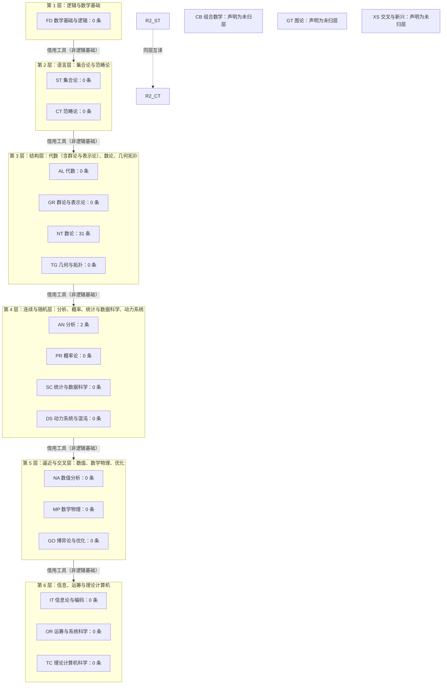
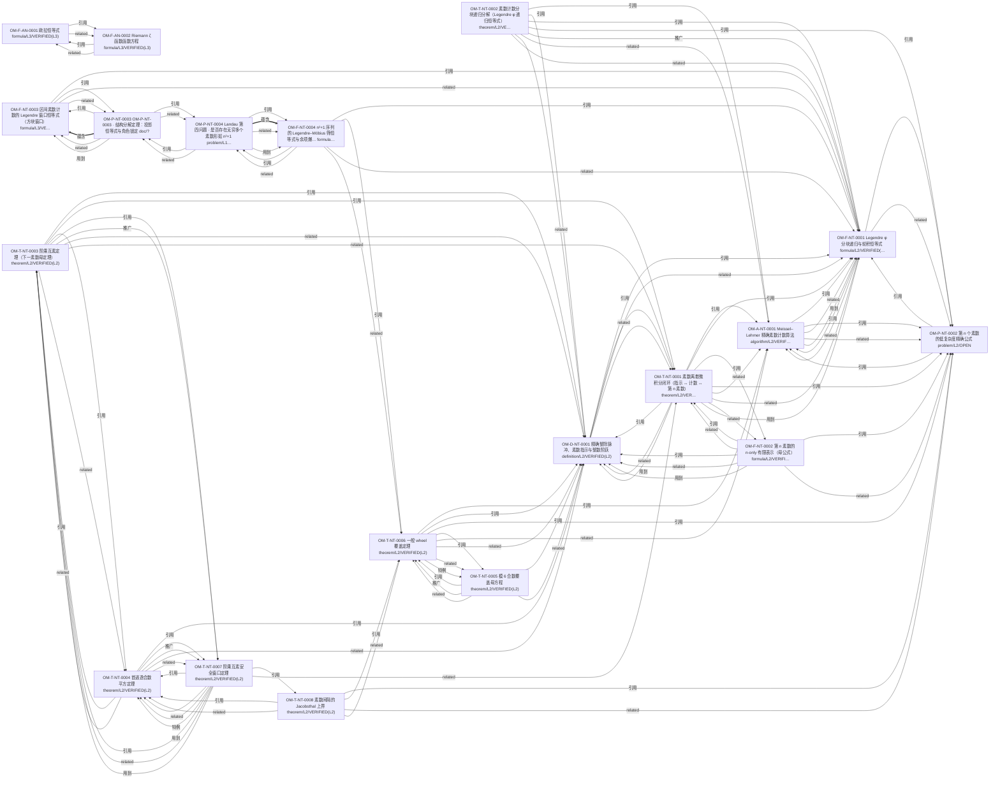
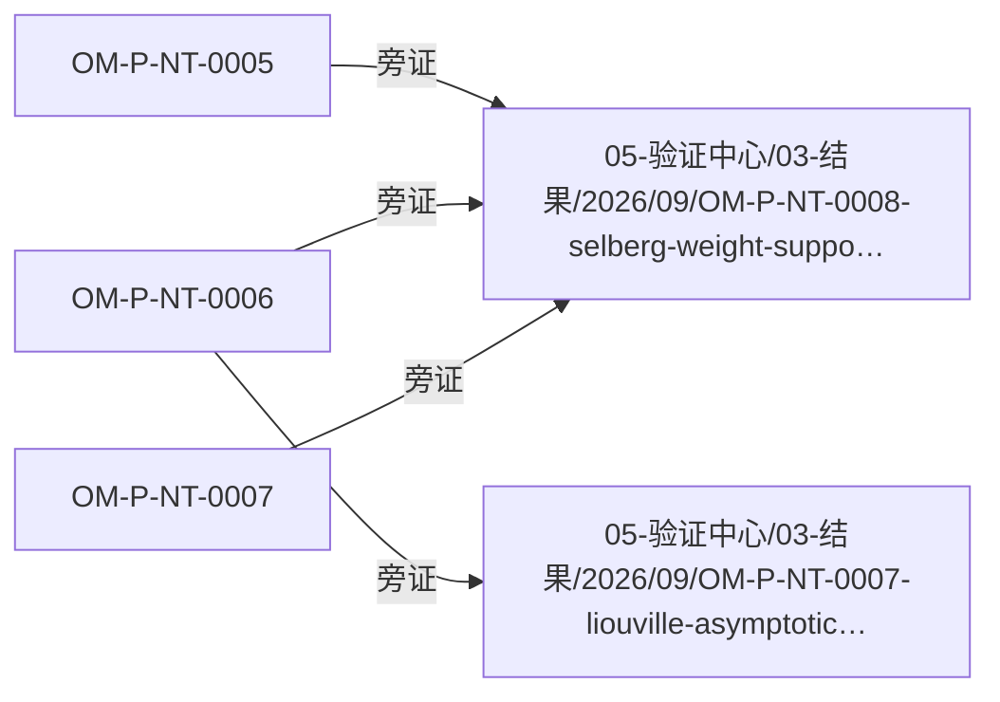

# 四层总览：理论体系 × 逻辑 × 方程 × 未解难题

> 本文件是**装配物**：正文散文手写，所有计数点名 `10-文献与索引/知识图谱/_版面/graph_face.txt`（下称「版面」，它是本轮唯一载体），节点与边逐字取自 `10-文献与索引/graph.json` 的图谱快照 `10-文献与索引/知识图谱/graph.json`，五张流程图按字节嵌自 `10-文献与索引/知识图谱/流程图/`。重跑 `python -m openmath graph` 会同时更新版面与图；文档若与版面不符，**以版面为准并改文档**。

## 〇、先说清楚：这一轮没有证明任何东西

「攻破没有攻破的难题」这一条，本轮**未达成**，而且不能靠写文档达成。盘面给的是一套可复核的现状：

- 台账里的难题状态只有 `OPEN`／`PARTIAL`／`PROPOSED` 这一类**声明**，没有任何一条被标成已证；版面判定见其末行 verdict（本轮 5 类 DEFECT/LEDGER-GAP 非空 → AMBIGUOUS_REFERENCE, DANGLING, ID_COLLISION_YAML_VS_MD, ID_MULTI_FILE, MD_ONLY_LEDGER）。
- 图谱能说的是「哪条关系不可遍历」，不能说的是「猜想成立」。§五把不可遍历的关系逐条点名，这就是「没攻破」的确切形状。
- 上一轮已判死的路线不在本文里复活：`03-难题与猜想/` 里带 `CANCELLATION` 的账本仍在图上（§四）。

## 一、四层是什么，以及图上真正住了多少东西

| 层 | 装什么 | 图上节点（版面 `00-四层总览`） |
| --- | --- | --- |
| 体系层 | 20 个数学域的目录与依赖分层 | 版面未列（该层没有任何节点） |
| 逻辑层 | 定义／符号／前提（`OM-D-*`） | 1 |
| 方程层 | 公式／定理／算法／反例（`OM-F-*` `OM-T-*` `OM-A-*` `OM-X-*`） | 15 |
| 难题层 | 猜想、问题、纲领与攻坚账本（`OM-P-*`、md 台账） | 27 |

层的节点数由版面印出；跨层的真实边共 46 条，折叠成 4 条层间边画在总览图上。
台账规模（版面）：机器可读记录 19 条、仅 md 的账本节点 24 份、验证文档 4 份、类型化边 168 条、YAML 解析失败 0 份。

```mermaid
flowchart TB
  subgraph SYS[体系层：2 个域有登记条目（共 20 域）]
    D_AN["AN 分析：2 条"]
    D_NT["NT 数论：31 条"]
  end
  subgraph L1[逻辑层：1 个节点]
    n1["OM-D-NT-0001 精确整除脉冲、素数指示与整数阶跃 definition/L2/VERIFIED(L2)"]
  end
  subgraph L2[方程层：15 个节点]
    n2["OM-A-NT-0001 Meissel–Lehmer 精确素数计数算法 algorithm/L2/VERIF…"]
    n3["OM-F-AN-0001 欧拉恒等式 formula/L3/VERIFIED(L3)"]
    n4["OM-F-AN-0002 Riemann ζ 函数函数方程 formula/L3/VERIFIED(L3)"]
    n5["OM-F-NT-0001 Legendre φ 分块递归与轮积恒等式 formula/L2/VERIFIED(…"]
    n6["OM-F-NT-0002 第 n 素数的 n-only 有限表示（母公式） formula/L2/VERIFI…"]
    n7["OM-F-NT-0003 区间素数计数的 Legendre 窗口恒等式（方块窗口） formula/L3/VE…"]
    n8["OM-F-NT-0004 n²+1 序列的 Legendre–Möbius 筛恒等式与余项爆… formula…"]
    n9["OM-T-NT-0001 素数离散微积分闭环（指示 ↔ 计数 ↔ 第 n 素数） theorem/L2/VER…"]
    n10["OM-T-NT-0002 素数计数分块递归分解（Legendre φ 递归恒等式） theorem/L2/VE…"]
    n11["OM-T-NT-0003 阶乘互素定理（下一素数母定理） theorem/L2/VERIFIED(L2)"]
    n12["OM-T-NT-0004 首逃逸合数平方定理 theorem/L2/VERIFIED(L2)"]
    n13["OM-T-NT-0005 模 6 合数覆盖母方程 theorem/L2/VERIFIED(L2)"]
    n14["OM-T-NT-0006 一般 wheel 覆盖定理 theorem/L2/VERIFIED(L2)"]
    n15["OM-T-NT-0007 阶乘互素安全窗口定理 theorem/L2/VERIFIED(L2)"]
    n16["OM-T-NT-0008 素数间隔的 Jacobsthal 上界 theorem/L2/VERIFIED(L2)"]
  end
  subgraph L3[难题层：27 个节点]
    n17["OM-BR-0001 OM-BR-0001 · 三重奏定理：线性斜对称动力学 ↔ Fre… doc/?"]
    n18["OM-P-NT-0001 OM-P-NT-0001 · 黎曼假设（Riemann Hypot… doc/OPEN"]
    n19["OM-P-NT-0002 第 n 个素数的低复杂度精确公式 problem/L2/OPEN"]
    n20["OM-P-NT-0003 Landau 第三问题 · Legendre 猜想（相邻平方数之间… problem…"]
    n20["OM-P-NT-0003 OM-P-NT-0003 · 强哥德巴赫猜想（Strong Bin… doc/PAR…"]
    n20["OM-P-NT-0003 PWCV 框架下强哥德巴赫猜想的结构分析 doc/?"]
    n20["OM-P-NT-0003 强哥德巴赫：Ramanujan 局部模型主项的审计与缺口定位 doc/?"]
    n20["OM-P-NT-0003 OM-P-NT-0003 前缀覆盖前沿、一般缺口引理与有限最优值证书 doc/?"]
    n20["OM-P-NT-0003 OM-P-NT-0003 反证法路线：反例的容斥等价形式与近反例穷… doc/?"]
    n20["OM-P-NT-0003 OM-P-NT-0003 · 合数模角色定位与 conductor… doc/?"]
    n20["OM-P-NT-0003 OM-P-NT-0003 引擎缺陷审计与修复：9 项真实缺陷、4 … doc/?"]
    n20["OM-P-NT-0003 强哥德巴赫猜想 — 未证问题清单（整理稿） doc/?"]
    n20["OM-P-NT-0003 OM-P-NT-0003 生成式（和集覆盖）路线裁定：能否'用素数… doc/?"]
    n20["OM-P-NT-0003 强哥德巴赫猜想 — 突破靶心清单（可判定里程碑） doc/?"]
    n20["OM-P-NT-0003 OM-P-NT-0003 素数侧生成式审计：素数把偶数填满（对偶视… doc/?"]
    n20["OM-P-NT-0003 OM-P-NT-0003 素数侧生成路线的闭合：reach 可证、… doc/?"]
    n20["OM-P-NT-0003 OM-P-NT-0003 · 结构分解定理：投影恒等式与角色锁定 doc/?"]
    n21["OM-P-NT-0003-CANCELLATION-20260920 继续攻坚：精确误差账本与双边迁移 doc…"]
    n22["OM-P-NT-0003-CONT-20260920 强哥德巴赫联盟续研：从相关和到双素数的误差预算 doc/…"]
    n23["OM-P-NT-0003-DIRECTIONS-20260920 多方向实验：精确卷积、相邻迁移、逐层筛损失 …"]
    n24["OM-P-NT-0003-JOINTSIEVE-20260922 联合筛证书：二阶/三阶 Bonferroni…"]
    n25["OM-P-NT-0003-JOINTSIEVE-PAPER-20260922 强哥德巴赫续研：二阶信息的精确反…"]
    n26["OM-P-NT-0003-JOINTSIEVE-VERIFY-20260922 联合筛证书：独立核验报告（20…"]
    n27["OM-P-NT-0003-KEY-BOUND-20260920 关键点攻坚：不引用真实分拆数的单侧误差上界 d…"]
    n28["OM-P-NT-0003-NEW-METHODS-20260920 新方法审计：求导、高阶容斥、频谱、矩与组合…"]
    n29["OM-P-NT-0003-REVIEW-20260922 强哥德巴赫：证明状态复核（2026-09-22） d…"]
    n30["OM-P-NT-0004 Landau 第四问题 · 是否存在无穷多个素数形如 n²+1 problem/L1…"]
  end
  L2 -.->|"折叠 16 条真实边"| L1
  L2 -.->|"折叠 16 条真实边"| L3
  L1 -.->|"折叠 4 条真实边"| L2
  L3 -.->|"折叠 10 条真实边"| L2
```

## 二、体系层：域的分层与它真正的空白

分层来自 `01-数学体系/域依赖.yaml`（机器可读版；原先只有一张手画 ASCII 图，那版图会静默漏掉整行域，现在由 `DOMAIN_UNPLACED` 裁决）。版面：声明分层 6 层、归域 17 / 20 个，显式声明未归层的域 CB, GT, XS。

**关键读数**：版面 `domains with >=1 node` ＝ 2 / 20。也就是说 20 个域里只有 2 个域在台账上有内容，其余 18 个域目前只是目录名。分层图描述的是**借用工具的频率**，不是逻辑基础，这一点写在 yaml 头部。

## 三、逻辑层与方程层：台账里真正写下来的东西

下表逐字来自 `10-文献与索引/知识图谱/graph.json`（状态／等级是记录自己的字段，不是本文的评价）。「入边」按图上的边现算。

| ID | 类型 | 域 | 状态 | 等级 | 标题 | 入边 | LaTeX（若有） |
| --- | --- | --- | --- | --- | --- | --- | --- |
| `OM-F-AN-0001` | formula | AN | VERIFIED(L3) | L3 | 欧拉恒等式 | 2 | $e^{i\pi} + 1 = 0$ |
| `OM-F-AN-0002` | formula | AN | VERIFIED(L3) | L3 | Riemann ζ 函数函数方程 | 3 | $\zeta(s) = 2^{s} \pi^{s-1} \sin\left(\frac{\pi s}{2}\right) $ |
| `OM-A-NT-0001` | algorithm | NT | VERIFIED(L2) | L2 | Meissel–Lehmer 精确素数计数算法 | 9 | $Meissel: pi(x) = phi(x,a) + a - 1 - sum_{i=a+1}^{b} (pi(floo$ |
| `OM-D-NT-0001` | definition | NT | VERIFIED(L2) | L2 | 精确整除脉冲、素数指示与整数阶跃 | 16 | $delta_d(N) = floor(N/d) - floor((N-1)/d) = 1_{d／N}; I_P(N) =$ |
| `OM-F-NT-0001` | formula | NT | VERIFIED(L2) | L2 | Legendre φ 分块递归与轮积恒等式 | 17 | $phi(x,a) = phi(x,a-1) - phi(floor(x/p_a), a-1), phi(x,0) = x$ |
| `OM-F-NT-0002` | formula | NT | VERIFIED(L2) | L2 | 第 n 素数的 n-only 有限表示（母公式） | 2 | $L_n=floor(n(log n+log log n-1))+1, U_n=ceil(n(log n+log log $ |
| `OM-F-NT-0003` | formula | NT | VERIFIED(L3) | L3 | 区间素数计数的 Legendre 窗口恒等式（方块窗口） | 4 | $c(n) := #{p prime : n^2 < p <= (n+1)^2} = pi((n+1)^2) - pi(n$ |
| `OM-F-NT-0004` | formula | NT | VERIFIED(L3) | L3 | n²+1 序列的 Legendre–Möbius 筛恒等式与余项爆炸度量 | 4 | $omega(p) = #{n mod p : p ／ n^2+1} = 1 (p=2), 2 (p = 1 mod 4)$ |
| `OM-P-NT-0002` | problem | NT | OPEN | L2 | 第 n 个素数的低复杂度精确公式 | 12 | $Q1: 是否存在 F:N->N，使 F(n)=p_n 且不把 p_1..p_{n-1} 作为输入？（已解决：存在，Wil$ |
| `OM-P-NT-0003` | problem | NT | PROPOSED | L1 | Landau 第三问题 · Legendre 猜想（相邻平方数之间必有素数） | 13 | $对一切正整数 n，存在素数 p 满足 n^2 < p < (n+1)^2； 等价地 c(n) := pi((n+1)^2$ |
| `OM-P-NT-0004` | problem | NT | PROPOSED | L1 | Landau 第四问题 · 是否存在无穷多个素数形如 n²+1 | 4 | $是否存在无穷多个正整数 n 使得 n^2 + 1 为素数？ 记 A(N) = #{n <= N : n^2+1 为素数}$ |
| `OM-T-NT-0001` | theorem | NT | VERIFIED(L2) | L2 | 素数离散微积分闭环（指示 ↔ 计数 ↔ 第 n 素数） | 7 | $Delta pi(N) = pi(N) - pi(N-1) = I_P(N); p_n = min{x>=2: pi(x$ |
| `OM-T-NT-0002` | theorem | NT | VERIFIED(L2) | L2 | 素数计数分块递归分解（Legendre φ 递归恒等式） | 0 | $phi(x,a)=phi(x,a-1)-phi(floor(x/p_a),a-1), phi(x,0)=x; pi(x)$ |
| `OM-T-NT-0003` | theorem | NT | VERIFIED(L2) | L2 | 阶乘互素定理（下一素数母定理） | 5 | $q = NextPrime(m) = min{ x>m : gcd(x, m!) = 1 }$ |
| `OM-T-NT-0004` | theorem | NT | VERIFIED(L2) | L2 | 首逃逸合数平方定理 | 8 | $min{ C>1 : C composite and gcd(C,m!)=1 } = [NextPrime(m)]^2$ |
| `OM-T-NT-0005` | theorem | NT | VERIFIED(L2) | L2 | 模 6 合数覆盖母方程 | 3 | $N=6k+epsilon>3, epsilon in {-1,+1}; N composite iff exists a$ |
| `OM-T-NT-0006` | theorem | NT | VERIFIED(L2) | L2 | 一般 wheel 覆盖定理 | 7 | $gcd(N,M)=1, N=Ma+r, M=b+s? no; N=(Ma+r)(Mb+s), k = Mab + a s$ |
| `OM-T-NT-0007` | theorem | NT | VERIFIED(L2) | L2 | 阶乘互素安全窗口定理 | 5 | $if m < x < [NextPrime(m)]^2 then gcd(x, m!) = 1  <=>  x is p$ |
| `OM-T-NT-0008` | theorem | NT | VERIFIED(L2) | L2 | 素数间隔的 Jacobsthal 上界 | 1 | $g_n = p_{n+1}-p_n  <=  j(p_n#), j(M) = min { L : 任意 L 个连续整数中$ |

读法：方程层（公式／定理／算法／反例）在图上有 15 个节点，逻辑层只有 1 个——**这是本轮最硬的结构性发现**：整套台账把力气花在数论的恒等式与攻坚轮次上，而没有把「用了哪些定义、哪些前提」写成可引用的记录，所以 §七 的 `UNDEFINED_SYMBOL` 才会是 37 枚（被引用却没有定义记录的符号名）。

## 四、难题层：攻坚线在图上的形状

难题层节点 27 个（含 md 账本 24 份）。md 账本没有 YAML 伴生，`openmath index` 看不见它们，因此图上单列一条边类型 `cites`（版面印 104 条）把它们接进来——其中大部分靠**文件名链接**（攻坚轮次之间就是这么互相指的，不写 OM-ID）。

| 难题／账本 | 状态 | 标题 | 出边目标数 |
| --- | --- | --- | --- |
| `OM-BR-0001` | — | OM-BR-0001 · 三重奏定理：线性斜对称动力学 ↔ Frenet 曲率不变量 | 0 |
| `OM-P-NT-0001` | OPEN | OM-P-NT-0001 · 黎曼假设（Riemann Hypothesis, RH） | 0 |
| `OM-P-NT-0003` | PARTIAL | OM-P-NT-0003 · 强哥德巴赫猜想（Strong Binary Goldbach Conjec | 6 |
| `OM-P-NT-0003` | — | PWCV 框架下强哥德巴赫猜想的结构分析 | 6 |
| `OM-P-NT-0003` | — | 强哥德巴赫：Ramanujan 局部模型主项的审计与缺口定位 | 6 |
| `OM-P-NT-0003` | — | OM-P-NT-0003 前缀覆盖前沿、一般缺口引理与有限最优值证书 | 6 |
| `OM-P-NT-0003` | — | OM-P-NT-0003 反证法路线：反例的容斥等价形式与近反例穷举扫描 | 6 |
| `OM-P-NT-0003` | — | OM-P-NT-0003 · 合数模角色定位与 conductor 重标定 | 6 |
| `OM-P-NT-0003` | — | OM-P-NT-0003 引擎缺陷审计与修复：9 项真实缺陷、4 项严重、渲染门禁归零 | 6 |
| `OM-P-NT-0003` | — | 强哥德巴赫猜想 — 未证问题清单（整理稿） | 6 |
| `OM-P-NT-0003` | — | OM-P-NT-0003 生成式（和集覆盖）路线裁定：能否"用素数填满所有偶数" | 6 |
| `OM-P-NT-0003` | — | 强哥德巴赫猜想 — 突破靶心清单（可判定里程碑） | 6 |
| `OM-P-NT-0003` | — | OM-P-NT-0003 素数侧生成式审计：素数把偶数填满（对偶视角） | 6 |
| `OM-P-NT-0003` | — | OM-P-NT-0003 素数侧生成路线的闭合：reach 可证、pairing 不可绕过 | 6 |
| `OM-P-NT-0003` | — | OM-P-NT-0003 · 结构分解定理：投影恒等式与角色锁定 | 6 |
| `OM-P-NT-0003-CANCELLATION-20260920` | DRAFT | 继续攻坚：精确误差账本与双边迁移 | 0 |
| `OM-P-NT-0003-CONT-20260920` | DRAFT | 强哥德巴赫联盟续研：从相关和到双素数的误差预算 | 0 |
| `OM-P-NT-0003-DIRECTIONS-20260920` | DRAFT | 多方向实验：精确卷积、相邻迁移、逐层筛损失 | 0 |
| `OM-P-NT-0003-JOINTSIEVE-20260922` | DRAFT | 联合筛证书：二阶/三阶 Bonferroni 下界与有限证书（2026-09-22） | 0 |
| `OM-P-NT-0003-JOINTSIEVE-PAPER-20260922` | DRAFT | 强哥德巴赫续研：二阶信息的精确反模型与三阶有限证书 | 0 |
| `OM-P-NT-0003-JOINTSIEVE-VERIFY-20260922` | DRAFT | 联合筛证书：独立核验报告（2026-09-22） | 0 |
| `OM-P-NT-0003-KEY-BOUND-20260920` | DRAFT | 关键点攻坚：不引用真实分拆数的单侧误差上界 | 0 |
| `OM-P-NT-0003-NEW-METHODS-20260920` | DRAFT | 新方法审计：求导、高阶容斥、频谱、矩与组合覆盖 | 0 |
| `OM-P-NT-0003-REVIEW-20260922` | DRAFT | 强哥德巴赫：证明状态复核（2026-09-22） | 0 |

```mermaid
flowchart TB
  n1["OM-BR-0001 OM-BR-0001 · 三重奏定理：线性斜对称动力学 ↔ Fre… doc/?"]
  n2["OM-P-NT-0001 OM-P-NT-0001 · 黎曼假设（Riemann Hypot… doc/OPEN"]
  n3["OM-P-NT-0002 第 n 个素数的低复杂度精确公式 problem/L2/OPEN"]
  n4["OM-P-NT-0003 Landau 第三问题 · Legendre 猜想（相邻平方数之间… problem…"]
  n4["OM-P-NT-0003 OM-P-NT-0003 · 强哥德巴赫猜想（Strong Bin… doc/PAR…"]
  n4["OM-P-NT-0003 PWCV 框架下强哥德巴赫猜想的结构分析 doc/?"]
  n4["OM-P-NT-0003 强哥德巴赫：Ramanujan 局部模型主项的审计与缺口定位 doc/?"]
  n4["OM-P-NT-0003 OM-P-NT-0003 前缀覆盖前沿、一般缺口引理与有限最优值证书 doc/?"]
  n4["OM-P-NT-0003 OM-P-NT-0003 反证法路线：反例的容斥等价形式与近反例穷… doc/?"]
  n4["OM-P-NT-0003 OM-P-NT-0003 · 合数模角色定位与 conductor… doc/?"]
  n4["OM-P-NT-0003 OM-P-NT-0003 引擎缺陷审计与修复：9 项真实缺陷、4 … doc/?"]
  n4["OM-P-NT-0003 强哥德巴赫猜想 — 未证问题清单（整理稿） doc/?"]
  n4["OM-P-NT-0003 OM-P-NT-0003 生成式（和集覆盖）路线裁定：能否'用素数… doc/?"]
  n4["OM-P-NT-0003 强哥德巴赫猜想 — 突破靶心清单（可判定里程碑） doc/?"]
  n4["OM-P-NT-0003 OM-P-NT-0003 素数侧生成式审计：素数把偶数填满（对偶视… doc/?"]
  n4["OM-P-NT-0003 OM-P-NT-0003 素数侧生成路线的闭合：reach 可证、… doc/?"]
  n4["OM-P-NT-0003 OM-P-NT-0003 · 结构分解定理：投影恒等式与角色锁定 doc/?"]
  n5["OM-P-NT-0003-CANCELLATION-20260920 继续攻坚：精确误差账本与双边迁移 doc…"]
  n6["OM-P-NT-0003-CONT-20260920 强哥德巴赫联盟续研：从相关和到双素数的误差预算 doc/…"]
  n7["OM-P-NT-0003-DIRECTIONS-20260920 多方向实验：精确卷积、相邻迁移、逐层筛损失 …"]
  n8["OM-P-NT-0003-JOINTSIEVE-20260922 联合筛证书：二阶/三阶 Bonferroni…"]
  n9["OM-P-NT-0003-JOINTSIEVE-PAPER-20260922 强哥德巴赫续研：二阶信息的精确反…"]
  n10["OM-P-NT-0003-JOINTSIEVE-VERIFY-20260922 联合筛证书：独立核验报告（20…"]
  n11["OM-P-NT-0003-KEY-BOUND-20260920 关键点攻坚：不引用真实分拆数的单侧误差上界 d…"]
  n12["OM-P-NT-0003-NEW-METHODS-20260920 新方法审计：求导、高阶容斥、频谱、矩与组合…"]
  n13["OM-P-NT-0003-REVIEW-20260922 强哥德巴赫：证明状态复核（2026-09-22） d…"]
  n14["OM-P-NT-0004 Landau 第四问题 · 是否存在无穷多个素数形如 n²+1 problem/L1…"]
  n15["卡点：OM-P-NT-0002 的关系只写在 equivalent_forms+implications 里，无法遍历"]
  n3 -.->|不可遍历| n15
  n16["卡点：OM-P-NT-0003 的关系只写在 equivalent_forms 里，无法遍历"]
  n4 -.->|不可遍历| n16
  n17["卡点：OM-P-NT-0004 的关系只写在 equivalent_forms 里，无法遍历"]
  n14 -.->|不可遍历| n17
  n18["悬空引用：OM-F-AN-0003（被引用但无载体）"]
  n19["03-难题与猜想/05-经典未解猜想/OM-P-NT-0003-goldbach-conjecture.md"]
  n19 -->|引用| n3
  n20["03-难题与猜想/05-经典未解猜想/OM-P-NT-0003-关键点_独立单侧误差界_20260920.md"]
  n20 -->|引用| n4
  n21["03-难题与猜想/05-经典未解猜想/OM-P-NT-0003-多方向实验_卷积迁移与筛损失_20260920…"]
  n21 -->|引用| n4
  n22["03-难题与猜想/05-经典未解猜想/OM-P-NT-0003-新方法审计_求导容斥频谱与矩_20260920…"]
  n22 -->|引用| n4
  n23["03-难题与猜想/05-经典未解猜想/OM-P-NT-0003-续攻_误差账本与双边迁移_20260920.md"]
  n23 -->|引用| n4
  n24["03-难题与猜想/05-经典未解猜想/OM-P-NT-0003-联合筛_二阶反模型与三阶证书_20260922…"]
  n24 -->|引用| n4
  n25["03-难题与猜想/05-经典未解猜想/OM-P-NT-0003-联合筛证书_二阶Bonferroni_2026…"]
  n25 -->|引用| n4
  n26["03-难题与猜想/05-经典未解猜想/OM-P-NT-0003-联合筛证书_独立核验报告_20260922.md"]
  n26 -->|引用| n4
  n27["03-难题与猜想/05-经典未解猜想/OM-P-NT-0003-联盟续研_误差预算与量词修复_20260920…"]
  n27 -->|引用| n4
  n28["03-难题与猜想/05-经典未解猜想/OM-P-NT-0003-证明状态复核_2026-09-22.md"]
  n28 -->|引用| n4
  n29["OM-A-NT-0001 Meissel–Lehmer 精确素数计数算法 algorithm/L2/VERIF…"]
  n29 -->|引用| n3
  n30["OM-F-AN-0002 Riemann ζ 函数函数方程 formula/L3/VERIFIED(L3)"]
  n30 -->|引用| n2
  n31["OM-F-NT-0001 Legendre φ 分块递归与轮积恒等式 formula/L2/VERIFIED(…"]
  n31 -->|引用| n3
  n32["OM-F-NT-0002 第 n 素数的 n-only 有限表示（母公式） formula/L2/VERIFI…"]
  n32 -->|引用| n3
  n33["OM-F-NT-0003 区间素数计数的 Legendre 窗口恒等式（方块窗口） formula/L3/VE…"]
  n33 -->|引用| n4
  n34["OM-F-NT-0004 n²+1 序列的 Legendre–Möbius 筛恒等式与余项爆… formula…"]
  n34 -->|引用| n14
  n3 -->|引用| n29
  n3 -->|引用| n31
  n4 -->|引用| n33
  n4 -->|引用| n14
  n4 ==>|蕴含| n33
  n4 -->|用到| n33
  n14 -->|引用| n34
  n14 -->|引用| n4
  n14 ==>|蕴含| n34
  n14 -->|用到| n34
  n35["OM-T-NT-0001 素数离散微积分闭环（指示 ↔ 计数 ↔ 第 n 素数） theorem/L2/VER…"]
  n35 -->|引用| n3
  n36["OM-T-NT-0002 素数计数分块递归分解（Legendre φ 递归恒等式） theorem/L2/VE…"]
  n36 -->|引用| n3
  n37["OM-T-NT-0006 一般 wheel 覆盖定理 theorem/L2/VERIFIED(L2)"]
  n37 -->|引用| n3
  n38["OM-T-NT-0008 素数间隔的 Jacobsthal 上界 theorem/L2/VERIFIED(L2)"]
  n38 -->|引用| n3
```

## 五、卡点：图上走不过去的地方（这才是「没攻破」的可复核形式）

版面给每类缺口配了严重度。DEFECT/LEDGER-GAP 非空的 5 类是**账本缺陷**，ADVISORY 是**内容缺口**；两类含义不同，本文不把它们混成一个「问题数」。

| 缺口类 | 严重度 | 枚数（版面） | 它到底拦住了什么 |
| --- | --- | --- | --- |
| `UNDEFINED_SYMBOL` | ADVISORY | 37 | 符号被使用却没有定义记录：逻辑层是空的 |
| `MD_ONLY_LEDGER` | LEDGER-GAP | 28 | 只有 md 没有 YAML 的账本：`openmath index` 检索不到，等于不在台账上 |
| `AMBIGUOUS_REFERENCE` | DEFECT | 13 | 同一个 ID 挂在两条不同主张上，指向它的边无法归属——两条主张有被静默合并成一条的风险 |
| `ORPHAN` | ADVISORY | 10 | 没有任何入边出边的节点：写了但没人引用，也没引用任何人 |
| `PROSE_RELATION_UNTRAVERSABLE` | ADVISORY | 6 | 关系只写在散文里，图上走不过去 |
| `DANGLING` | DEFECT | 1 | 被引用但从未铸出的 ID：引用是空的 |
| `ID_COLLISION_YAML_VS_MD` | DEFECT | 1 | 记录与 md 账本抢同一个 ID，谁才是正本未定 |
| `ID_MULTI_FILE` | LEDGER-GAP | 1 | 同一 ID 出现在多份 md 里，版本关系没人登记 |
| `BROKEN_DOC_LINK` | DEFECT | 0 | 文件名链接指向不存在的文件 |
| `DOMAIN_UNPLACED` | DEFECT | 0 | 域既没归层也没声明未归层 |
| `EVIDENCE_INVERSION` | DEFECT | 0 | 声称 L4/L5/L6 却拿不出「通过＋脚本在场」两条证据 |
| `LOAD_ERROR` | DEFECT | 0 | YAML 解析失败 |
| `TERM_INCONSISTENCY` | ADVISORY | 0 | 同一概念多种写法 |

三条必须由读者自己承担的结论：

1. **桥接层为空。** 版面 `04-桥接与旁证`：桥接文档 0 份、桥接边 0 条。也就是说 `04-数学统一场论/` 与公式／难题台账之间**当前没有任何可遍历的关系**；「统一」现在是一个目录名，不是一条能被图走到的论证链。这是本轮唯一无法用排版解释的空白。
2. **正本未定。** 版面 `ID_COLLISION_YAML_VS_MD`＝1 枚、`AMBIGUOUS_REFERENCE`＝13 枚：同一个号段同时挂着两条主张，于是 13 条边的归属不可判。改号是编号主人的决定（牵动几十处引用），图只负责把这些边逐条点名，不替谁裁决。
3. **悬空引用。** `DANGLING`＝1 枚：有一条被引用的恒等式从未铸出记录，任何以它为前提的推导都落在空处。

## 六、这台仪器凭什么可信

每类判据都被一个**指名变异体**打破过；判据是「相对基线增长」而不是「非空」——基线本身就红的类（`DOMAIN_UNPLACED`／`ORPHAN`／`UNDEFINED_SYMBOL`）投不投变异都红，拿「非空」当牙等于恒绿。本轮 9 枚变异体全部被抓住（9 caught / 0 not caught），运行日志按盘面落库：`10-文献与索引/知识图谱/_版面/graph_mutants_face.txt`，复现命令 `python 08-工具/tests/graph_mutants.py`（夹具树只写在系统临时目录，绝不碰真语料）。

同一份版面还印出不变量故障数：`python -m openmath graph --check` 不写盘只判，本轮 rc=1（DEFECT 类非空即红）。`python -m openmath graph` 的 rc=0 **只说明生成物完好**，不说明语料干净——这一点仪器自己会在末行声明。

## 七、怎么用这张图（引用纪律）

- 任何计数：点名 `10-文献与索引/知识图谱/_版面/graph_face.txt`，并写「当时读数」（版面每次重跑都会移动）。
- 任何 ID／标题／状态：点名 `10-文献与索引/知识图谱/graph.json`，或直接把记录本身引上。
- 任何关系是否存在：先看 `交叉引用索引/引用图.md` 的「可遍历」列；「否」就是散文关系，不许当已建立的关系引用。
- 外部仓库的主张（`10-文献与索引/外部仓库/`）永远是 `PROPOSED`，不许写成「已证明」，也不进 `02-公式库`／`03-难题与猜想` 当正本。

## 八、下一轮要还的债（按版面枚数排序，不自编优先级）

1. `MD_ONLY_LEDGER` 28 份：把攻坚账本逐份升成 YAML＋md 成对记录，或明确登记为「只读史料」。
2. `UNDEFINED_SYMBOL` 37 枚：补 `OM-D-*` 定义记录，逻辑层才不再是空的。
3. 桥接 0 条：给 `04-数学统一场论/` 的每一条「统一」主张配上 `OM-BR-*` 记录与两端 ID，否则该层不进图。
4. `PROSE_RELATION_UNTRAVERSABLE` 6 枚：把散文里的关系改写成记录的字段（`related`／`implications`／`equivalent_forms`）。
5. 撞号与悬空各 1 / 1 枚：由编号主人裁决改号方向，仪器继续点名。

---

*装配方式*：本文由 `python -m openmath graph` 之后单独装配；文档不参与扫描集（只扫 `OM-*.yaml` 与 `OM-*.md`），所以本文的行数不会移动版面上的任何读数。
