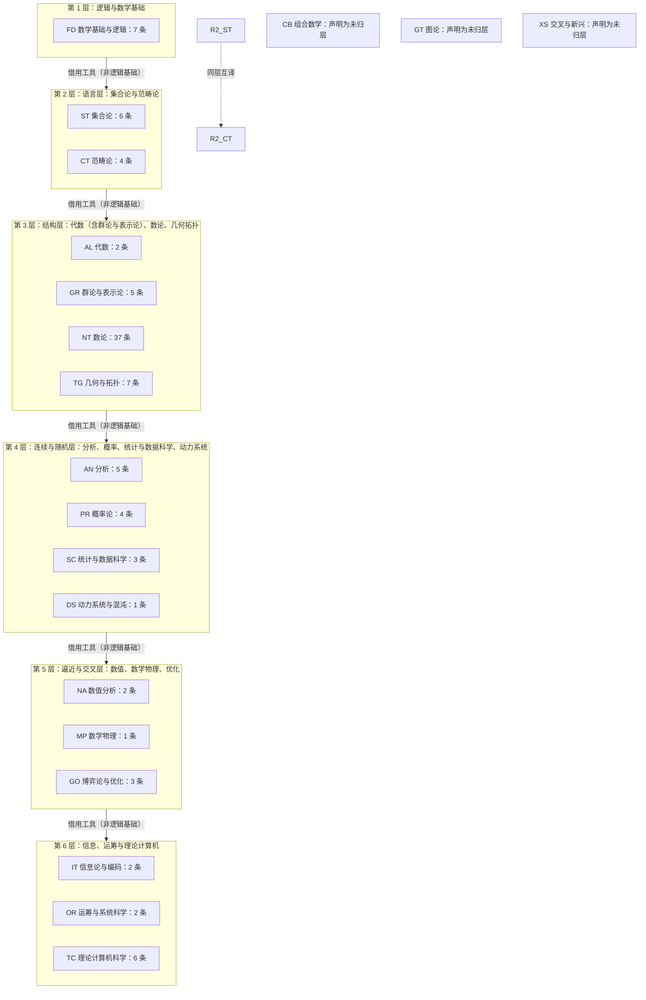
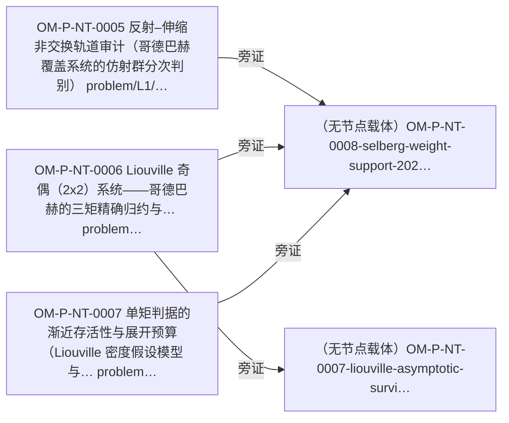

# 四层总览：理论体系 × 逻辑 × 方程 × 未解难题

> 本文件是**装配物**：正文散文手写，所有计数点名 `10-文献与索引/知识图谱/_版面/graph_face.txt`（下称「版面」，它是本轮唯一载体），节点与边逐字取自 `10-文献与索引/graph.json` 的图谱快照 `10-文献与索引/知识图谱/graph.json`，五张流程图按字节嵌自 `10-文献与索引/知识图谱/流程图/`。重跑 `python -m openmath graph` 会同时更新版面与图；文档若与版面不符，**以版面为准并改文档**。

## 〇、先说清楚：这一轮没有证明任何东西

「攻破没有攻破的难题」这一条，本轮**未达成**，而且不能靠写文档达成。盘面给的是一套可复核的现状：

- 台账里的难题状态只有 `OPEN`／`PARTIAL`／`PROPOSED` 这一类**声明**，没有任何一条被标成已证；版面判定见其末行 verdict（本轮 3 类 DEFECT/LEDGER-GAP 非空 → EDGE_ENDPOINT_OFF_GRAPH, ID_MULTI_FILE, MD_ONLY_LEDGER）。
- 图谱能说的是「哪条关系不可遍历」，不能说的是「猜想成立」。§五把不可遍历的关系逐条点名，这就是「没攻破」的确切形状。
- 上一轮已判死的路线不在本文里复活：`03-难题与猜想/` 里带 `CANCELLATION` 的账本仍在图上（§四）。

## 一、四层是什么，以及图上真正住了多少东西

| 层 | 装什么 | 图上节点（版面 `00-四层总览`） |
| --- | --- | --- |
| 体系层 | 20 个数学域的目录与依赖分层 | 版面未列（该层没有任何节点） |
| 逻辑层 | 定义／符号／前提（`OM-D-*`） | 29 |
| 方程层 | 公式／定理／算法／反例（`OM-F-*` `OM-T-*` `OM-A-*` `OM-X-*`） | 44 |
| 难题层 | 猜想、问题、纲领与攻坚账本（`OM-P-*`、md 台账） | 37 |

层的节点数由版面印出；跨层的真实边共 279 条，折叠成 6 条层间边画在总览图上。（两轮之间的涨幅见上一批条目，本句不重复历史数；修**键**那一步讲的是机制——上一版按 `id or path` 建节点键，23 份 md 账本里有 13 份共用同一个号段 ID，于是部分面孔在图上无处落脚，指向它们文件路径的边被渲染器 `continue` 掉；键修好之后版面 `nodes / unique keys` 印 110 / 110。48→160 这一步涨的是**内容**：第 1／2／2b／3 批把「哪条定理用到哪条定义」逐条写进记录，跨层的边于是真的存在了，而不是我把它画出来。三处读数都点名版面。）
台账规模（版面）：机器可读记录 87 条、仅 md 的账本节点 23 份、验证文档 4 份、类型化边 589 条、YAML 解析失败 0 份。
边的两端能不能落到节点上，版面 `---- endpoint resolution ----` 现印：两端都在图内 585 / 589，一端无载体 4 条，两端无载体 0 条，两端并成同一个键 0 条。（口径核对：本脚本把这三格相加与版面 `typed edges` 比过一次，585＋4＋0＝589。）缺载体的那一层再按型分账：版面 `off-graph ends by class` 那一行分账现印 4 个端点：`evidence-path` 4。型名单由版面那一行现推（本轮 `evidence-path`），不是我把类别名打进句子；`ambiguous-id` 型必须等于版面 `AMBIGUOUS_REFERENCE` 的枚数（闸门里的版面内断言），所以「换了驱动的那一格」与「总数」不可能各说各话。上一批分账里的 `no-carrier` 4 枚本轮铸出记录主人后归零（版面 `no-carrier` 型 0 枚），于是那 4 根**两头都悬**的线变成 4 根**一头落在台账节点上、一头停在结果档文件路径**的线；剩下的 4 枚全在证据档一型里，那是章程的裁定对象而不是补铸能收的账（§五 第 4 条）。

```mermaid
flowchart TB
  subgraph SYS[体系层：19 个域有登记条目（共 20 域）]
    D_AL["AL 代数：2 条"]
    D_AN["AN 分析：5 条"]
    D_CB["CB 组合数学：2 条"]
    D_CT["CT 范畴论：4 条"]
    D_DS["DS 动力系统与混沌：1 条"]
    D_FD["FD 数学基础与逻辑：7 条"]
    D_GO["GO 博弈论与优化：3 条"]
    D_GR["GR 群论与表示论：5 条"]
    D_GT["GT 图论：1 条"]
    D_IT["IT 信息论与编码：2 条"]
    D_MP["MP 数学物理：1 条"]
    D_NA["NA 数值分析：2 条"]
    D_NT["NT 数论：37 条"]
    D_OR["OR 运筹与系统科学：2 条"]
    D_PR["PR 概率论：4 条"]
    D_SC["SC 统计与数据科学：3 条"]
    D_ST["ST 集合论：6 条"]
    D_TC["TC 理论计算机科学：6 条"]
    D_TG["TG 几何与拓扑：7 条"]
  end
  subgraph L1[逻辑层：29 个节点]
    n1["OM-D-AL-0001 同态、核、像与商 definition/L1/PROPOSED"]
    n2["OM-D-AN-0001 指数、圆周率与 zeta/Gamma 的记号 definition/L1/PROPO…"]
    n3["OM-D-CT-0001 范畴、函子与自然变换 definition/L1/PROPOSED"]
    n4["OM-D-CT-0002 笛卡尔闭范畴与指数对象 definition/L1/PROPOSED"]
    n5["OM-D-FD-0001 朴素概括原则 definition/L1/PROPOSED"]
    n6["OM-D-FD-0002 形式语言、证明关系与一致性陈述 definition/L1/PROPOSED"]
    n7["OM-D-FD-0003 罗素类与有穷数学的记号 definition/L1/PROPOSED"]
    n8["OM-D-GO-0001 博弈、策略、效用与混合策略单纯形 definition/L1/PROPOSED"]
    n9["OM-D-GR-0001 群作用、轨道与稳定子 definition/L1/PROPOSED"]
    n10["OM-D-GR-0002 有限群的阶与 p-子群计数 definition/L1/PROPOSED"]
    n11["OM-D-GR-0003 复表示与字符 definition/L1/PROPOSED"]
    n12["OM-D-GT-0001 完全图、边着色与 Ramsey 数 definition/L1/PROPOSED"]
    n13["OM-D-IT-0001 离散无记忆信道、互信息与容量 definition/L1/PROPOSED"]
    n14["OM-D-NA-0001 区间求积的记号：端点 lo/hi、节点 xi 与它们的仿射来源 definition…"]
    n15["OM-D-NT-0001 精确整除脉冲、素数指示与整数阶跃 definition/L2/VERIFIED(L2)"]
    n16["OM-D-NT-0002 素数计数与 Legendre 分块的记号 definition/L1/PROPOSED"]
    n17["OM-D-NT-0003 筛、轮与相邻素数算子的记号 definition/L1/PROPOSED"]
    n18["OM-D-OR-0001 M/M/1 的记号：到达率 lambda_a、服务率 mu、平稳概… definit…"]
    n19["OM-D-PR-0001 概率空间与随机变量 definition/L1/PROPOSED"]
    n20["OM-D-PR-0002 正态律与标准化记号 definition/L1/PROPOSED"]
    n21["OM-D-SC-0001 统计推断与指数族的记号：得分函数、Fisher 信息与自然参数 definition…"]
    n22["OM-D-ST-0001 选择公理 definition/L1/PROPOSED"]
    n23["OM-D-ST-0002 可数性与两个 aleph 基数 definition/L1/PROPOSED"]
    n24["OM-D-ST-0003 二元关系、良序与选择函数 definition/L1/PROPOSED"]
    n25["OM-D-TC-0001 NP 完全性（多项式时间归约下的完全类） definition/L1/PROPOSED"]
    n26["OM-D-TC-0002 复杂性类 P、NP 与 SAT definition/L1/PROPOSED"]
    n27["OM-D-TG-0001 拓扑空间、连续映射与同胚 definition/L1/PROPOSED"]
    n28["OM-D-TG-0002 紧凸集与上半连续的集值映射 definition/L1/PROPOSED"]
    n29["OM-D-TG-0003 刚体运动、等分等价与球面记号 definition/L1/PROPOSED"]
  end
  subgraph L2[方程层：44 个节点]
    n30["OM-A-NT-0001 Meissel–Lehmer 精确素数计数算法 algorithm/L2/VERIF…"]
    n31["OM-F-AN-0001 欧拉恒等式 formula/L3/VERIFIED(L3)"]
    n32["OM-F-AN-0002 Riemann ζ 函数函数方程 formula/L3/VERIFIED(L3)"]
    n33["OM-F-AN-0003 欧拉公式（一般形式）· 复指数把加法折成旋转 formula/L3/VERIFIED…"]
    n34["OM-F-AN-0004 狄利克雷 L-函数函数方程 formula/L2/VERIFIED(L2)"]
    n35["OM-F-NA-0001 三点 Gauss–Legendre 求积在任意区间上对不超过 5 … formula…"]
    n36["OM-F-NT-0001 Legendre φ 分块递归与轮积恒等式 formula/L2/VERIFIED(…"]
    n37["OM-F-NT-0002 第 n 素数的 n-only 有限表示（母公式） formula/L2/VERIFI…"]
    n38["OM-F-NT-0003 区间素数计数的 Legendre 窗口恒等式（方块窗口） formula/L3/VE…"]
    n39["OM-F-NT-0004 n²+1 序列的 Legendre–Möbius 筛恒等式与余项爆… formula…"]
    n40["OM-T-AL-0001 第一同构定理 theorem/L1/PROPOSED"]
    n41["OM-T-CB-0001 Ramsey 定理（有限形式） theorem/L1/PROPOSED"]
    n42["OM-T-CB-0002 Sperner 引理 theorem/L1/PROPOSED"]
    n43["OM-T-CT-0001 米田引理 theorem/L1/PROPOSED"]
    n44["OM-T-CT-0002 Lawvere 对角不动点定理 theorem/L1/PROPOSED"]
    n45["OM-T-DS-0001 Poincare 回归定理 theorem/L1/PROPOSED"]
    n46["OM-T-FD-0001 哥德尔第一不完备定理 theorem/L1/PROPOSED"]
    n47["OM-T-FD-0002 哥德尔第二不完备定理 theorem/L1/PROPOSED"]
    n48["OM-T-GO-0001 von Neumann 极小极大定理 theorem/L1/PROPOSED"]
    n49["OM-T-GO-0002 Nash 均衡存在性定理 theorem/L1/PROPOSED"]
    n50["OM-T-GR-0001 西罗定理 theorem/L1/PROPOSED"]
    n51["OM-T-GR-0002 不可约字符的正交关系 theorem/L1/PROPOSED"]
    n52["OM-T-IT-0001 Shannon 有噪信道编码定理 theorem/L1/PROPOSED"]
    n53["OM-T-MP-0001 一维盒的热核迹＝绕数轨道和：θ 模变换读成一条迹公式，前导项是盒的… theorem…"]
    n54["OM-T-NT-0001 素数离散微积分闭环（指示 ↔ 计数 ↔ 第 n 素数） theorem/L2/VER…"]
    n55["OM-T-NT-0002 素数计数分块递归分解（Legendre φ 递归恒等式） theorem/L2/VE…"]
    n56["OM-T-NT-0003 阶乘互素定理（下一素数母定理） theorem/L2/VERIFIED(L2)"]
    n57["OM-T-NT-0004 首逃逸合数平方定理 theorem/L2/VERIFIED(L2)"]
    n58["OM-T-NT-0005 模 6 合数覆盖母方程 theorem/L2/VERIFIED(L2)"]
    n59["OM-T-NT-0006 一般 wheel 覆盖定理 theorem/L2/VERIFIED(L2)"]
    n60["OM-T-NT-0007 阶乘互素安全窗口定理 theorem/L2/VERIFIED(L2)"]
    n61["OM-T-NT-0008 素数间隔的 Jacobsthal 上界 theorem/L2/VERIFIED(L2)"]
    n62["OM-T-OR-0001 M/M/1 的几何平稳量与 Little 律闭合形式：十枚代数通道… theorem…"]
    n63["OM-T-PR-0001 Kolmogorov 强大数律 theorem/L1/PROPOSED"]
    n64["OM-T-PR-0002 中心极限定理 theorem/L1/PROPOSED"]
    n65["OM-T-SC-0001 Cramér–Rao 不等式：Fisher 信息、等号条件与三个可… theorem…"]
    n66["OM-T-SC-0002 Fisher 信息的可加性：独立观测把信息相加，自然指数族把它读成… theorem…"]
    n67["OM-T-ST-0001 良序定理 theorem/L1/PROPOSED"]
    n68["OM-T-TC-0001 停机问题不可判定 theorem/L1/PROPOSED"]
    n69["OM-T-TC-0002 Cook-Levin 定理（SAT 是 NP 完全） theorem/L1/PROP…"]
    n70["OM-T-TG-0001 Brouwer 不动点定理 theorem/L1/PROPOSED"]
    n71["OM-T-TG-0002 Banach-Tarski 分球定理 theorem/L1/PROPOSED"]
    n72["OM-T-TG-0003 角谷不动点定理 theorem/L1/PROPOSED"]
    n73["OM-X-FD-0001 罗素悖论（朴素概括原则的反例） counterexample/L1/PROPOSED"]
  end
  subgraph L3[难题层：37 个节点]
    n74["OM-P-NT-0001 OM-P-NT-0001 · 黎曼假设（Riemann Hypot… doc/OPEN"]
    n75["OM-P-NT-0003 PWCV 框架下强哥德巴赫猜想的结构分析 doc/?"]
    n76["OM-P-NT-0003 强哥德巴赫：Ramanujan 局部模型主项的审计与缺口定位 doc/?"]
    n77["OM-P-NT-0003-KEY-BOUND-20260920 关键点攻坚：不引用真实分拆数的单侧误差上界 d…"]
    n78["OM-P-NT-0003 OM-P-NT-0003 前缀覆盖前沿、一般缺口引理与有限最优值证书 doc/?"]
    n79["OM-P-NT-0003 OM-P-NT-0003 反证法路线：反例的容斥等价形式与近反例穷… doc/?"]
    n80["OM-P-NT-0003 OM-P-NT-0003 · 合数模角色定位与 conductor… doc/?"]
    n81["OM-P-NT-0003-DIRECTIONS-20260920 多方向实验：精确卷积、相邻迁移、逐层筛损失 …"]
    n82["OM-P-NT-0003 OM-P-NT-0003 引擎缺陷审计与修复：9 项真实缺陷、4 … doc/?"]
    n83["OM-P-NT-0003-NEW-METHODS-20260920 新方法审计：求导、高阶容斥、频谱、矩与组合…"]
    n84["OM-P-NT-0003 强哥德巴赫猜想 — 未证问题清单（整理稿） doc/?"]
    n85["OM-P-NT-0003 OM-P-NT-0003 生成式（和集覆盖）路线裁定：能否'用素数… doc/?"]
    n86["OM-P-NT-0003 强哥德巴赫猜想 — 突破靶心清单（可判定里程碑） doc/?"]
    n87["OM-P-NT-0003 OM-P-NT-0003 素数侧生成式审计：素数把偶数填满（对偶视… doc/?"]
    n88["OM-P-NT-0003 OM-P-NT-0003 素数侧生成路线的闭合：reach 可证、… doc/?"]
    n89["OM-P-NT-0003 OM-P-NT-0003 · 结构分解定理：投影恒等式与角色锁定 doc/?"]
    n90["OM-P-NT-0003-CANCELLATION-20260920 继续攻坚：精确误差账本与双边迁移 doc…"]
    n91["OM-P-NT-0003-JOINTSIEVE-PAPER-20260922 强哥德巴赫续研：二阶信息的精确反…"]
    n92["OM-P-NT-0003-JOINTSIEVE-20260922 联合筛证书：二阶/三阶 Bonferroni…"]
    n93["OM-P-NT-0003-JOINTSIEVE-VERIFY-20260922 联合筛证书：独立核验报告（20…"]
    n94["OM-P-NT-0003-CONT-20260920 强哥德巴赫联盟续研：从相关和到双素数的误差预算 doc/…"]
    n95["OM-P-NT-0003-REVIEW-20260922 强哥德巴赫：证明状态复核（2026-09-22） d…"]
    n96["OM-BR-0001 OM-BR-0001 · 三重奏定理：线性斜对称动力学 ↔ Fre… doc/?"]
    n97["OM-C-ST-0001 连续统假设 CH conjecture/L1/PROPOSED"]
    n98["OM-C-ST-0002 否定连续统假设 ¬CH conjecture/L1/PROPOSED"]
    n99["OM-C-TG-0001 朴素可测性公设（体积在刚体运动下不变且定义于所有有界集） conjecture/L1…"]
    n100["OM-P-FD-0001 希尔伯特纲领（有穷一致性证明） problem/L1/PROPOSED"]
    n101["OM-P-NT-0002 第 n 个素数的低复杂度精确公式 problem/L2/OPEN"]
    n102["OM-P-NT-0003 强哥德巴赫猜想（每个偶数可表为两素数之和） problem/L1/PARTIAL"]
    n103["OM-P-NT-0004 Landau 第四问题 · 是否存在无穷多个素数形如 n²+1 problem/L1…"]
    n104["OM-P-NT-0005 反射–伸缩非交换轨道审计（哥德巴赫覆盖系统的仿射群分次判别） problem/L1/…"]
    n105["OM-P-NT-0006 Liouville 奇偶（2x2）系统——哥德巴赫的三矩精确归约与… problem…"]
    n106["OM-P-NT-0007 单矩判据的渐近存活性与展开预算（Liouville 密度假设模型与… problem…"]
    n107["OM-P-NT-0009 Landau 第三问题 · Legendre 猜想（相邻平方数之间… problem…"]
    n108["OM-P-NT-0010 Andrica 猜想（相邻素数平方根之差恒小于 1）· 平方根尺度… problem…"]
    n109["OM-P-TC-0001 判定问题（Entscheidungsproblem） problem/L1/PROP…"]
    n110["OM-P-TC-0002 P 与 NP 是否相等 problem/L1/PROPOSED"]
  end
  L2 -.->|"折叠 88 条真实边"| L1
  L2 -.->|"折叠 29 条真实边"| L3
  L1 -.->|"折叠 97 条真实边"| L2
  L1 -.->|"折叠 15 条真实边"| L3
  L3 -.->|"折叠 29 条真实边"| L2
  L3 -.->|"折叠 21 条真实边"| L1
```



## 二、体系层：域的分层与它真正的空白

分层来自 `01-数学体系/域依赖.yaml`（机器可读版；原先只有一张手画 ASCII 图，那版图会静默漏掉整行域，现在由 `DOMAIN_UNPLACED` 裁决）。版面：声明分层 6 层、归域 17 / 20 个，显式声明未归层的域 CB, GT, XS。

**关键读数**：版面 `domains with >=1 node` ＝ 19 / 20。也就是说 20 个域里 19 个域在台账上有内容（`AL`×2、`AN`×5、`CB`×2、`CT`×4、`DS`×1、`FD`×7、`GO`×3、`GR`×5、`GT`×1、`IT`×2、`MP`×1、`NA`×2、`NT`×24、`OR`×2、`PR`×4、`SC`×3、`ST`×6、`TC`×6、`TG`×7），其余 1 个域目前只是目录名：`XS`（交叉与新兴）。上一版这一格是 2 / 20（只有 `NT` 与 `AN`）。口径分两把尺子：本行的 `×N` 只数**记录节点**（`graph.json` 里 `node_type=record`），而下面的分层图每格「× 条」数的是该域**全部节点**（记录＋仅 md 的账本）——例如 `NT` 记录 24 条、图上 37 个节点，差的 13 个是攻坚账本；全库仅 md 的账本节点本轮 23 个。引用「某域多少条」必须点名是哪一把尺子。分层图描述的是**借用工具的频率**，不是逻辑基础，这一点写在 yaml 头部。



## 三、逻辑层与方程层：台账里真正写下来的东西

下表逐字来自 `10-文献与索引/知识图谱/graph.json`（状态／等级是记录自己的字段，不是本文的评价）。「入边」按图上的边现算。

| ID | 类型 | 域 | 状态 | 等级 | 标题 | 入边 | LaTeX（若有） |
| --- | --- | --- | --- | --- | --- | --- | --- |
| `OM-F-AN-0001` | formula | AN | VERIFIED(L3) | L3 | 欧拉恒等式 | 2 | $e^{i\pi} + 1 = 0$ |
| `OM-F-AN-0002` | formula | AN | VERIFIED(L3) | L3 | Riemann ζ 函数函数方程 | 3 | $\zeta(s) = 2^{s} \pi^{s-1} \sin\left(\frac{\pi s}{2}\right) $ |
| `OM-A-NT-0001` | algorithm | NT | VERIFIED(L2) | L2 | Meissel–Lehmer 精确素数计数算法 | 9 | $Meissel: pi(x) = phi(x,a) + a - 1 - sum_{i=a+1}^{b} (pi(floo$ |
| `OM-D-NT-0001` | definition | NT | VERIFIED(L2) | L2 | 精确整除脉冲、素数指示与整数阶跃 | 16 | $delta_d(N) = floor(N/d) - floor((N-1)/d) = 1_{d／N}; I_P(N) =$ |
| `OM-F-NT-0001` | formula | NT | VERIFIED(L2) | L2 | Legendre φ 分块递归与轮积恒等式 | 17 | $phi(x,a) = phi(x,a-1) - phi(floor(x/p_a), a-1), phi(x,0) = x$ |
| `OM-F-NT-0002` | formula | NT | VERIFIED(L2) | L2 | 第 n 素数的 n-only 有限表示（母公式） | 2 | $L_n=floor(n(log n+log log n-1))+1, U_n=ceil(n(log n+log log $ |
| `OM-F-NT-0003` | formula | NT | VERIFIED(L3) | L3 | 区间素数计数的 Legendre 窗口恒等式（方块窗口） | 4 | $c(n) := #{p prime : n^2 < p <= (n+1)^2} = pi((n+1)^2) - pi(n$ |
| `OM-F-NT-0004` | formula | NT | VERIFIED(L3) | L3 | n²+1 序列的 Legendre–Möbius 筛恒等式与余项爆炸度量 | 4 | $omega(p) = #{n mod p : p ／ n^2+1} = 1 (p=2), 2 (p = 1 mod 4)$ |
| `OM-P-NT-0002` | problem | NT | OPEN | L2 | 第 n 个素数的低复杂度精确公式 | 12 | $Q1: 是否存在 F:N->N，使 F(n)=p_n 且不把 p_1..p_{n-1} 作为输入？（已解决：存在，Wil$ |
| `OM-P-NT-0009` | problem | NT | PROPOSED | L1 | Landau 第三问题 · Legendre 猜想（相邻平方数之间必有素数） | 13 | $对一切正整数 n，存在素数 p 满足 n^2 < p < (n+1)^2； 等价地 c(n) := pi((n+1)^2$ |
| `OM-P-NT-0004` | problem | NT | PROPOSED | L1 | Landau 第四问题 · 是否存在无穷多个素数形如 n²+1 | 4 | $是否存在无穷多个正整数 n 使得 n^2 + 1 为素数？ 记 A(N) = #{n <= N : n^2+1 为素数}$ |
| `OM-T-NT-0001` | theorem | NT | VERIFIED(L2) | L2 | 素数离散微积分闭环（指示 ↔ 计数 ↔ 第 n 素数） | 7 | $Delta pi(N) = pi(N) - pi(N-1) = I_P(N); p_n = min{x>=2: pi(x$ |
| `OM-T-NT-0002` | theorem | NT | VERIFIED(L2) | L2 | 素数计数分块递归分解（Legendre φ 递归恒等式） | 0 | $phi(x,a)=phi(x,a-1)-phi(floor(x/p_a),a-1), phi(x,0)=x; pi(x)$ |
| `OM-T-NT-0003` | theorem | NT | VERIFIED(L2) | L2 | 阶乘互素定理（下一素数母定理） | 5 | $q = NextPrime(m) = min{ x>m : gcd(x, m!) = 1 }$ |
| `OM-T-NT-0004` | theorem | NT | VERIFIED(L2) | L2 | 首逃逸合数平方定理 | 8 | $min{ C>1 : C composite and gcd(C,m!)=1 } = [NextPrime(m)]^2$ |
| `OM-T-NT-0005` | theorem | NT | VERIFIED(L2) | L2 | 模 6 合数覆盖母方程 | 3 | $N=6k+epsilon>3, epsilon in {-1,+1}; N composite iff exists a$ |
| `OM-T-NT-0006` | theorem | NT | VERIFIED(L2) | L2 | 一般 wheel 覆盖定理 | 7 | $gcd(N,M)=1, N=Ma+r, M=b+s? no; N=(Ma+r)(Mb+s), k = Mab + a s$ |
| `OM-T-NT-0007` | theorem | NT | VERIFIED(L2) | L2 | 阶乘互素安全窗口定理 | 5 | $if m < x < [NextPrime(m)]^2 then gcd(x, m!) = 1  <=>  x is p$ |
| `OM-T-NT-0008` | theorem | NT | VERIFIED(L2) | L2 | 素数间隔的 Jacobsthal 上界 | 1 | $g_n = p_{n+1}-p_n  <=  j(p_n#), j(M) = min { L : 任意 L 个连续整数中$ |

读法：方程层（公式／定理／算法／反例）在图上有 44 个节点，逻辑层 29 个——**这一格本轮翻了一倍方向**：上一版印的是「方程层 15 个节点、逻辑层只有 1 个」，那句话当时是对的，也是 §五 `UNDEFINED_SYMBOL` 高的原因（用了符号却没有定义记录可指）。现在记号被逐张写进 `OM-D-*` 定义卡，逻辑层从 19 涨到 29（「1 → 19」那一段是上一批的事，写在同日第 3 批条目里）。同一把尺子的账要分两段读：`UNDEFINED_SYMBOL` 从上一版的 51 降到版面的 26 枚——**这个「降」的箭头不是本轮的**：51→15 是第 4 批铸的 7 张定义卡把结构名升成了定义条目（凭据 `scratch/MINT_tranche4_notation_defs.txt`，写前／写后两个读数出自同一台仪器的逐类普查），15→18 是**上一批**（第 10 批）铸 `OM-F-AN-0004` 带进来的**净涨** 3 名（`chi`／`q`／`tau`）——「现面名单 ∩ 该批记录 `symbols`」的交集另有 1 名（`s`）在别的记录的符号表里早已登记，不进涨幅；那一格在第 10 批是**涨**。**本轮（第 11 批）这一格净涨 0 枚**：铸 `OM-P-NT-0010` 时它声明的 4 枚记号里有 3 枚（`A_k`／`g_k`／`p_k`）不在任何定义卡名单上，版面当场印 18→21（中途读数凭据 `scratch/T11_GRAPH.txt`）；本轮按第 4 批纪律**先铸卡、再落记录**——把这 3 枚升进记号卡 `OM-D-NT-0002`（`p_k`／`g_k` 是该卡既有 `p_n`／`g_n` 的索引写法，`A_k` 是本轮新命名的量），于是这一格回到 18（终值凭据 `scratch/T11_GRAPHCHECK_final.txt`）；该卡自己重声明的 `k` 早已在名单上，既不进涨幅也不出名单。**第 13 批这一格同样净涨 3 枚（＝0，逐名相同）**：铸 `OM-T-SC-0001` 时它声明的 8 枚记号里有 3 枚（`I_n`／`eta`／`score`）不在任何定义卡名单上，版面当场印 18→21（中途读数凭据 `scratch/T13_GRAPH_regen.txt`）；本轮仍按第 4 批纪律**先铸卡、再落记录**——把这 3 枚升进记号卡 `OM-D-SC-0001`（该卡声明的记号**逐名**就是被吸收的那 3 枚，现算相符），于是这一格回到 18（终值凭据 `scratch/T13_GRAPH_regen2.txt`，那张面印 81 条记录）；改前名单与现面名单**逐名**对拼同集合（不只对枚数），所以这一格写「净涨 0」而不是「没动」。**第 14 批这一格净涨 5 枚（18→23）**：铸 `OM-T-SC-0002` 时它声明的 10 枚记号里有 5 枚（`lam`／`sd1`／`sd2`／`x1`／`x2`）不在任何定义卡名单上；差项 ∩ 该记录 `symbols` 逐名相符（`lam`／`sd1`／`sd2`／`x1`／`x2`），差项 ＼ 该记录 `symbols` 为空，出册 0 名——所以这 5 枚全部由本轮那一条记录带入，没有别人的账混进来（名册差项面 `scratch/T14_ROSTER_delta.txt` 2066 B 现读）。**本轮未守第 4 批『先铸卡、再落记录』纪律**：这 5 名未升进记号卡 `OM-D-SC-0001`，故这一格是**净涨**而不是「涨完回落到同一格」，登记为债（`x1`／`x2`／`sd1`／`sd2` 是既有记号 `x`／`σ` 的带索引写法，`lam` 是 Poisson 的均值参数，扩卡与否由下一批裁定）。另涨的一型是散文关系：`PROSE_RELATION_UNTRAVERSABLE` 15→19 枚（新入册 4 枚全部住在 `OM-T-SC-0002`.`equivalent_forms`——那 4 条是**等价写法**而不是跨记录关系，转成 ID 会让图上出现无人证明的边）。剩下的 26 枚**故意不铸**，按名单分两类：短记号（一个小写字母后最多跟一位数字下标）15 枚（`b`、`c`、`d`、`e`、`g`、`i`、`k`、`k2`、`n`、`q`、`r`、`s`、`x1`、`x2`、`z`）与长记号（其余，含带函数自变量者）11 枚（`bt`、`chi`、`epsilon`、`hbar`、`lam`、`phi(x, a)`、`sd1`、`sd2`、`sigma`、`tau`、`theta`），而记号台账按名字全域聚合，铸一枚 `e`＝自然对数的底，就会把 `OM-T-TC-0001` 里的 `e`（停机判定器索引）判成「已有定义」＝假绿；同名多释义实测 50 枚（载体 `scratch/SYMBOL_COLLISION_face.txt`——那份快照里的 UNDEFINED_SYMBOL 是铸前读数，本轮不把它当现值引用）。**「逻辑层是空的」这句已作废，改写成「逻辑层薄且滞后于定理卡」**。

域×记录数（`graph.json` 的 record 节点按域现数，与版面 `domains with >=1 node` ＝ 19 / 20 同口径；逐条标题见 `10-文献与索引/知识图谱/交叉引用索引/按域.md`）：

| 域 | 记录条数 |
| --- | --- |
| `AL` | 2 |
| `AN` | 5 |
| `CB` | 2 |
| `CT` | 4 |
| `DS` | 1 |
| `FD` | 7 |
| `GO` | 3 |
| `GR` | 5 |
| `GT` | 1 |
| `IT` | 2 |
| `MP` | 1 |
| `NA` | 2 |
| `NT` | 24 |
| `OR` | 2 |
| `PR` | 4 |
| `SC` | 3 |
| `ST` | 6 |
| `TC` | 6 |
| `TG` | 7 |

按目录（`graph.json` 的 path 前缀）：`02-公式库/代数`×2、`02-公式库/信息论与编码`×2、`02-公式库/几何与拓扑`×7、`02-公式库/分析`×5、`02-公式库/动力系统与混沌`×1、`02-公式库/博弈论与优化`×3、`02-公式库/图论`×1、`02-公式库/数值分析`×2、`02-公式库/数学基础与逻辑`×7、`02-公式库/数学物理`×1、`02-公式库/数论`×18、`02-公式库/概率论`×4、`02-公式库/理论计算机科学`×6、`02-公式库/组合数学`×2、`02-公式库/统计与数据科学`×3、`02-公式库/群论与表示论`×5、`02-公式库/范畴论`×4、`02-公式库/运筹与系统科学`×2、`02-公式库/集合论`×6、`03-难题与猜想/05-经典未解猜想`×6。证据等级分布：L1 63／L2 19／L3 5／L4 0——L4 为 0 是本库红线一的形状，不是疏漏。

```mermaid
flowchart LR
  n1["OM-A-NT-0001 Meissel–Lehmer 精确素数计数算法 algorithm/L2/VERIF…"]
  n2["OM-F-NT-0001 Legendre φ 分块递归与轮积恒等式 formula/L2/VERIFIED(…"]
  n1 -->|引用| n2
  n3["OM-P-NT-0002 第 n 个素数的低复杂度精确公式 problem/L2/OPEN"]
  n1 -->|引用| n3
  n1 -->|related| n2
  n1 -->|related| n3
  n1 -->|用到| n2
  n4["OM-C-ST-0001 连续统假设 CH conjecture/L1/PROPOSED"]
  n5["OM-C-ST-0002 否定连续统假设 ¬CH conjecture/L1/PROPOSED"]
  n4 -->|引用| n5
  n6["OM-D-ST-0001 选择公理 definition/L1/PROPOSED"]
  n4 -->|引用| n6
  n4 -.->|冲突| n5
  n4 -->|related| n6
  n4 -->|用到| n6
  n4 -->|用到| n6
  n5 -->|引用| n4
  n5 -->|引用| n6
  n5 -.->|冲突| n4
  n5 -->|related| n4
  n5 -->|用到| n6
  n7["OM-C-TG-0001 朴素可测性公设（体积在刚体运动下不变且定义于所有有界集） conjecture/L1…"]
  n8["OM-D-PR-0001 概率空间与随机变量 definition/L1/PROPOSED"]
  n7 -->|引用| n8
  n9["OM-T-TG-0002 Banach-Tarski 分球定理 theorem/L1/PROPOSED"]
  n7 -->|引用| n9
  n7 -.->|冲突| n9
  n7 -->|related| n9
  n7 -->|用到| n8
  n10["OM-D-AL-0001 同态、核、像与商 definition/L1/PROPOSED"]
  n11["OM-D-CT-0001 范畴、函子与自然变换 definition/L1/PROPOSED"]
  n10 -->|引用| n11
  n10 -->|related| n11
  n12["OM-D-AN-0001 指数、圆周率与 zeta/Gamma 的记号 definition/L1/PROPO…"]
  n13["OM-D-NT-0002 素数计数与 Legendre 分块的记号 definition/L1/PROPOSED"]
  n12 -->|引用| n13
  n14["OM-F-AN-0001 欧拉恒等式 formula/L3/VERIFIED(L3)"]
  n12 -->|引用| n14
  n15["OM-F-AN-0002 Riemann ζ 函数函数方程 formula/L3/VERIFIED(L3)"]
  n12 -->|引用| n15
  n16["OM-F-AN-0003 欧拉公式（一般形式）· 复指数把加法折成旋转 formula/L3/VERIFIED…"]
  n12 -->|引用| n16
  n17["OM-T-TC-0001 停机问题不可判定 theorem/L1/PROPOSED"]
  n12 -->|引用| n17
  n12 -->|related| n14
  n12 -->|related| n15
  n12 -->|related| n16
  n12 -->|用到| n16
  n18["OM-D-CT-0002 笛卡尔闭范畴与指数对象 definition/L1/PROPOSED"]
  n18 -->|引用| n11
  n19["OM-T-CT-0002 Lawvere 对角不动点定理 theorem/L1/PROPOSED"]
  n18 -->|引用| n19
  n18 -->|related| n11
  n18 -->|related| n19
  n18 -->|用到| n11
  n20["OM-D-FD-0001 朴素概括原则 definition/L1/PROPOSED"]
  n21["OM-X-FD-0001 罗素悖论（朴素概括原则的反例） counterexample/L1/PROPOSED"]
  n20 -->|引用| n21
  n20 -.->|冲突| n21
  n22["OM-D-FD-0002 形式语言、证明关系与一致性陈述 definition/L1/PROPOSED"]
  n22 -->|引用| n20
  n23["OM-P-FD-0001 希尔伯特纲领（有穷一致性证明） problem/L1/PROPOSED"]
  n22 -->|引用| n23
  n24["OM-T-FD-0001 哥德尔第一不完备定理 theorem/L1/PROPOSED"]
  n22 -->|引用| n24
  n25["OM-T-FD-0002 哥德尔第二不完备定理 theorem/L1/PROPOSED"]
  n22 -->|引用| n25
  n22 -->|related| n20
  n26["OM-D-FD-0003 罗素类与有穷数学的记号 definition/L1/PROPOSED"]
  n26 -->|引用| n22
  n26 -->|引用| n23
  n27["OM-T-ST-0001 良序定理 theorem/L1/PROPOSED"]
  n26 -->|引用| n27
  n26 -->|引用| n21
  n26 -->|related| n22
  n26 -->|related| n23
  n26 -->|related| n21
  n26 -->|用到| n22
  n26 -->|用到| n22
  n26 -->|用到| n21
  n28["OM-D-GO-0001 博弈、策略、效用与混合策略单纯形 definition/L1/PROPOSED"]
  n28 -->|引用| n8
  n29["OM-D-TG-0002 紧凸集与上半连续的集值映射 definition/L1/PROPOSED"]
  n28 -->|引用| n29
  n30["OM-T-GO-0001 von Neumann 极小极大定理 theorem/L1/PROPOSED"]
  n28 -->|引用| n30
  n31["OM-T-GO-0002 Nash 均衡存在性定理 theorem/L1/PROPOSED"]
  n28 -->|引用| n31
  n32["OM-T-TG-0003 角谷不动点定理 theorem/L1/PROPOSED"]
  n28 -->|引用| n32
  n28 -->|related| n30
  n28 -->|related| n31
  n28 -->|related| n32
  n28 -->|用到| n8
  n28 -->|用到| n29
  n33["OM-D-GR-0001 群作用、轨道与稳定子 definition/L1/PROPOSED"]
  n33 -->|引用| n10
  n33 -->|用到| n10
  n34["OM-D-GR-0002 有限群的阶与 p-子群计数 definition/L1/PROPOSED"]
  n34 -->|引用| n33
  n35["OM-T-GR-0001 西罗定理 theorem/L1/PROPOSED"]
  n34 -->|引用| n35
  n34 -->|related| n33
  n34 -->|related| n35
  n34 -->|用到| n33
  n36["OM-D-GR-0003 复表示与字符 definition/L1/PROPOSED"]
  n36 -->|引用| n10
  n36 -->|引用| n34
  n37["OM-T-GR-0002 不可约字符的正交关系 theorem/L1/PROPOSED"]
  n36 -->|引用| n37
  n36 -->|related| n10
  n36 -->|related| n34
  n36 -->|related| n37
  n36 -->|用到| n10
  n38["OM-D-GT-0001 完全图、边着色与 Ramsey 数 definition/L1/PROPOSED"]
  n39["OM-T-CB-0001 Ramsey 定理（有限形式） theorem/L1/PROPOSED"]
  n38 -->|引用| n39
  n38 -->|related| n39
  n40["OM-D-IT-0001 离散无记忆信道、互信息与容量 definition/L1/PROPOSED"]
  n40 -->|引用| n8
  n41["OM-T-IT-0001 Shannon 有噪信道编码定理 theorem/L1/PROPOSED"]
  n40 -->|引用| n41
  n40 -->|related| n8
  n40 -->|related| n41
  n40 -->|用到| n8
  n42["OM-D-NA-0001 区间求积的记号：端点 lo/hi、节点 xi 与它们的仿射来源 definition…"]
  n43["OM-F-NA-0001 三点 Gauss–Legendre 求积在任意区间上对不超过 5 … formula…"]
  n42 -->|related| n43
  n42 -->|用到| n43
  n44["OM-D-NT-0001 精确整除脉冲、素数指示与整数阶跃 definition/L2/VERIFIED(L2)"]
  n44 -->|引用| n2
  n45["OM-T-NT-0001 素数离散微积分闭环（指示 ↔ 计数 ↔ 第 n 素数） theorem/L2/VER…"]
  n44 -->|引用| n45
  n44 -->|related| n2
  n44 -->|related| n45
  n13 -->|引用| n1
  n13 -->|引用| n44
  n13 -->|引用| n2
  n46["OM-F-NT-0002 第 n 素数的 n-only 有限表示（母公式） formula/L2/VERIFI…"]
  n13 -->|引用| n46
  n47["OM-F-NT-0003 区间素数计数的 Legendre 窗口恒等式（方块窗口） formula/L3/VE…"]
  n13 -->|引用| n47
  n13 -->|引用| n45
  n48["OM-T-NT-0002 素数计数分块递归分解（Legendre φ 递归恒等式） theorem/L2/VE…"]
  n13 -->|引用| n48
  n49["OM-T-NT-0008 素数间隔的 Jacobsthal 上界 theorem/L2/VERIFIED(L2)"]
  n13 -->|引用| n49
  n13 -->|related| n2
  n13 -->|related| n46
  n13 -->|related| n47
  n13 -->|related| n45
  n13 -->|related| n48
  n13 -->|related| n49
  n13 -->|用到| n44
  n50["OM-D-NT-0003 筛、轮与相邻素数算子的记号 definition/L1/PROPOSED"]
  n50 -->|引用| n28
  n50 -->|引用| n13
  n51["OM-F-NT-0004 n²+1 序列的 Legendre–Möbius 筛恒等式与余项爆… formula…"]
  n50 -->|引用| n51
  n52["OM-P-NT-0004 Landau 第四问题 · 是否存在无穷多个素数形如 n²+1 problem/L1…"]
  n50 -->|引用| n52
  n53["OM-T-NT-0003 阶乘互素定理（下一素数母定理） theorem/L2/VERIFIED(L2)"]
  n50 -->|引用| n53
  n54["OM-T-NT-0004 首逃逸合数平方定理 theorem/L2/VERIFIED(L2)"]
  n50 -->|引用| n54
  n55["OM-T-NT-0005 模 6 合数覆盖母方程 theorem/L2/VERIFIED(L2)"]
  n50 -->|引用| n55
  n56["OM-T-NT-0006 一般 wheel 覆盖定理 theorem/L2/VERIFIED(L2)"]
  n50 -->|引用| n56
  n57["OM-T-NT-0007 阶乘互素安全窗口定理 theorem/L2/VERIFIED(L2)"]
  n50 -->|引用| n57
  n50 -->|引用| n49
  n50 -->|related| n51
  n50 -->|related| n52
  n50 -->|related| n53
  n50 -->|related| n54
  n50 -->|related| n55
  n50 -->|related| n56
  n50 -->|related| n57
  n50 -->|related| n49
  n50 -->|用到| n13
  n50 -->|用到| n51
  n58["OM-D-OR-0001 M/M/1 的记号：到达率 lambda_a、服务率 mu、平稳概… definit…"]
  n58 -->|引用| n36
  n59["OM-D-TC-0001 NP 完全性（多项式时间归约下的完全类） definition/L1/PROPOSED"]
  n58 -->|引用| n59
  n60["OM-T-OR-0001 M/M/1 的几何平稳量与 Little 律闭合形式：十枚代数通道… theorem…"]
  n58 -->|引用| n60
  n61["OM-T-SC-0002 Fisher 信息的可加性：独立观测把信息相加，自然指数族把它读成… theorem…"]
  n58 -->|引用| n61
  n58 -->|related| n60
  n58 -->|用到| n36
  n58 -->|用到| n59
  n58 -->|用到| n60
  n58 -->|用到| n61
  n62["OM-D-ST-0003 二元关系、良序与选择函数 definition/L1/PROPOSED"]
  n8 -->|引用| n62
  n63["OM-T-DS-0001 Poincare 回归定理 theorem/L1/PROPOSED"]
  n8 -->|引用| n63
  n64["OM-T-PR-0001 Kolmogorov 强大数律 theorem/L1/PROPOSED"]
  n8 -->|引用| n64
  n8 -->|related| n63
  n8 -->|related| n64
  n8 -->|用到| n62
  n65["OM-D-PR-0002 正态律与标准化记号 definition/L1/PROPOSED"]
  n65 -->|引用| n28
  n65 -->|引用| n8
  n66["OM-T-PR-0002 中心极限定理 theorem/L1/PROPOSED"]
  n65 -->|引用| n66
  n65 -->|related| n8
  n65 -->|related| n66
  n65 -->|用到| n8
  n65 -->|用到| n8
  n67["OM-D-SC-0001 统计推断与指数族的记号：得分函数、Fisher 信息与自然参数 definition…"]
  n67 -->|引用| n40
  n67 -->|引用| n8
  n67 -->|引用| n65
  n68["OM-T-SC-0001 Cramér–Rao 不等式：Fisher 信息、等号条件与三个可… theorem…"]
  n67 -->|引用| n68
  n67 -->|related| n40
  n67 -->|related| n68
  n67 -->|用到| n8
  n67 -->|用到| n65
  n6 -->|引用| n4
  n6 -->|引用| n27
  n6 ==>|蕴含| n27
  n6 -->|related| n27
  n69["OM-D-ST-0002 可数性与两个 aleph 基数 definition/L1/PROPOSED"]
  n69 -->|引用| n4
  n69 -->|引用| n5
  n69 -->|引用| n6
  n69 -->|引用| n27
  n69 -->|related| n4
  n69 -->|related| n5
  n69 -->|related| n27
  n69 -->|用到| n6
  n62 -->|引用| n6
  n62 -->|引用| n27
  n62 -->|related| n6
  n62 -->|related| n27
  n62 -->|用到| n6
  n70["OM-P-TC-0002 P 与 NP 是否相等 problem/L1/PROPOSED"]
  n59 -->|引用| n70
  n71["OM-T-TC-0002 Cook-Levin 定理（SAT 是 NP 完全） theorem/L1/PROP…"]
  n59 -->|引用| n71
  n59 -->|related| n71
  n59 -->|用到| n71
  n72["OM-D-TC-0002 复杂性类 P、NP 与 SAT definition/L1/PROPOSED"]
  n72 -->|引用| n59
  n72 -->|引用| n70
  n72 -->|引用| n71
  n72 -->|related| n59
  n72 -->|related| n70
  n72 -->|related| n71
  n73["OM-D-TG-0001 拓扑空间、连续映射与同胚 definition/L1/PROPOSED"]
  n73 -->|引用| n11
  n73 -->|引用| n18
  n73 -->|引用| n62
  n74["OM-T-TG-0001 Brouwer 不动点定理 theorem/L1/PROPOSED"]
  n73 -->|引用| n74
  n73 -->|related| n11
  n73 -->|related| n74
  n73 -->|用到| n62
  n29 -->|引用| n73
  n29 -->|引用| n32
  n29 -->|related| n73
  n29 -->|related| n32
  n29 -->|用到| n73
  n75["OM-D-TG-0003 刚体运动、等分等价与球面记号 definition/L1/PROPOSED"]
  n75 -->|引用| n7
  n75 -->|引用| n73
  n75 -->|引用| n9
  n75 -->|related| n7
  n75 -->|related| n9
  n75 -->|用到| n73
  n14 -->|引用| n16
  n14 -->|引用| n15
  n14 -->|引用| n16
  n14 -->|推广| n16
  n14 -->|related| n15
  n15 -->|引用| n14
  n76["OM-F-AN-0004 狄利克雷 L-函数函数方程 formula/L2/VERIFIED(L2)"]
  n15 -->|引用| n76
  n15 -->|引用| n14
  n15 -->|引用| n76
  n15 -->|推广| n76
  n15 -->|related| n14
  n16 -->|引用| n14
  n16 -->|引用| n15
  n16 -->|引用| n14
  n16 -->|引用| n15
  n16 -->|related| n15
  n16 -->|特例| n14
  n76 -->|引用| n12
  n76 -->|引用| n15
  n76 -->|引用| n12
  n76 -->|引用| n15
  n76 -->|related| n12
  n76 -->|特例| n15
  n43 -->|引用| n37
  n43 -->|related| n37
  n43 -->|用到| n42
  n2 -->|引用| n1
  n2 -->|引用| n3
  n2 -->|related| n1
  n2 -->|related| n3
  n46 -->|引用| n44
  n46 -->|引用| n3
  n46 -->|引用| n45
  n46 -->|related| n44
  n46 -->|related| n3
  n46 -->|related| n45
  n46 -->|用到| n44
  n47 -->|引用| n2
  n77["OM-P-NT-0009 Landau 第三问题 · Legendre 猜想（相邻平方数之间… problem…"]
  n47 -->|引用| n77
  n47 -->|related| n2
  n47 -->|related| n77
  n51 -->|引用| n2
  n51 -->|引用| n52
  n51 -->|引用| n56
  n51 -->|related| n2
  n51 -->|related| n52
  n51 -->|related| n56
  n78["OM-P-TC-0001 判定问题（Entscheidungsproblem） problem/L1/PROP…"]
  n23 -->|引用| n78
  n23 -->|引用| n24
  n23 -->|引用| n25
  n23 -.->|冲突| n24
  n23 -.->|冲突| n25
  n23 -->|related| n78
  n23 -->|用到| n25
  n3 -->|引用| n1
  n3 -->|引用| n2
  n79["OM-P-NT-0003 强哥德巴赫猜想（每个偶数可表为两素数之和） problem/L1/PARTIAL"]
  n79 -->|引用| n3
  n79 -->|引用| n2
  n79 -->|引用| n3
  n79 -->|related| n3
  n79 -->|related| n52
  n79 -->|related| n77
  n79 -->|related| n48
  n79 -->|用到| n44
  n79 -->|用到| n50
  n52 -->|引用| n51
  n52 -->|引用| n77
  n52 ==>|蕴含| n51
  n52 -->|related| n51
  n52 -->|related| n77
  n52 -->|用到| n51
  n80["OM-P-NT-0005 反射–伸缩非交换轨道审计（哥德巴赫覆盖系统的仿射群分次判别） problem/L1/…"]
  n80 -->|引用| n79
  n80 -->|related| n79
  n81["OM-P-NT-0006 Liouville 奇偶（2x2）系统——哥德巴赫的三矩精确归约与… problem…"]
  n81 -->|引用| n44
  n81 -->|引用| n50
  n81 -->|引用| n79
  n82["OM-P-NT-0007 单矩判据的渐近存活性与展开预算（Liouville 密度假设模型与… problem…"]
  n81 -->|引用| n82
  n81 -->|related| n79
  n81 -->|related| n82
  n81 -->|用到| n44
  n81 -->|用到| n50
  n82 -->|引用| n50
  n82 -->|引用| n79
  n82 -->|引用| n81
  n82 -->|related| n79
  n82 -->|related| n81
  n82 -->|用到| n50
  n82 -->|用到| n81
  n77 -->|引用| n47
  n77 -->|引用| n79
  n77 -->|引用| n52
  n83["OM-P-NT-0010 Andrica 猜想（相邻素数平方根之差恒小于 1）· 平方根尺度… problem…"]
  n77 -->|引用| n83
  n77 ==>|蕴含| n47
  n77 -->|related| n47
  n77 -->|related| n52
  n77 -->|related| n83
  n77 -->|用到| n47
  n83 -->|引用| n13
  n83 -->|引用| n76
  n83 -->|引用| n47
  n83 -->|引用| n77
  n83 ==>|蕴含| n13
  n83 ==>|蕴含| n77
  n83 -->|related| n47
  n83 -->|related| n77
  n83 -->|用到| n13
  n78 -->|引用| n23
  n78 -->|引用| n17
  n78 -.->|冲突| n17
  n78 -->|related| n23
  n78 -->|用到| n17
  n70 -->|引用| n59
  n70 -->|引用| n71
  n70 -->|related| n59
  n70 -->|related| n71
  n70 -->|用到| n59
  n84["OM-T-AL-0001 第一同构定理 theorem/L1/PROPOSED"]
  n84 -->|引用| n10
  n85["OM-T-CT-0001 米田引理 theorem/L1/PROPOSED"]
  n84 -->|引用| n85
  n84 -->|related| n85
  n84 -->|用到| n10
  n39 -->|引用| n69
  n86["OM-T-CB-0002 Sperner 引理 theorem/L1/PROPOSED"]
  n39 -->|引用| n86
  n39 -->|related| n69
  n39 -->|related| n86
  n39 -->|用到| n69
  n86 -->|引用| n73
  n86 -->|引用| n39
  n86 -->|引用| n74
  n86 -->|related| n73
  n86 -->|related| n39
  n86 -->|用到| n73
  n85 -->|引用| n11
  n85 -->|related| n11
  n85 -->|用到| n11
  n19 -->|引用| n11
  n19 -->|引用| n85
  n19 -->|引用| n24
  n19 -->|引用| n17
  n19 -->|related| n85
  n19 -->|related| n24
  n19 -->|related| n17
  n19 -->|用到| n11
  n63 -->|引用| n8
  n63 -->|引用| n64
  n63 -->|related| n8
  n63 -->|related| n64
  n63 -->|用到| n8
  n24 -->|引用| n23
  n24 -->|引用| n25
  n24 -.->|冲突| n23
  n24 ==>|蕴含| n23
  n24 -->|related| n25
  n25 -->|引用| n23
  n25 -->|引用| n24
  n25 -.->|冲突| n23
  n25 ==>|蕴含| n23
  n25 -->|related| n24
  n25 -->|用到| n24
  n30 -->|引用| n31
  n30 -->|引用| n74
  n30 -->|related| n31
  n30 -->|related| n74
  n30 -->|用到| n74
  n31 -->|引用| n73
  n31 -->|引用| n30
  n31 -->|引用| n32
  n31 -->|related| n30
  n31 -->|用到| n73
  n31 -->|用到| n32
  n35 -->|引用| n33
  n35 -->|引用| n45
  n35 -->|related| n45
  n35 -->|用到| n33
  n37 -->|引用| n10
  n37 -->|引用| n35
  n37 -->|related| n35
  n37 -->|用到| n10
  n41 -->|引用| n40
  n41 -->|引用| n64
  n41 -->|引用| n17
  n41 -->|related| n40
  n41 -->|related| n64
  n41 -->|related| n17
  n41 -->|用到| n40
  n41 -->|用到| n64
  n87["OM-T-MP-0001 一维盒的热核迹＝绕数轨道和：θ 模变换读成一条迹公式，前导项是盒的… theorem…"]
  n87 -->|引用| n12
  n87 -->|引用| n15
  n87 -->|引用| n16
  n87 -->|引用| n76
  n87 -->|related| n15
  n87 -->|related| n16
  n87 -->|related| n76
  n87 -->|用到| n12
  n45 -->|引用| n1
  n45 -->|引用| n44
  n45 -->|引用| n2
  n45 -->|引用| n46
  n45 -->|引用| n3
  n45 -->|related| n1
  n45 -->|related| n44
  n45 -->|related| n2
  n45 -->|related| n46
  n45 -->|用到| n44
  n45 -->|用到| n2
  n48 -->|引用| n1
  n48 -->|引用| n44
  n48 -->|引用| n2
  n48 -->|引用| n3
  n48 -->|推广| n2
  n48 -->|related| n1
  n48 -->|related| n44
  n48 -->|related| n2
  n53 -->|引用| n44
  n53 -->|引用| n45
  n53 -->|引用| n54
  n53 -->|引用| n57
  n53 -->|推广| n57
  n53 -->|related| n44
  n53 -->|related| n45
  n53 -->|related| n54
  n54 -->|引用| n44
  n54 -->|引用| n53
  n54 -->|引用| n57
  n54 -->|推广| n57
  n54 -->|related| n44
  n54 -->|related| n53
  n54 -->|related| n57
  n55 -->|引用| n44
  n55 -->|引用| n56
  n55 -->|推广| n56
  n55 -->|related| n44
  n55 -->|related| n56
  n56 -->|引用| n1
  n56 -->|引用| n44
  n56 -->|引用| n3
  n56 -->|引用| n55
  n56 -->|related| n1
  n56 -->|related| n44
  n56 -->|related| n55
  n56 -->|特例| n55
  n57 -->|引用| n53
  n57 -->|引用| n54
  n57 -->|引用| n49
  n57 -->|related| n45
  n57 -->|related| n53
  n57 -->|related| n54
  n57 -->|特例| n54
  n57 -->|用到| n53
  n57 -->|用到| n54
  n49 -->|引用| n3
  n49 -->|引用| n54
  n49 -->|引用| n56
  n49 -->|related| n3
  n49 -->|related| n54
  n49 -->|related| n56
  n60 -->|引用| n36
  n60 -->|引用| n58
  n60 -->|引用| n8
  n60 -->|引用| n59
  n60 -->|引用| n61
  n60 -->|related| n61
  n60 -->|用到| n58
  n60 -->|用到| n8
  n60 -->|用到| n61
  n64 -->|引用| n8
  n64 -->|引用| n63
  n64 -->|引用| n66
  n64 -->|related| n63
  n64 -->|related| n66
  n64 -->|用到| n8
  n66 -->|引用| n8
  n66 -->|引用| n64
  n66 -->|related| n64
  n66 -->|用到| n8
  n68 -->|引用| n40
  n68 -->|引用| n8
  n68 -->|引用| n65
  n68 -->|引用| n41
  n68 -->|引用| n66
  n68 -->|related| n65
  n68 -->|related| n41
  n68 -->|related| n66
  n68 -->|用到| n40
  n68 -->|用到| n8
  n61 -->|引用| n40
  n61 -->|引用| n67
  n61 -->|引用| n66
  n61 -->|引用| n68
  n61 ==>|蕴含| n68
  n61 -->|related| n67
  n61 -->|related| n66
  n61 -->|related| n68
  n61 -->|用到| n40
  n61 -->|用到| n67
  n61 -->|用到| n68
  n27 -->|引用| n6
  n27 ==>|蕴含| n6
  n27 -->|related| n6
  n27 -->|用到| n6
  n27 -->|用到| n6
  n17 -->|引用| n78
  n17 -.->|冲突| n78
  n17 ==>|蕴含| n78
  n17 -->|related| n78
  n71 -->|引用| n59
  n71 ==>|蕴含| n59
  n71 -->|related| n59
  n71 -->|用到| n59
  n74 -->|引用| n73
  n74 -->|引用| n86
  n74 -->|引用| n19
  n74 -->|引用| n32
  n74 -->|related| n73
  n74 -->|related| n32
  n74 -->|用到| n73
  n74 -->|用到| n86
  n9 -->|引用| n7
  n9 -->|引用| n6
  n9 -->|引用| n73
  n9 -.->|冲突| n7
  n9 -->|related| n7
  n9 -->|related| n6
  n9 -->|用到| n6
  n9 -->|用到| n6
  n9 -->|用到| n73
  n32 -->|引用| n31
  n32 -->|引用| n74
  n32 -->|推广| n74
  n32 -->|related| n31
  n32 -->|用到| n74
  n21 -->|引用| n20
  n21 -.->|冲突| n20
  n21 -->|related| n20
  n21 -->|用到| n20
  n21 -->|用到| n20
```

## 四、难题层：攻坚线在图上的形状

难题层节点 37 个（版面 `03-难题卡点`：难题节点 37 个、图上 71 个节点／134 条边）。md 账本没有 YAML 伴生，`openmath index` 看不见它们，因此图上单列一条边类型 `cites`（版面现印 294 条）把它们接进来——其中大部分靠**文件名链接**（攻坚轮次之间就是这么互相指的，不写 OM-ID）。

| 难题／账本 | 状态 | 标题 | 出边目标数 |
| --- | --- | --- | --- |
| `OM-BR-0001` | — | OM-BR-0001 · 三重奏定理：线性斜对称动力学 ↔ Frenet 曲率不变量 | 0 |
| `OM-P-NT-0001` | OPEN | OM-P-NT-0001 · 黎曼假设（Riemann Hypothesis, RH） | 0 |
| `OM-P-NT-0003` | PARTIAL | OM-P-NT-0003 · 强哥德巴赫猜想（Strong Binary Goldbach Conjec | 6 |
| `OM-P-NT-0003` | — | PWCV 框架下强哥德巴赫猜想的结构分析 | 6 |
| `OM-P-NT-0003` | — | 强哥德巴赫：Ramanujan 局部模型主项的审计与缺口定位 | 6 |
| `OM-P-NT-0003` | — | OM-P-NT-0003 前缀覆盖前沿、一般缺口引理与有限最优值证书 | 6 |
| `OM-P-NT-0003` | — | OM-P-NT-0003 反证法路线：反例的容斥等价形式与近反例穷举扫描 | 6 |
| `OM-P-NT-0003` | — | OM-P-NT-0003 · 合数模角色定位与 conductor 重标定 | 6 |
| `OM-P-NT-0003` | — | OM-P-NT-0003 引擎缺陷审计与修复：9 项真实缺陷、4 项严重、渲染门禁归零 | 6 |
| `OM-P-NT-0003` | — | 强哥德巴赫猜想 — 未证问题清单（整理稿） | 6 |
| `OM-P-NT-0003` | — | OM-P-NT-0003 生成式（和集覆盖）路线裁定：能否"用素数填满所有偶数" | 6 |
| `OM-P-NT-0003` | — | 强哥德巴赫猜想 — 突破靶心清单（可判定里程碑） | 6 |
| `OM-P-NT-0003` | — | OM-P-NT-0003 素数侧生成式审计：素数把偶数填满（对偶视角） | 6 |
| `OM-P-NT-0003` | — | OM-P-NT-0003 素数侧生成路线的闭合：reach 可证、pairing 不可绕过 | 6 |
| `OM-P-NT-0003` | — | OM-P-NT-0003 · 结构分解定理：投影恒等式与角色锁定 | 6 |
| `OM-P-NT-0003-CANCELLATION-20260920` | DRAFT | 继续攻坚：精确误差账本与双边迁移 | 0 |
| `OM-P-NT-0003-CONT-20260920` | DRAFT | 强哥德巴赫联盟续研：从相关和到双素数的误差预算 | 0 |
| `OM-P-NT-0003-DIRECTIONS-20260920` | DRAFT | 多方向实验：精确卷积、相邻迁移、逐层筛损失 | 0 |
| `OM-P-NT-0003-JOINTSIEVE-20260922` | DRAFT | 联合筛证书：二阶/三阶 Bonferroni 下界与有限证书（2026-09-22） | 0 |
| `OM-P-NT-0003-JOINTSIEVE-PAPER-20260922` | DRAFT | 强哥德巴赫续研：二阶信息的精确反模型与三阶有限证书 | 0 |
| `OM-P-NT-0003-JOINTSIEVE-VERIFY-20260922` | DRAFT | 联合筛证书：独立核验报告（2026-09-22） | 0 |
| `OM-P-NT-0003-KEY-BOUND-20260920` | DRAFT | 关键点攻坚：不引用真实分拆数的单侧误差上界 | 0 |
| `OM-P-NT-0003-NEW-METHODS-20260920` | DRAFT | 新方法审计：求导、高阶容斥、频谱、矩与组合覆盖 | 0 |
| `OM-P-NT-0003-REVIEW-20260922` | DRAFT | 强哥德巴赫：证明状态复核（2026-09-22） | 0 |

```mermaid
flowchart TB
  n1["OM-BR-0001 OM-BR-0001 · 三重奏定理：线性斜对称动力学 ↔ Fre… doc/?"]
  n2["OM-C-ST-0001 连续统假设 CH conjecture/L1/PROPOSED"]
  n3["OM-C-ST-0002 否定连续统假设 ¬CH conjecture/L1/PROPOSED"]
  n4["OM-C-TG-0001 朴素可测性公设（体积在刚体运动下不变且定义于所有有界集） conjecture/L1…"]
  n5["OM-P-FD-0001 希尔伯特纲领（有穷一致性证明） problem/L1/PROPOSED"]
  n6["OM-P-NT-0001 OM-P-NT-0001 · 黎曼假设（Riemann Hypot… doc/OPEN"]
  n7["OM-P-NT-0002 第 n 个素数的低复杂度精确公式 problem/L2/OPEN"]
  n8["OM-P-NT-0003 强哥德巴赫猜想（每个偶数可表为两素数之和） problem/L1/PARTIAL"]
  n9["OM-P-NT-0003 PWCV 框架下强哥德巴赫猜想的结构分析 doc/?"]
  n10["OM-P-NT-0003 强哥德巴赫：Ramanujan 局部模型主项的审计与缺口定位 doc/?"]
  n11["OM-P-NT-0003 OM-P-NT-0003 前缀覆盖前沿、一般缺口引理与有限最优值证书 doc/?"]
  n12["OM-P-NT-0003 OM-P-NT-0003 反证法路线：反例的容斥等价形式与近反例穷… doc/?"]
  n13["OM-P-NT-0003 OM-P-NT-0003 · 合数模角色定位与 conductor… doc/?"]
  n14["OM-P-NT-0003 OM-P-NT-0003 引擎缺陷审计与修复：9 项真实缺陷、4 … doc/?"]
  n15["OM-P-NT-0003 强哥德巴赫猜想 — 未证问题清单（整理稿） doc/?"]
  n16["OM-P-NT-0003 OM-P-NT-0003 生成式（和集覆盖）路线裁定：能否'用素数… doc/?"]
  n17["OM-P-NT-0003 强哥德巴赫猜想 — 突破靶心清单（可判定里程碑） doc/?"]
  n18["OM-P-NT-0003 OM-P-NT-0003 素数侧生成式审计：素数把偶数填满（对偶视… doc/?"]
  n19["OM-P-NT-0003 OM-P-NT-0003 素数侧生成路线的闭合：reach 可证、… doc/?"]
  n20["OM-P-NT-0003 OM-P-NT-0003 · 结构分解定理：投影恒等式与角色锁定 doc/?"]
  n21["OM-P-NT-0003-CANCELLATION-20260920 继续攻坚：精确误差账本与双边迁移 doc…"]
  n22["OM-P-NT-0003-CONT-20260920 强哥德巴赫联盟续研：从相关和到双素数的误差预算 doc/…"]
  n23["OM-P-NT-0003-DIRECTIONS-20260920 多方向实验：精确卷积、相邻迁移、逐层筛损失 …"]
  n24["OM-P-NT-0003-JOINTSIEVE-20260922 联合筛证书：二阶/三阶 Bonferroni…"]
  n25["OM-P-NT-0003-JOINTSIEVE-PAPER-20260922 强哥德巴赫续研：二阶信息的精确反…"]
  n26["OM-P-NT-0003-JOINTSIEVE-VERIFY-20260922 联合筛证书：独立核验报告（20…"]
  n27["OM-P-NT-0003-KEY-BOUND-20260920 关键点攻坚：不引用真实分拆数的单侧误差上界 d…"]
  n28["OM-P-NT-0003-NEW-METHODS-20260920 新方法审计：求导、高阶容斥、频谱、矩与组合…"]
  n29["OM-P-NT-0003-REVIEW-20260922 强哥德巴赫：证明状态复核（2026-09-22） d…"]
  n30["OM-P-NT-0004 Landau 第四问题 · 是否存在无穷多个素数形如 n²+1 problem/L1…"]
  n31["OM-P-NT-0005 反射–伸缩非交换轨道审计（哥德巴赫覆盖系统的仿射群分次判别） problem/L1/…"]
  n32["OM-P-NT-0006 Liouville 奇偶（2x2）系统——哥德巴赫的三矩精确归约与… problem…"]
  n33["OM-P-NT-0007 单矩判据的渐近存活性与展开预算（Liouville 密度假设模型与… problem…"]
  n34["OM-P-NT-0009 Landau 第三问题 · Legendre 猜想（相邻平方数之间… problem…"]
  n35["OM-P-NT-0010 Andrica 猜想（相邻素数平方根之差恒小于 1）· 平方根尺度… problem…"]
  n36["OM-P-TC-0001 判定问题（Entscheidungsproblem） problem/L1/PROP…"]
  n37["OM-P-TC-0002 P 与 NP 是否相等 problem/L1/PROPOSED"]
  n38["卡点：OM-P-NT-0002 的关系只写在 equivalent_forms+implications 里，无法遍历"]
  n7 -.->|不可遍历| n38
  n39["卡点：OM-P-NT-0003 的关系只写在 equivalent_forms 里，无法遍历"]
  n8 -.->|不可遍历| n39
  n40["卡点：OM-P-NT-0004 的关系只写在 equivalent_forms 里，无法遍历"]
  n30 -.->|不可遍历| n40
  n41["卡点：OM-P-NT-0006 的关系只写在 equivalent_forms 里，无法遍历"]
  n32 -.->|不可遍历| n41
  n42["卡点：OM-P-NT-0007 的关系只写在 equivalent_forms 里，无法遍历"]
  n33 -.->|不可遍历| n42
  n43["OM-F-AN-0002 Riemann ζ 函数函数方程 formula/L3/VERIFIED(L3)"]
  n6 -->|引用| n43
  n10 -->|引用| n22
  n27 -->|引用| n8
  n12 -->|引用| n14
  n13 -->|引用| n20
  n23 -->|引用| n8
  n14 -->|引用| n12
  n28 -->|引用| n8
  n20 -->|引用| n13
  n21 -->|引用| n23
  n21 -->|引用| n8
  n25 -->|引用| n24
  n25 -->|引用| n26
  n25 -->|引用| n8
  n24 -->|引用| n27
  n24 -->|引用| n25
  n24 -->|引用| n26
  n24 -->|引用| n29
  n24 -->|引用| n8
  n26 -->|引用| n25
  n26 -->|引用| n24
  n26 -->|引用| n8
  n22 -->|引用| n8
  n29 -->|引用| n8
  n29 -->|引用| n9
  n29 -->|引用| n27
  n29 -->|引用| n23
  n29 -->|引用| n28
  n29 -->|引用| n21
  n29 -->|引用| n24
  n29 -->|引用| n22
  n29 -->|引用| n8
  n44["OM-A-NT-0001 Meissel–Lehmer 精确素数计数算法 algorithm/L2/VERIF…"]
  n44 -->|引用| n7
  n2 -->|引用| n3
  n45["OM-D-ST-0001 选择公理 definition/L1/PROPOSED"]
  n2 -->|引用| n45
  n2 -->|用到| n45
  n2 -->|用到| n45
  n3 -->|引用| n2
  n3 -->|引用| n45
  n3 -->|用到| n45
  n46["OM-D-PR-0001 概率空间与随机变量 definition/L1/PROPOSED"]
  n4 -->|引用| n46
  n47["OM-T-TG-0002 Banach-Tarski 分球定理 theorem/L1/PROPOSED"]
  n4 -->|引用| n47
  n4 -->|用到| n46
  n48["OM-D-FD-0002 形式语言、证明关系与一致性陈述 definition/L1/PROPOSED"]
  n48 -->|引用| n5
  n49["OM-D-FD-0003 罗素类与有穷数学的记号 definition/L1/PROPOSED"]
  n49 -->|引用| n5
  n50["OM-D-NT-0003 筛、轮与相邻素数算子的记号 definition/L1/PROPOSED"]
  n50 -->|引用| n30
  n45 -->|引用| n2
  n51["OM-D-ST-0002 可数性与两个 aleph 基数 definition/L1/PROPOSED"]
  n51 -->|引用| n2
  n51 -->|引用| n3
  n52["OM-D-TC-0001 NP 完全性（多项式时间归约下的完全类） definition/L1/PROPOSED"]
  n52 -->|引用| n37
  n53["OM-D-TC-0002 复杂性类 P、NP 与 SAT definition/L1/PROPOSED"]
  n53 -->|引用| n37
  n54["OM-D-TG-0003 刚体运动、等分等价与球面记号 definition/L1/PROPOSED"]
  n54 -->|引用| n4
  n43 -->|引用| n6
  n55["OM-F-NT-0001 Legendre φ 分块递归与轮积恒等式 formula/L2/VERIFIED(…"]
  n55 -->|引用| n7
  n56["OM-F-NT-0002 第 n 素数的 n-only 有限表示（母公式） formula/L2/VERIFI…"]
  n56 -->|引用| n7
  n57["OM-F-NT-0003 区间素数计数的 Legendre 窗口恒等式（方块窗口） formula/L3/VE…"]
  n57 -->|引用| n34
  n58["OM-F-NT-0004 n²+1 序列的 Legendre–Möbius 筛恒等式与余项爆… formula…"]
  n58 -->|引用| n30
  n5 -->|引用| n36
  n59["OM-T-FD-0001 哥德尔第一不完备定理 theorem/L1/PROPOSED"]
  n5 -->|引用| n59
  n60["OM-T-FD-0002 哥德尔第二不完备定理 theorem/L1/PROPOSED"]
  n5 -->|引用| n60
  n5 -->|用到| n60
  n7 -->|引用| n44
  n7 -->|引用| n55
  n8 -->|引用| n7
  n8 -->|引用| n27
  n8 -->|引用| n11
  n8 -->|引用| n12
  n8 -->|引用| n13
  n8 -->|引用| n23
  n8 -->|引用| n14
  n8 -->|引用| n28
  n8 -->|引用| n16
  n8 -->|引用| n18
  n8 -->|引用| n19
  n8 -->|引用| n20
  n8 -->|引用| n21
  n8 -->|引用| n25
  n8 -->|引用| n26
  n8 -->|引用| n22
  n8 -->|引用| n29
  n8 -->|引用| n55
  n8 -->|引用| n7
  n61["OM-D-NT-0001 精确整除脉冲、素数指示与整数阶跃 definition/L2/VERIFIED(L2)"]
  n8 -->|用到| n61
  n8 -->|用到| n50
  n30 -->|引用| n58
  n30 -->|引用| n34
  n30 ==>|蕴含| n58
  n30 -->|用到| n58
  n31 -->|引用| n8
  n62["（无节点载体）OM-P-NT-0008-selberg-weight-support-202…"]
  n31 -->|旁证| n62
  n32 -->|引用| n61
  n32 -->|引用| n50
  n32 -->|引用| n8
  n32 -->|引用| n33
  n63["（无节点载体）OM-P-NT-0007-liouville-asymptotic-survi…"]
  n32 -->|旁证| n63
  n32 -->|旁证| n62
  n32 -->|用到| n61
  n32 -->|用到| n50
  n33 -->|引用| n50
  n33 -->|引用| n8
  n33 -->|引用| n32
  n33 -->|旁证| n62
  n33 -->|用到| n50
  n33 -->|用到| n32
  n34 -->|引用| n57
  n34 -->|引用| n8
  n34 -->|引用| n30
  n34 -->|引用| n35
  n34 ==>|蕴含| n57
  n34 -->|用到| n57
  n64["OM-D-NT-0002 素数计数与 Legendre 分块的记号 definition/L1/PROPOSED"]
  n35 -->|引用| n64
  n65["OM-F-AN-0004 狄利克雷 L-函数函数方程 formula/L2/VERIFIED(L2)"]
  n35 -->|引用| n65
  n35 -->|引用| n57
  n35 -->|引用| n34
  n35 ==>|蕴含| n64
  n35 ==>|蕴含| n34
  n35 -->|用到| n64
  n36 -->|引用| n5
  n66["OM-T-TC-0001 停机问题不可判定 theorem/L1/PROPOSED"]
  n36 -->|引用| n66
  n36 -->|用到| n66
  n37 -->|引用| n52
  n67["OM-T-TC-0002 Cook-Levin 定理（SAT 是 NP 完全） theorem/L1/PROP…"]
  n37 -->|引用| n67
  n37 -->|用到| n52
  n59 -->|引用| n5
  n59 ==>|蕴含| n5
  n60 -->|引用| n5
  n60 ==>|蕴含| n5
  n68["OM-T-NT-0001 素数离散微积分闭环（指示 ↔ 计数 ↔ 第 n 素数） theorem/L2/VER…"]
  n68 -->|引用| n7
  n69["OM-T-NT-0002 素数计数分块递归分解（Legendre φ 递归恒等式） theorem/L2/VE…"]
  n69 -->|引用| n7
  n70["OM-T-NT-0006 一般 wheel 覆盖定理 theorem/L2/VERIFIED(L2)"]
  n70 -->|引用| n7
  n71["OM-T-NT-0008 素数间隔的 Jacobsthal 上界 theorem/L2/VERIFIED(L2)"]
  n71 -->|引用| n7
  n66 -->|引用| n36
  n66 ==>|蕴含| n36
  n47 -->|引用| n4
```



## 五、卡点：图上走不过去的地方（这才是「没攻破」的可复核形式）

版面给每类缺口配了严重度。DEFECT/LEDGER-GAP 非空的 3 类是**账本缺陷**，ADVISORY 是**内容缺口**；两类含义不同，本文不把它们混成一个「问题数」。

| 缺口类 | 严重度 | 枚数（版面） | 它到底拦住了什么 |
| --- | --- | --- | --- |
| `UNDEFINED_SYMBOL` | ADVISORY | 26 | 符号被使用却没有定义记录：逻辑层滞后于定理卡 |
| `MD_ONLY_LEDGER` | LEDGER-GAP | 27 | 只有 md 没有 YAML 的账本：`openmath index` 检索不到，等于不在台账上 |
| `EDGE_ENDPOINT_OFF_GRAPH` | LEDGER-GAP | 4 | 这条边的某一端在节点集里没有载体：画在图上只能标成「无节点载体」 |
| `RELATION_KEY_UNREAD` | LEDGER-GAP | 0 | 语料把关系写成了列表（元素是纯 ID），而发射器的通道名单不读这一键：这些边在图上无处可画，且盘、版面、老判据全都照旧绿 |
| `AMBIGUOUS_REFERENCE` | DEFECT | 0 | 同一个 ID 挂在两条不同主张上，指向它的边无法归属——两条主张有被静默合并成一条的风险 |
| `ORPHAN` | ADVISORY | 3 | 没有任何入边出边的节点：写了但没人引用，也没引用任何人 |
| `PROSE_RELATION_UNTRAVERSABLE` | ADVISORY | 32 | 关系只写在散文里，图上走不过去 |
| `DANGLING` | DEFECT | 0 | 被引用但从未铸出的 ID：引用是空的 |
| `ID_COLLISION_YAML_VS_MD` | DEFECT | 0 | 记录与 md 账本抢同一个 ID，谁才是正本未定 |
| `ID_MULTI_FILE` | LEDGER-GAP | 1 | 同一 ID 出现在多份 md 里，版本关系没人登记 |
| `BROKEN_DOC_LINK` | DEFECT | 0 | 文件名链接指向不存在的文件 |
| `DOMAIN_UNPLACED` | DEFECT | 0 | 域既没归层也没声明未归层 |
| `EVIDENCE_INVERSION` | DEFECT | 0 | 声称 L4/L5/L6 却拿不出「通过＋脚本在场」两条证据 |
| `LOAD_ERROR` | DEFECT | 0 | YAML 解析失败 |
| `TERM_INCONSISTENCY` | ADVISORY | 0 | 同一概念多种写法 |
| `CONTRADICTION_ASYMMETRIC` | ADVISORY | 0 | 冲突只记在矛盾的一侧：另一侧不认这条冲突，单边账本 |

三条必须由读者自己承担的结论：

1. **桥接层为空。** 版面 `04-桥接与旁证`：桥接文档 0 份、桥接边 0 条。也就是说 `04-数学统一场论/` 与公式／难题台账之间**当前没有任何可遍历的关系**；「统一」现在是一个目录名，不是一条能被图走到的论证链。这是本轮唯一无法用排版解释的空白。
2. **正本已定，代价由分账点名。** 版面 `ID_COLLISION_YAML_VS_MD`＝0 枚、`AMBIGUOUS_REFERENCE`＝0 枚（涨前 1／13）：上一批让号方按 `00-宪章/04-标识与编号规范.md`「ID 一经分配，永不改变、永不回收」改了号，本轮补上另一半——给那个独占号段却没有机器可读记录的 ID 铸出记录主人（`03-难题与猜想/05-经典未解猜想/OM-P-NT-0003-goldbach-conjecture.yaml`，该号自这份文件自己的头注第 2 行现记的 2026-09-12 起独占，陈述是强哥德巴赫猜想、`current_status: OPEN`：**登记的是「未被证明」这件事的账面，不是证明**）。同时把「什么算声明这个号」收紧到 md 自己写下的号（front matter／正文 ID 表）：盘上 22 份 `OM-P-NT-0003` 前缀的 md 里直书此号的只有 1 份（它正是新记录的配对面孔，本来就落在 `docs` 之外），9 份声明各自的轮次号（`OM-P-NT-0003-KEY-BOUND-20260920` 这一型），12 份的号**完全来自文件名兜底**——那是攻坚线给卷宗起的名字，不是「本文件主张这个号」（普查载体 `scratch/T8_ID_SOURCE_CENSUS.txt`）。兜底那一型改由 `ID_MULTI_FILE` 记账（现印 1 枚）：把它也算成撞号＝仪器替语料造一个它没有说过的主张，那一格于是恒红且红得没法解释。上一批那句「歧义消了 13 枚而悬边只涨 12 枚，差 1 枚**未归因**」本轮换了收法：**不给那一枚补算，而是给每一枚缺端打上型**——改前 `scratch/T8_CLASSIFY_face.txt` 把版面的 23 枚缺端逐枚分账为配对面孔 5／证据档 4／撞号无主 14／其它 0（**其它型 0 枚**），本轮**改前**版面印 8 枚＝`evidence-path` 4／`no-carrier` 4——那 4 枚 `no-carrier` 已由本轮铸记录收走，现印只剩 4 枚（见下一条）；差项从此必须落进某个型，`unexplained` 型本轮 0 枚。3. **悬空引用已消。** 版面 `DANGLING`＝0 枚：上一版那条被引用却从未铸出的恒等式 `OM-F-AN-0003` 本轮补铸成记录，并在 `python -m openmath verify --level L2` 里判 PASS（凭据 `scratch/FAN0003_engine_L2.txt`，语料引擎与单例脚本两条通道各测一次）。此前任何以它为前提的推导都落在空处，现在落在一条有载体的记录上。
4. **旁证层的「记录主人」这一头已通，另一头是章程未裁项。** 版面 `EDGE_ENDPOINT_OFF_GRAPH`＝4 枚，其中 4 枚就是 `04-桥接与旁证` 的全部；其余 0 枚是上一批那两型（号段共用卷宗与配对 md 正文引用）的账——本轮铸的是第三条路：`03-难题与猜想/05-经典未解猜想/` 下 `OM-P-NT-0005`／`OM-P-NT-0006`／`OM-P-NT-0007` 各一份 YAML＋一份配对面孔 md（6 份文件），上一批那句「既没有 YAML 记录也没有无伴生 md」不再成立。于是改前分账里的 `no-carrier` 4 枚全部落地：缺端 8→4 枚、双端悬线 4→0 根、一端无载体 0→4 条（版面 `---- endpoint resolution ----` 两代各现读）。留下的 4 枚全是证据档一型——分账现印 4 个端点：`evidence-path` 4，逐枚点名在载体 `scratch/T9_CLASSIFY_face.txt`：`OM-P-NT-0007-liouville-asymptotic-survival-20260926.md` 1 枚／`OM-P-NT-0008-selberg-weight-support-20260926.md` 3 枚。这 4 枚**不是「再铸一条记录」能收的**：`openmath/graph.py` 的现行口径（第 163、377 行）写着「evidence —— 05-验证中心 的结果档（只作旁证，不作知识节点）」，结果档不做节点，证据端就永远悬着。本轮把这一格从「补铸可收」就地改登记为**章程级未裁项**：要么改章程让结果档成为节点，要么接受验证中心与台账之间永远有一端不落地。另注：`OM-P-NT-0008-selberg-weight-support-20260926` 仍无记录主人，但它在这一格里是**证据档路径**，与「要不要给 0008 铸记录」是两件事。


## 六、这台仪器凭什么可信

每类判据都被一个**指名变异体**打破过；判据是「相对基线增长」而不是「非空」——基线本身就红的类（`DOMAIN_UNPLACED`／`ORPHAN`／`UNDEFINED_SYMBOL`）投不投变异都红，拿「非空」当牙等于恒绿。本轮 18 枚变异体全部被抓住（18 caught / 0 not caught），运行日志按盘面落库：`10-文献与索引/知识图谱/_版面/graph_mutants_face.txt`，复现命令 `python 08-工具/tests/graph_mutants.py`（夹具树只写在系统临时目录，绝不碰真语料）。

第 10 枚变异体本轮**换了靶子**，而换靶子的理由是它先恒绿了：它原名 `M10-OFFGRAPH`，喂的是「把一份轮次文档的链接指向**配对面孔**」（与 YAML 同名的 md，在盘上、在 `all_md` 里，却不是节点）。面孔通道落地之前这一改动里 `BROKEN_DOC_LINK` 不红（文件确实存在）、`DANGLING` 不红（号段有载体）、`resolvable` 照旧是真（它量的是「盘上有没有这个文件」）、`EMPTY-CHART` 也不红，**只有** `EDGE_ENDPOINT_OFF_GRAPH` 那一格会动——它就是这一枚的靶；`resolvable` 这个字段名在四个建边通道里分别指「ID 有节点」「文件在盘上」和「写死的真」，一个名字三种含义，旧仪器看不见自己的盲点。本轮通道把这一型变成了**合法形状**，于是这一枚在改前那张面上是恒绿的一行（逐字抄自 `scratch/T8_MUTANTS_pre.txt`：「M10-OFFGRAPH     -> EDGE_ENDPOINT_OFF_GRAPH    base=0   after=0   delta=0   ESCAPED   还原=True faults=0」）：语料搬家而针还指着老地方，正是「仪器对自己测的结果失明」那一族。刀口随语料搬走——`M10-NO-CARRIER` 现在指无载体那一型，配对面孔那一型改由两枚新格接管，见下面的「第 14、15 枚」。

第 11、12 枚变异体是 `contradicts` 这条通道落地上线后配的：`M11-UNRENDERED` 从 `ARROW` 里撤掉 `contradicts`，版面那把 `TYPE-UNRENDERED` 立刻报「记录间边在 02 图上无处可画＝渲染器正静默丢掉它」，而 `M12-ASYM` 把成对冲突账改成单边，`CONTRADICTION_ASYMMETRIC` 从 0 涨到 1。这两枚是**成对**存在的意义：前一枚证明图会画这条边，后一枚证明账本要求两边各记一次——只留一枚的话，「渲染丢边」与「记账漏背面」这两种失效在绿面上长得一样。
第 13 枚变异体 `M13-UNREAD-CH` 是本轮接线时补的，它测的不是渲染表而是**建边那一侧**：只在内存里把 `EDGE_CHANNELS` 的 `uses` 撤掉，再让仪器重跑一遍。这一格里两个读数必须同时成立——`RELATION_KEY_UNREAD` 点名那个键，**且**版面少建若干条边（少建数由两次 build 的边数现减，不凭「应该丢几条」打字）；只点名不少边＝撤的东西根本没进输出，那只是一支没接电的表针。
第 14、15 枚变异体是**成对**的，合起来才叫面孔通道有牙：`M14-PAIRED-FACE` 在内存里撤掉 `FACE_SUFFIXES` 再重跑一遍 build，悬边表必须**同时**多出一行、多出一个端点（由两次 build 现减，不凭「应该少几条」打字），而新增那一枚端点的型必须是 `unexplained`——撤掉通道后它属于「说不清为什么悬」，型对得上才说明分账吃得到新形状；`M15-FACE-LANDS` 不调 `resolve()`，按节点／边的形状独立点一遍「靠通道才落地的端点」，必须与 M14 现减的那个值同值，**且基线不许已经悬着面孔**（否则那个 +1 是存量不是增量，格 14 就在它要抓的那一型上恒绿）。一枚测「撤了会掉」，一枚测「点数与撤法同意」。
第 16、17 枚是收紧「声明」那一刀的正反两面，两行判决逐字抄自载体 `scratch/T8_MUTANTS_final.txt`：「M16-CLAIM-WIDEN  -> ID_COLLISION_YAML_VS_MD    把兜底算进声明名单 ⇒ 0 → 1 枚｜新增行=OM-T-NT-0001←03-难题与猜想/OM-T-NT-0001-round1-note.md」／「M17-CLAIM-NARROW -> ID_COLLISION_YAML_VS_MD    收紧面：基线撞号 0 枚，而 1 行 ID_MULTI_FILE 点名 点到了（兜底档案=2/2 份）」。只留一面的话，「兜底不计入撞号」与「夹具里根本没有兜底档案」在绿面上长得一样。
第 18 枚 `M18-AMBIGUOUS` 打的是旧针永远看不见的一型：两份 md 共用一个号段、没有记录主人、**也没有任何边指向那个号**——旧的 `AMBIGUOUS_REFERENCE` 由 `dup_ids` 驱动，这一型上恒 0；本轮把它改由 `resolve()` 的双端歧义名单驱动（一型一行、逐端点名），这一枚才红得住，那行判决同样抄自载体：「M18-AMBIGUOUS    -> AMBIGUOUS_REFERENCE        base=0   after=1   delta=1   CAUGHT    还原=True faults=0」。同一轮里版面多印一行 `off-graph ends by class`，闸门加三条版面内闭合断言（分账端点数＝一端＋2×两端；按型加回端点总数；`ambiguous-id` 型＝`AMBIGUOUS_REFERENCE` 枚数）——三断言任一不闭合就抛：**一张不自洽的版面不能拿去裁判文档**。


版面重跑还配了一次确定性见证：连发两遍 `python -m openmath graph`，7 份生成物逐文件比差异，要求只动 `generated` 那一行；判据自己先过三格对照（版面拼法 `generated: `、JSON 拼法 `"generated": `、以及真多一行必须报红）。载体 `scratch/DETERMINISM_resolve.txt`，本轮判定「两次同输入同版面（只有时间戳在动）」。

第 12 批把一把一次性的尺接成了**常驻判据**。第 11 批那趟解析普查归还过一枚丢失（`OM-F-AN-0004` 的 `assumptions` 源文 5 枚、机读 3 枚），但它末行自己写着「这一格没有闸门覆盖」：`lint` 只判结构、这台判据面只判版面读数，「人类在 .yaml 里读到的那一条」与「机器读到的那一条」是否同文，当时无人值守。本轮把判据搬进包内 `openmath/openmath/fidelity.py`：按 YAML 应有语义自己数一遍源文（列表项续行拼回同一枚），再与 `yamlish.loads` 的面逐枚比，三型判决 `COUNT`／`TEXT-LOSS`／`SPLIT`；口径为顶层列表键 19 枚、映射表白名单 65 枚键，被扫份数 79 份＝本版面记录数 79 份（两台独立仪器：一台数语料文件、一台数生成物键），有丢失的记录 0 份。入口两条：`python -m openmath fidelity`（有记录不同文即 rc≠0）与 `08-工具/tests/test_core.py::test_record_fidelity_resident`（现 10/10 台 rc=0，pytest 这一例把「语料同文」「三型夹具必须响」「两张干净面必须 0 枚」三件事一起钉住）。**这一格的牙齿不是宣称的**：`scratch/T12_FALSIFY_face.txt` 四把反对照——清空 `LIST_FIELDS`、把 `audit_text` 换成恒空、把语料换成一份真字节的折叠副本（临时目录，不碰仓库），三把都必须把这一例逼红，第四把是未削弱的基线，必须绿。判据不吃行尾注释：上一批在「引号后带 `# 注释`」那一型上造出过 34 枚假阳，所以「收紧」与「放宽」各配一枚对照才算这一把尺可用。

第 13 批干的是**内容**：往一个空域里铸第一对记录。`SC`（统计与数据科学）在改前的版面上只是目录名——空域 5 个之一（`MP`（数学物理）／`NA`（数值分析）／`OR`（运筹与系统科学）／`SC`（统计与数据科学）／`XS`（交叉与新兴）），没有节点就没有边，谈不上关系。本轮铸 `OM-T-SC-0001`（Cramér–Rao 不等式：Fisher 信息、等号条件与三个可算族，`kind=theorem`、状态 `VERIFIED(L2)`）与配套的记号卡 `OM-D-SC-0001`（得分函数、Fisher 信息、自然参数），域覆盖于是 15 / 20 → 16 / 20，空域从 5 个减到 4 个（`MP`（数学物理）／`NA`（数值分析）／`OR`（运筹与系统科学）／`XS`（交叉与新兴）；两拨名单都由 `ids.DOMAINS` ∖ 域普查现推，驱动器不手打域名）。台账 79 → 81 条；新边 18 条**逐通道归因**（`cites`×`配对 md 正文（ID 引用）` 9 条／`related`×`related` 5 条／`uses`×`uses` 4 条），且合计恰等于两条新记录自己建出的边数——涨幅里没有别人的边。`OM-T-SC-0001` 的可跑性有两把尺：通用引擎那一格在判决面印 PASS（采样点数与残差由 `scratch/T13_VERIFY_SC0001.txt` 现读），专脚本那张面印 判定 1-4 中 PASS 4／FAIL 0（判定1=True 判定2=True 判定3=True 判定4=True）（`scratch/T13_SC0001_face.txt`），它的自检印 PASS（变异体 4 枚须全响、正例 2 枚须不误伤）（`scratch/T13_SC0001_selftest.txt`）。**L2 通过不构成证明**（红线一）：这张面只核对脚本内写下的族与采样点，定理地位来自文献。尺度族那一格是本轮唯一「界不被达到」的正面样本——专脚本那张面现印 Var/界=1.14159265359，超出 14.159265%（`scratch/T13_SC0001_face.txt` 判定3b）。

仪器侧本轮欠的两件事就地补上：① 「§二 域覆盖」这条读数原先只 gate **表格**那一格，而 §二 那句散文档案（「多少个域里多少个域在台账上有内容」那一抄本，改前印 15／20）是**未 gate 的抄本**，版面走到 16 时那句可以静静留着旧数不红；本轮把它接进闭集（词表 `§二 域覆盖散文`，期望按**该句自己的槽序**现推，与表格那把相反），并按第 4 批以来的规矩同批补一对反对照（`doc_face_sync --selftest` 第 10 格：反序抄本必须 MISMATCH、句子抹成文字必须 MISSING-CLAIM，两臂现判均通过）。词表因此 69 条 → 72 条。② 空域名单那四条句子原先由驱动器手打，本轮改成**由词表正则折回字面项＋复算枚数现生成**，并在插入后断言词表这一条恰好命中 1 处——手打名单与判据名单是两把尺，第 12 批已经为这类「尺子吃错对象」红过一次。

同一份版面还印出不变量故障数：`python -m openmath graph --check` 不写盘只判，本轮 rc=1（DEFECT 类非空即红）。`python -m openmath graph` 的 rc=0 **只说明生成物完好**，不说明语料干净——这一点仪器自己会在末行声明。

## 七、怎么用这张图（引用纪律）

- 任何计数：点名 `10-文献与索引/知识图谱/_版面/graph_face.txt`，并写「当时读数」（版面每次重跑都会移动）。
- 任何 ID／标题／状态：点名 `10-文献与索引/知识图谱/graph.json`，或直接把记录本身引上。
- 任何关系是否存在：先看 `交叉引用索引/引用图.md` 的「可遍历」列；「否」就是散文关系，不许当已建立的关系引用。
- 外部仓库的主张（`10-文献与索引/外部仓库/`）永远是 `PROPOSED`，不许写成「已证明」，也不进 `02-公式库`／`03-难题与猜想` 当正本。

## 八、下一轮要还的债（按版面枚数排序，不自编优先级）

1. `MD_ONLY_LEDGER` 27 份：把攻坚账本逐份升成 YAML＋md 成对记录，或明确登记为「只读史料」。
2. `UNDEFINED_SYMBOL` 26 枚：补齐要靠**按名建卡的纪律**，不靠枚数。第 4 批把上一版 51 枚里的结构名铸成了 7 张 `OM-D-*` 定义卡（那一格于是 51→15），第 10 批铸 `OM-F-AN-0004` 又把它推回 15→18（净涨 3 名：`chi`／`q`／`tau`；同名交集另有 1 名 `s` 早已登记，不计涨幅）。**第 11 批这一格净涨 0 枚**，走的是第 4 批那条路：铸 `OM-P-NT-0010` 声明的 4 枚记号里 3 枚（`A_k`／`g_k`／`p_k`）不在任何定义卡名单上，版面当场印 18→21（中途凭据 `scratch/T11_GRAPH.txt`），本轮先铸卡再落记录、把这 3 名升进记号卡 `OM-D-NT-0002`（`OM-P-NT-0010` 重声明的 `k` 本就在名单上，不进涨幅也不出名单），于是这一格回到 18（终值凭据 `scratch/T11_GRAPHCHECK_final.txt`）。名单的两拨由生成物现数：单字母裸记号 12 枚（`b`／`c`／`d`／`e`／`g`／`i`／`k`／`n`／`q`／`r`／`s`／`z`）／多名记号 6 枚（`chi`／`epsilon`／`phi(x, a)`／`sigma`／`tau`／`theta`），名单载体 `10-文献与索引/知识图谱/graph.json` 的 `gaps.UNDEFINED_SYMBOL`；本轮把 §三 那句的 12／6 名单与版面名单**逐名**对拼（不只对枚数），两集合相同才敢写「净涨 0 枚」。**另一格债本轮不修、就地点名**：§三 那句判据（词表 `§三 符号账`）把「上一版的」三个字钉死在题面上，而本轮没动词表（69 条与上一批同），所以那句现在字面指的是第 4 批之前的读数、不是第 10 批——**标签失效而数字仍对**，正是这台仪器点名过的失效型；把题面改成按批次命名要同批补一组变异体对照（宽接口欠对照＝第 4 批以来立的规矩），本轮登记为债。
3. 桥接 0 条：给 `04-数学统一场论/` 的每一条「统一」主张配上 `OM-BR-*` 记录与两端 ID，否则该层不进图。
4. `PROSE_RELATION_UNTRAVERSABLE` 32 枚：把散文里的关系改写成记录的字段（`related`／`implications`／`equivalent_forms`）**且元素必须是 ID**。第 10 批收掉的一枚靠「待录入」换成 ID；第 11 批收掉这一枚走的是另一头——**铸出被指的那条记录**：`OM-P-NT-0009` 的 `equivalent_forms` 里那句相邻素数间隙的散文，在本轮 `OM-P-NT-0010` 落地后被换成 ID，该格 11→10，版面 `implies` 边 +2（归因现算：`OM-P-NT-0010`.`equivalent_forms` 与 `OM-P-NT-0010`.`implications` 各建 1 条）。只读名册 `scratch/T11_PROSE_roster.txt`（4734 B）的三组正对照现读：`OM-P-NT-0010`.`equivalent_forms` 建出 1 条边（通道 `implies`）／`OM-P-NT-0010`.`implications` 建出 1 条边（通道 `implies`）／`OM-P-NT-0009`.`equivalent_forms` 建出 1 条边（通道 `implies`）——「换成 ID 之后图上真走得通」是名册自己印的，不是我叙述的；同一张名册的分组读数共 6 组，其中 1 组建得出边、5 组印 0 条，全库由这些字段名建出的边合计 10 条（**全库口径**，与本名册的分组数不是同一分母）。剩余 15 枚逐主点名（由生成物 10-文献与索引/知识图谱/graph.json 的 gaps 名单现算，名册载体 `scratch/T13_PROSE_roster.txt` 2120 B）：`OM-P-NT-0002` 3 枚／`OM-P-NT-0003` 2 枚／`OM-P-NT-0004` 1 枚／`OM-P-NT-0006` 2 枚／`OM-P-NT-0007` 2 枚／`OM-T-SC-0001` 5 枚——本轮涨的 5 枚全部住在 `OM-T-SC-0001`.`equivalent_forms`（逐主×字段现读：`OM-P-NT-0002`.`equivalent_forms` 1 枚；`OM-P-NT-0002`.`implications` 2 枚；`OM-P-NT-0003`.`equivalent_forms` 2 枚；`OM-P-NT-0004`.`equivalent_forms` 1 枚；`OM-P-NT-0006`.`equivalent_forms` 2 枚；`OM-P-NT-0007`.`equivalent_forms` 2 枚；`OM-T-SC-0001`.`equivalent_forms` 5 枚）。同一张名册逐枚答过「文本里有没有 ID」，15 枚**全部为「无」**（有 ID 的 0 枚），所以这一格的正解是**铸出被指的那条记录**或承认它是纯内容散文，而不是把散文换个键名重写一遍。「建不出」不许写成叙述：名册的分组读数共 7 组（主×字段），其中 1 组建得出边、6 组印 0 条，能建出边的那组点名 `OM-P-NT-0004`.`equivalent_forms`——**同一个字段名在别的记录上确实建得出边**，所以通道没坏，坏的是元素；`OM-T-SC-0001` 自己建出的边合计 10 条（按 型×通道 分组：`cites`（通道 `配对 md 正文（ID 引用）`）5 条／`related`（通道 `related`）3 条／`uses`（通道 `uses`）2 条
  `cites`×`配对 md 正文（ID 引用）` 的终点名单（5 个）= OM-D-IT-0001／OM-D-PR-0001／OM-D-PR-0002／OM-T-IT-0001／OM-T-PR-0002
  `related`×`related` 的终点名单（3 个）= OM-D-PR-0002／OM-T-IT-0001／OM-T-PR-0002
  `uses`×`uses` 的终点名单（2 个）= OM-D-IT-0001／OM-D-PR-0001
全库由字段名 `equivalent_forms`／`implications` 建出的边合计 10 条（`implies`×`equivalent_forms` 3 条／`implies`×`implications` 7 条）——**全库口径**，与上面的逐组枚数不是同一分母
判决：这一格的正解是**铸出被指的那条记录**或承认它是纯内容散文；把散文换个键名重写一遍不会建出边（`_edges_from_record` 读到的元素不是图上的键就退回散文通道）。），全库由 `equivalent_forms`／`implications` 建出的边合计 10 条（`implies`×`equivalent_forms` 3 条／`implies`×`implications` 7 条，**全库口径**，与本名册的分组数不是同一分母）。边建不出来的原因写在 `openmath/graph.py` 的 `_edges_from_record`：它按通道名单读键，读到的元素不是图上的键就退回散文通道、只登记不建边。
5. 撞号与悬空各 0 / 0 枚：本轮已消解（让号方按宪章改号、被引用的恒等式补铸成记录），仪器继续点名剩下的悬线。
6. `EDGE_ENDPOINT_OFF_GRAPH` 4 枚，其中 4 枚挂在证据档：上一批那句「4 枚给 `OM-P-NT-0005`／`0006`／`0007` 铸记录」的账本轮已付——三条记录与配对面孔铸齐后，版面 `no-carrier` 型归零，分账现印 4 个端点：`evidence-path` 4。其余 0 枚是上一批那条共用号段的账——本轮 `OM-P-NT-0003` 在版面 `nodes` 上挂着 13 个 doc 节点，它们仍共用一个号（由 `ID_MULTI_FILE` 记账），与这一格无关。剩下的就是那条**章程级**未裁项：`05-验证中心/03-结果/` 的结果档要不要成为节点——现口径「evidence 只作旁证，不作知识节点」把它们排除在节点集之外，所以这 4 枚不是铸记录能收的；要么改章程，要么验证中心与台账之间永远悬着一端。
7. **发射器曾静默丢掉一整个关系键。** 版面 `typed edges` 从 375 条涨到 417 条（凭据 `scratch/TR5_docface_post.txt` 与本轮 `scratch/T6_GRAPHCHECK_after_uses.txt`，两行都是同一台仪器的现读）：涨的 42 条全是 `uses:` 这个键——`02-公式库` 里 37 份记录写着它、42 条目标 ID 逐条都能落成节点（探针 `scratch/USES_PROBE_face.txt`），而发射器只认它列过的键名单，于是这些边**在图上无处可画、在 lint 里不红、在版面上不印**。现在键名单接进了 `uses`，并立了 `RELATION_KEY_UNREAD` 一格：凡「列表元素是纯 ID 而通道名单不读这一键」的记录逐条点名，配套的变异体是第 13 枚 `M13-UNREAD-CH`（只在内存里撤通道，版面必须同时点名这个键**且**印出少建的边数，两件事缺一判 ESCAPED）。边型普查里 `uses` 这一型从 13 条变成 55 条（旧值 13 由「版面现读 55 条 − 本轮接出的 42 条」现推：接线前那 13 条走的是正文引用通道，与 YAML 键无关；同一算法撤掉通道复跑一次即可复现，不另打字），其余各型一条未动。
7. 空域 1 个（`XS`（交叉与新兴））：版面 `domains with >=1 node` 现印 19 / 20——剩下的这些域不是「写得少」而是**图上没有节点**，没有节点就没有边，谈不上关系。
8. `python -m openmath verify --level L2` 本轮已复跑：**25 PASS／56 SKIP／0 FAIL／6 UNKNOWN**，判决行 87 条＝版面记录数，四格相加 25＋56＋0＋6＝87 与版面记录数闭合（凭据 `scratch/VERIFY_L2_clean.txt`；上一轮的凭据是更早语料时点的，作废）。54 个 SKIP 的理由由判决面现数、只有一种（「记录未提供 sympy 表达式，L2 无法执行），即这些方程还没有可跑形式：**这是内容债，不是仪器债**，收法是把语句写成 sympy 能求值的式子。本轮新增的那一枚 SKIP 是**故意的**——`OM-D-SC-0001` 是记号卡、不给 sympy 表达式；同一批新增的 PASS 是 `OM-T-SC-0001`，判决面那一行印「OM-T-SC-0001   L2  PASS」（最大绝对残差 1.613e-98（容差 1e-40，已求值 2/2），凭据 `scratch/T13_VERIFY_SC0001.txt`），它另有一张专脚本面 `scratch/T13_SC0001_face.txt`（判定 1-4 中 PASS 4／FAIL 0（判定1=True 判定2=True 判定3=True 判定4=True）），**两把尺各印各的数、不许互相冒充**。第 11 批那枚 `OM-P-NT-0010` 的故意 SKIP 照旧成立（凭据 `scratch/T11_VERIFY_NT0010.txt`）。那 6 枚 UNKNOWN 逐枚点名在判决面 `scratch/VERIFY_L2_clean.txt`（第 34,35,81,82,83,84 行）：`OM-D-NT-0002`／`OM-D-NT-0003`／`OM-P-NT-0003`／`OM-P-NT-0005`／`OM-P-NT-0006`／`OM-P-NT-0007`——记号卡与难题记录都不带 `checks`，而数论的 L2 引擎 `prime_pi_block` 对空检查项返回 `items: []`，`engines.run()` 的护栏把这种 PASS 降级成 UNKNOWN——这条契约由 `08-工具/tests/test_core.py` 的回归断言钉着（空检查项不得计为通过）。**UNKNOWN 既不是崩也不是跳过**：它是「无检可查」这一种判决，并进 SKIP 就等于把「没检查」伪装成「依赖不满足」，所以仪器为它单列第四槽。本轮把这一句从「打字数」改成「由判决面现推」，理由是上一批这一句自己就是过期的：它写「那 2 枚」而**同一批的**判决面已印 3 枚（本轮的位移对照由两张面现读：文档改前引的那张前像 `scratch/_bak19_docs/VERIFY_L2_clean.txt.bak19`（判决行 79 条）里，同一批 6 枚住在第 34,35,78,79,80,81 行；现面 `scratch/VERIFY_L2_clean.txt`（判决行 81 条）印第 34,35,81,82,83,84 行——前 2 枚未动、后 4 枚整批后移 3 行。位移的账由两张面的形状现读：名单之前的判决行 74→76（本轮两条新记录落在第 62,63 行，**就在名单之前**）、名单之前的非判决（折行）行 3→4，两拨相加 2＋1＝3 正好等于位移 3 行；中途那张面（80 行，前像 `scratch/_bak22_verify/VERIFY_L2_clean.txt.bak22`）印 21 PASS／53 SKIP——记录先落地、记号卡后落地，四格在两个时点各印各的数。**行号是文件的属性、不是记录的属性**，所以引用行号必须点名是哪一张图；第 10 批那句「它写『那 2 枚』而**同一批的**判决面已印 3 枚」讲的正是同一种失效：句子漏掉了自己刚铸的那一条。））仪器债另记一条：非 UTF-8 出口下 LaTeX 里的 `⊢` 会把 `verify` 打崩（实测崩在 `OM-T-TG-0002` 的 statement 打印处，rc 非 0，而崩前已印出的行不构成凭据），复跑必须配 `PYTHONIOENCODING=utf-8`。

---

*装配方式*：本文由 `python -m openmath graph` 之后单独装配；**「文档里的数＝版面印的数」这条纪律现在有了仪器**——`python 08-工具/tests/doc_face_sync.py` 拿一份闭集声明词表把本文与 `README.md` 的每个「版面现印 N」复算一遍，改坏一个数它红、删掉一行声明它判 MISSING-CLAIM（覆盖面不空才算检查过）；本文此前的分叉（记录 19／边 168／域 2／符号 37／变异体 10）就是它点出来的。文档不参与扫描集（只扫 `OM-*.yaml` 与 `OM-*.md`），所以本文的行数不会移动版面上的任何读数。
